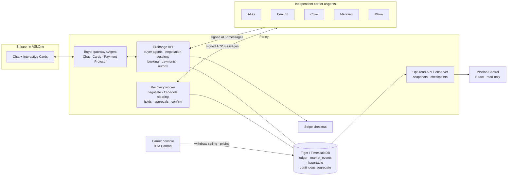

<div align="center">

# Parley

**An autonomous freight market on Fetch.ai: agents negotiate the price, the exchange decides the match, and nobody has to reveal their secrets.**


*LA Hacks 2026*

<a href="https://youtu.be/StnIpUOxzs8"></a>

</div>

---

When a sailing through the Strait of Hormuz is cancelled, dozens of shippers lose their space at once, and they all
scramble for the same few replacement slots. First-come-first-served rebooking strands the cargo that matters most.

**Parley** turns container shipping into a two-sided agent market:

- **Shippers book entirely inside ASI:One.** A private buyer agent negotiates with independent carrier agents in
  parallel, without ever revealing the shipper's budget, then books and takes card payment through the Fetch
  Agent Payment Protocol.
- **Carriers run their own uAgents** with private pricing policies, and operate them from a carrier console.
- **When a carrier withdraws a sailing**, the exchange negotiates replacements for every stranded booking at once
  (60-second cap), clears them *jointly* with a five-stage OR-Tools objective, holds, asks buyers for approval when
  needed, confirms, and pushes the outcome into each buyer's existing chat.
- **Tiger (TimescaleDB) referees every deal:** slot-level locking means parallel agents can never oversell, and every step
  is recorded so it can be watched live, or replayed, in Mission Control. See [Why Tiger](#why-tiger).

## Highlights

| | |
|---|---|
| 💬 **Native ASI:One experience** | Interactive cards end to end: shipment form → negotiated offers carousel → review → card payment → receipt. Recovery alerts, approval cards and rebooking confirmations arrive in the same chat. |
| 🤝 **Two-sided negotiation** | Each buyer agent counters each carrier agent up to twice, in parallel. Carriers price from private policies (business goal, floors, surge). Neither side's limits are ever exposed. Buyers can open a transcript of exactly how each price moved. |
| 💳 **Fetch Agent Payment Protocol** | The gateway is the seller: it sends `RequestPayment` with a Stripe checkout and verifies payment server-side before the carrier confirms. Fare differences after a rebooking are charged the same way. |
| 🌊 **Joint disruption recovery** | Withdrawal → parallel recovery negotiations → frozen offers → five-stage lexicographic OR-Tools clearing (must-deliver → whole bookings → fewest approvals → lowest extra cost → earliest arrival) compared against a first-come-first-served baseline → holds → approvals → carrier confirmations. |
| 🚢 **Carrier console** | IBM Carbon UI: sailings with a live ship deck, sailing detail and withdrawal review, pricing-agent preferences, agent activity, risk advisories, market view. |
| 🛰️ **Mission Control** | Read-only operator view: live maritime map, an Agent Universe showing every negotiation in flight, a Disruption War Room, a **Time Machine** that replays any incident from stored checkpoints, and Market Intelligence built on Tiger hypertables and a continuous aggregate. |

## Try it in ASI:One

Talk to **`@freight-parley`**, or just ask ASI:One something like *"Get me freight quotes for a 20ft container
from Dubai to India"*.

| Agent | Address | Role |
|---|---|---|
| **Parley** (`@freight-parley`) | `agent1q0ktnrhtmerdle6tz9lmdj9v7c0vzrtnl8wdvuthj88cj9ydp7j3vmymxm8` | Buyer-facing mailbox uAgent: Chat Protocol, Interactive Cards, Agent Payment Protocol (seller) |
| Atlas Lines | `agent1qvjf3yf8gnps47a5g6e5ca7ut5g0mul25nnwvvuuc6c64ndyundlz7g7evk` | Carrier uAgent (fill-the-ship policy) |
| Beacon Maritime | `agent1q25t3ute3t7q4jnhkxx2p82a5ddkdrlg4wt364xv02e0w9te4360k6jx3tl` | Carrier uAgent (protect-margin policy) |
| Cove Shipping | `agent1q0d9kttp2thtehadr89n02rque7rga7pqqgpfw4glvq4cczn2dtlgx4grlp` | Carrier uAgent (balanced policy) |
| Meridian Container Line | `agent1q20dh3l4ahk7fuemhyuaeprdhxxjm06d3uxl22zcj79j6hca9ctvzs8q6dr` | Carrier uAgent (protect-margin policy) |
| Dhow Feeder Lines | `agent1qvs77v0zayx5dfpvzz0n89a8yztp5p8j92ttmxcj2wlaxh3vn5fz2wjxd0d` | Carrier uAgent (fill-the-ship policy) |

## Architecture



Buyers only ever see ASI:One; carriers use their console; the exchange's own view (Mission Control) observes and
never acts. All agent traffic is signed uAgents messages defined once in `packages/freight_contracts`.

## How it works

**Booking.** "I need to ship cargo" → a form card (route, containers, arrive-by, priority, optional private budget,
auto-rebook limit) → the exchange pairs the request with eligible carriers (lane, space, deadline, cargo class) and
opens one negotiation session per carrier → each carrier quotes from its private policy → the buyer agent counters
up to twice using verified rival quotes → final offers arrive as a carousel (with negotiation transcripts) →
review → the carrier **holds** the space → card payment via the Agent Payment Protocol → the carrier **confirms** →
receipt with claim code.

**Disruption.** A carrier withdraws a sailing in its console → affected bookings are marked disrupted and each
buyer gets a cancellation alert → the exchange posts the stranded cargo (no budgets or identities) and runs
recovery negotiations for every booking in parallel, closing early when all sessions finish (60 s maximum) → the
frozen offer set is cleared jointly by OR-Tools and compared with a first-come-first-served counterfactual →
holds are placed → buyers whose replacement exceeds their pre-approved limit get an approval card → carriers
confirm → the old booking is superseded by the new one → buyers see "Rebooked" (and pay any fare difference).

**Privacy by construction.** Buyer budgets, auto-rebook limits and must-deliver flags never leave the exchange's
buyer agent; carrier floors and policies never leave the carrier agent. Public negotiation messages carry only
terms and a short rationale. The read-only APIs pass every response through a redaction guard.

## Why Tiger

Six independent agents negotiating at once will oversell if they take each other's word for it. Tiger is the
referee: no agreement is real until Tiger accepts it.

- **One truth about capacity.** Carrier agents read their own policy and inventory from Tiger, and the exchange
  re-checks every offer against it before the offer counts.
- **No double-booking under parallel negotiation.** Every container slot is a row. Holds and bookings claim slots
  with `FOR UPDATE SKIP LOCKED`, conditional updates and partial unique indexes, so a slot never has more than one
  active hold or booking, withdrawn sailings can't be held, and idempotency keys make retried agent messages
  harmless (`carriers/carrier_agent/holds.py`).
- **An audit trail that can't drift.** Each inventory change appends its `market_events` row in the same
  transaction.
- **Time series at the core.** `market_events` and per-minute `sailing_capacity_snapshots` are hypertables; the
  `market_activity_1m` continuous aggregate (with a refresh policy) powers Market Intelligence; the Time Machine
  replays incidents from `market_state_checkpoints` plus the event log.
- **Safe approvals.** Buyer approvals are serialized with advisory locks, so one approval can't apply twice.

## Repository layout

```
gateway/                 Buyer gateway uAgent (ASI:One): chat, interactive cards, payment protocol, outbox delivery
src/freight_exchange/    Exchange backend: API, buyer agents, negotiation, booking + payments, recovery, cards
src/freight_exchange/ops Mission Control read model, SSE stream, replay, analytics (read-only)
carriers/                Carrier uAgents with private pricing policies, holds and confirmations
console/                 Carrier console (FastAPI + IBM Carbon): sailings, withdrawal, pricing, activity, risk
dashboard/               Mission Control (React + TypeScript): five views incl. Time Machine
packages/                Shared contracts (signed messages), seams, disruption, OR-Tools allocation
scripts/                 run_demo.sh, demo_reset.sh, demo.py, e2e_demo.py, smoke tests
docs/                    PRD, phase specs (docs/specs_2), decisions, critical alerts / demo steps
```

## Getting started

Requirements: [uv](https://docs.astral.sh/uv/), Python 3.12, Node 20, a Tiger (TimescaleDB) database, an
Agentverse account, and Stripe **test** keys.

```bash
cp .env.example .env            # Tiger URL, agent seeds, Stripe sk_test_/pk_test_ keys (never commit .env)
uv sync && (cd carriers && uv sync) && (cd console && uv sync) && (cd gateway && uv sync)
uv run python scripts/init_carrier_identities.py                  # five carrier identities
uv run --project gateway python scripts/init_gateway_identity.py  # gateway identity + backend token
uv run python scripts/db.py migrate                               # schema, hypertables, continuous aggregate
(cd dashboard && npm install && npm run build)                    # Mission Control UI
./scripts/run_demo.sh                                             # start everything
./scripts/demo_reset.sh                                           # finalized demo market
```

Then connect the gateway's mailbox once from the Agentverse inspector link printed in `logs/gateway.log`.

| Service | URL |
|---|---|
| Carrier console | http://localhost:8800 |
| Mission Control | http://127.0.0.1:8820 |
| Exchange API (internal) | http://127.0.0.1:8900 |

## Demo script

`./scripts/demo_reset.sh` restores the exact same market before every run (fixed dates, Buyer B already on ATL-101,
Buyer C on another lane).

1. In ASI:One: **"I need to ship cargo"** → Jebel Ali → Mumbai · 2 containers · arrive by **Oct 23** · split off ·
   general / balanced · no budget · auto-rebook limit **600**.
2. Offers arrive from **Atlas ATL-101** and **Beacon BEA-201** (Cove has one free slot, Meridian arrives too late).
   Choose Atlas → review → pay with test card `4242 4242 4242 4242` → **Booking confirmed**.
3. In the carrier console, open Atlas → ATL-101 → **Review withdrawal** → withdraw.
4. In ASI:One: ⚠️ cancellation alert → 🔔 approval card for Beacon BEA-201 (≈$1,200 over the $600 limit) → approve →
   ✅ **Rebooked** → pay the fare difference. Buyer B is moved to Cove COV-301 automatically; Buyer C is untouched.
5. In Mission Control: watch the negotiations in Agent Universe and the War Room, then **Replay incident** in the
   Time Machine.

## Testing

```bash
uv run pytest -q                                   # exchange backend (285)
(cd carriers && uv run pytest -q)                  # carrier agents (79)
(cd console && uv run pytest -q)                   # carrier console (39)
(cd gateway && uv run pytest -q)                   # gateway wire format (11)
(cd dashboard && npx vitest run)                   # reducer + Time Machine replay of a recorded incident (18)
for p in packages/freight_seams packages/freight_disruption packages/freight_allocation; do (cd $p && uv run pytest -q); done
uv run python scripts/e2e_demo.py --preseeded      # live end to end: console withdrawal → recovery → Mission Control (22 checks)
uv run python scripts/demo.py audit                # ledger invariants (slots, holds, bookings, supersession)
```

## Tech stack

Fetch.ai **uAgents** (Chat Protocol, Agent Payment Protocol, mailbox) · **ASI:One** Interactive Cards ·
**Agentverse** · **LangGraph** · **Google OR-Tools** (CP-SAT) · **Tiger / TimescaleDB** (hypertables, continuous
aggregates) · **Stripe** checkout · **FastAPI / Starlette** · **IBM Carbon** · **React + TypeScript + Vite**,
Recharts, d3-geo.

## Limitations

- The market (carriers, vessels, schedules, prices, advisories) is a simulated demo market; no real freight is sold.
  Card payments run in Stripe sandbox mode.
- Each buyer agent is an isolated logical agent inside the exchange runtime, not a separately hosted uAgent.
- Multi-carrier recovery is a compensating saga (idempotent per-leg holds and confirmations), not a distributed
  transaction. A cheaper replacement is not refunded.
- ASI:One shows agent-initiated messages only inside a chat the buyer already has open.

## Team

Built at LA Hacks 2026 by **Parth Dua** and **Tisya Singh**.

Product requirements: [`docs/PRD.md`](docs/PRD.md) · phase specs: [`docs/specs_2/`](docs/specs_2/) · build log:
[`progress.md`](progress.md).
