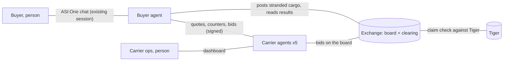

# Two-Sided Freight Market

Design agreed by Tisya and Parth, LA Hacks AI 2026. Deadline Sunday 12:00 PDT.

Buyers and carriers each send an agent to negotiate for them. Both sides keep secrets. When a
sailing is cancelled, the exchange decides who goes where using only what the agents chose to
offer.

> **Pitch line:** Agents negotiate the price, the exchange decides the match, and nobody has to
> reveal their secrets.

Only Fetch rules marked "mandatory" are hard constraints. Everything else is our choice.

---

## 1. The idea: negotiation under incomplete information

Every participant has information the others cannot see. A carrier knows its lowest acceptable
price, how badly it wants to fill the ship, and how much it charges in a crisis. A buyer knows the
most it will really pay and how urgent the cargo is. Nobody shares these numbers, so the only way
to find a deal is to probe: offer, counter, watch how the other side moves.

In normal times that is a one-to-one negotiation and the outcome is fairly predictable. A
disruption changes that. A cancelled sailing strands several buyers at once, and they all need the
same few remaining slots. If every buyer's agent grabs what it can, the fastest buyer wins and
buyers with tighter deadlines lose, even when an arrangement existed that served everyone. That is
the gap we fill.

So the market has two layers. **Agents negotiate prices**, because only they hold the private
information. **The exchange clears the market**, because only it sees every stranded booking and
every offer at once.

## 2. The cast

| Who | Kind | Role |
|---|---|---|
| **Buyer (shipper)** | Person | A company that needs containers moved. Uses ASI:One only, in one chat with their buyer agent. Sets preferences once, then gets updates and approval requests in that same chat. |
| **Buyer agent** | Agent, public on ASI:One | Acts for one buyer and holds that buyer's private limits. Negotiates with carrier agents, books, pays, reports back. In v1 it is one Agentverse agent (Parth's LangGraph agent) with a separate instance and state per buyer. |
| **Carrier agent** | uAgent, Agentverse profile | One per shipping company: Atlas, Beacon, Cove, Meridian, Dhow. Holds its own ships, inventory and private pricing policy. Quotes, counters and bids for stranded cargo. Signs everything it sends. |
| **Carrier ops** | Person | Staff at a shipping company. Uses the carrier dashboard (today's console) to cancel a sailing and to set the carrier agent's pricing policy. Never chats with buyers. |
| **Exchange** | Referee, no chat | Runs the board where stranded cargo is posted, checks carrier claims against real inventory, clears the market with the solver, enforces approvals, moves the money. Never negotiates and never sees private limits it is not given. |

### Communication rules

- **Agents only talk to agents.** Negotiation is agent to agent, with no person in the loop.
- **People only talk to their own agent, in a chat they started.** ASI:One only shows pushed
  messages inside an existing session; a new session is silently dropped (Parth's spike).
- **Carrier messages never go through the buyer agent's chat graph.** Agent negotiation uses the
  typed, signed request and reply channel that already works (decision 0002). Only the summary for
  the person goes into their chat. This avoids the auto-reply loop in the Agentverse SDK.
- **The exchange never forwards private limits.** Budgets, allowances and must-deliver flags are
  never sent to carriers. Carrier floors never leave the carrier.



## 3. Fetch rules and how we meet them

From the ASI:One Agent Challenge text. A custom frontend can supplement the chat but cannot replace
it for the buyer.

| Mandatory requirement | How we meet it |
|---|---|
| Register at least one agent on Agentverse | Buyer agent (live). Five carrier agents get Agentverse profiles if the 30 minute test passes. |
| Implement the Agent Chat Protocol | Buyer agent, via agentverse-sdk (live). |
| Discoverable and directly usable through ASI:One | Buyer agent, reachable by handle (live). |
| Meaningful tool execution or multi-agent orchestration | Carrier negotiation, Stripe, Tiger, OR-Tools clearing, push notifications. |
| Primary user workflow entirely within an ASI:One conversation | The buyer sets up, books, pays, approves and receives recovery updates in one chat. Cards count, since they render inside the chat. The dashboards only show what the agents did. |
| Public GitHub repo with run instructions | README at submission. |

Bonus points we target: multi-agent collaboration, interactive cards, reliability and recovery
from failures, real-time data. Deliverables: shared ASI:One chat URL, Agentverse profile URL for
each agent, repo, short video, description, plus the Submission Agent on ASI:One.

## 4. Normal times: how a booking is negotiated

1. **Setup.** The buyer fills the setup card in ASI:One, or sends one message (section 8). Public
   fields go into the request; private fields stay with the buyer agent.
2. **Open sessions.** The pairing policy opens a negotiation session between the buyer agent and
   every carrier that serves the lane (section 6). Each carrier quotes inside its session at once.
3. **Counter round 1.** The buyer agent counters each carrier using the best rival offer as
   leverage, adjusted for arrival date and the buyer's priority (section 9). The budget is never
   sent.
4. **Carrier reply.** Each carrier accepts, meets part way, or rejects, based on how full the ship
   is. It never goes below its private floor.
5. **Counter round 2 (optional, max).** Only for carriers that met part way, and only if a second
   round could change the ranking.
6. **Present and book.** The buyer sees the ranked final offers with a short trace, picks one, pays
   through Stripe test checkout, and the carrier confirms. Existing phase 3 and 4 flow.

## 5. Disruption: how a cancelled sailing is recovered

1. **Cancel.** Carrier ops cancels a sailing in the carrier dashboard. Bookings on it become
   disrupted (exists, phase 5).
2. **Post to the board.** The exchange posts every stranded booking: route, containers, deadline,
   cargo class, split allowed. No prices, budgets or must-deliver flags.
3. **Pair and open sessions.** The pairing policy opens a session between each stranded booking's
   buyer agent and every carrier that could carry it (section 6).
4. **Negotiate inside sessions (60 s window).** Each carrier bids with its private crisis surge;
   the buyer agent counters with its private limits; up to 2 rounds. Messages are checked:
   signature, schema, freshness, session (builds on #16). This is where hidden information is
   revealed through behavior.
5. **Claim check.** Every final offer is checked against the carrier's real remaining space in
   Tiger. Overstated offers are dropped (exists).
6. **Clear.** The solver assigns all stranded bookings at once (section 10), must-deliver first.
   It also computes what first come, first served would have produced, for comparison.
7. **Approve or auto-confirm.** Within the buyer's allowance: confirmed automatically. Above it: an
   approval request goes to the buyer's existing chat with a 30 minute window (exists, #15, #19).
8. **Confirm with carriers.** Reserve and confirm each replacement, supersede the old booking
   (phase 7, #18). If a reservation fails or an approval expires, release and clear once more.
9. **Tell everyone.** Each buyer gets a push in their existing chat: rebooked, needs approval, or
   not recovered, with the reason (exists, #12, #14). Carriers see results on their dashboard.

## 6. Negotiation sessions: how the exchange starts a negotiation

Agents do not find each other on their own. A policy script in the exchange decides which buyer
agent and which carrier agent should talk, then opens a negotiation session between them by
calling a function with both agents as parameters. It is rule-based, not a model choice: the same
board always produces the same pairs, and every pairing has a stated reason.

1. **Pair.** `pair_candidates(board, inventory)` reads every open request or stranded booking and
   every carrier's sailings. A pair is made only when the carrier serves the route, has a sailing
   arriving by the buyer's deadline, has real space for at least one container (claim checked
   against Tiger), and accepts the cargo class. Normal times: one request, every eligible carrier.
   Disruption: every stranded booking with every eligible carrier, at most 5 carriers per booking.
2. **Open.** For each pair the exchange calls
   `open_negotiation(buyer_agent, carrier_agent, booking_id, rounds=2, expires_at)`. It writes a
   session row to Tiger and sends both agents a kickoff message with the session id and only the
   public fields of the booking.
3. **Talk.** The two agents exchange offers and counters directly. Every message carries the
   session id and round number and is signed by its sender.
4. **Guard.** Any message is rejected if its session is unknown, closed or expired, if it exceeds
   the round limit, or if the sender is not one of the two agents paired in that session. Agents
   cannot open side deals outside a session.
5. **Close.** A session closes on accept, reject, round limit or expiry. Its final offer, or none,
   goes to the board. When every session for a disruption has closed, or the 60 second window ends,
   the exchange clears (section 10).

| Function | Input | Output | Owner |
|---|---|---|---|
| `pair_candidates` | Board (open requests or stranded bookings), carrier inventory | List of pairs: buyer agent, carrier agent, booking, reason | Parth (takeover) |
| `open_negotiation` | buyer_agent, carrier_agent, booking_id, rounds, expires_at | session_id; kickoff sent to both agents | Parth |
| `close_negotiation` | session_id, outcome | Final offer or none, posted to the board | Parth |
| `on_sessions_closed` | Disruption id | Triggers clearing once all sessions closed or the window ends | Parth |

| Session record (Tiger) | Meaning |
|---|---|
| `session_id` | Unique id carried on every message in the session |
| `buyer_agent`, `carrier_agent` | The only two agents allowed to speak in it |
| `booking_id` or `request_id` | What is being negotiated |
| `kind` | `booking` (normal times) or `recovery` (disruption) |
| `round`, `rounds_max` | Current round and the cap (2) |
| `status` | OPEN, ACCEPTED, REJECTED, EXHAUSTED, EXPIRED |
| `opened_at`, `expires_at` | Timing; every message is also logged to `market_events` for the market view |

In the LangGraph agent, `open_negotiation` can be a tool node, but the call is always made by the
pairing rule, never chosen by a model. In v1 the buyer agent lives in the same process as the
exchange, so its side of the session is internal; the carrier side goes over the existing signed
uAgents channel.

## 7. Worked example: why the clearing step matters

Illustrative numbers. The seeded demo market (#13) keeps the same shape on Jebel Ali to Mumbai.

| Stranded booking | Containers | Deadline | Must deliver | Allowance |
|---|---:|---|---|---:|
| Buyer A | 2 | Oct 25 | No | $600 |
| Buyer B | 1 | Oct 22 | Yes | $800 |
| Buyer C | 1 | Oct 22 | No | $0 |

Space left: **Beacon**, 2 slots, arrives Oct 22, ship half empty. **Cove**, 2 slots, arrives
Oct 24, ship nearly full.

- **Agents only, first come first served: 1 of 3.** A's agent answers first and takes both Beacon
  slots, because they are earlier and cheaper. B and C both need Oct 22 and only Beacon makes it.
  Both are stranded, including the must-deliver booking.
- **Agents negotiate, exchange clears: 3 of 3.** A goes on Cove and still arrives before Oct 25.
  B and C share Beacon. No single agent could find this: A's agent was right to want Beacon for A.

Negotiation inside that result: Beacon opens at $6,000 per container (crisis surge). B's agent
counters at $5,300, citing Cove. Beacon's ship is half empty, so its policy meets part way at
$5,500. B's original price was $5,000, so $500 extra fits B's $800 allowance and confirms
automatically. C has a $0 allowance, so C gets an approval request with 30 minutes to answer. The
exchange never knew Beacon would go to $5,500. Only Beacon did.

## 8. Parameters: what we need from each person

Visibility: **public** (everyone, including the board and carriers), **exchange** (the exchange
uses it, carriers never see it), **private** (only that party's own agent).

### Buyer

Asked once at setup, in chat or the setup card. ASI:One form fields support text, number, email,
select and checkbox. There is no date picker, so the deadline is a select built from real sailing
arrivals.

| Field | Meaning | Card input | Example | Visibility | Status |
|---|---|---|---|---|---|
| **What to ship (required)** | | | | | |
| `origin_port` | Where the cargo starts | select | AEJEA (Jebel Ali) | public | exists |
| `destination_port` | Where it must arrive | select | INBOM (Mumbai) | public | exists |
| `quantity` | Number of containers | number | 3 | public | exists |
| `container_type` | Container size, fixed to 20GP for the demo (PRD D3) | none, fixed | 20GP | public | exists |
| `latest_arrival` | Hard deadline; later arrivals are never offered | select of real arrivals | Oct 23 | public | exists |
| `earliest_departure` | Cargo not ready before this | select, optional | Oct 18 | public | exists |
| `allow_split` | OK to split containers across ships | checkbox | No | public | exists |
| `cargo_class` | What is inside; carriers may surcharge or refuse some classes | select: general, high value, hazardous | general | public | new |
| **How to negotiate (private, never sent to carriers)** | | | | | |
| `max_total_price` | Most the buyer will pay for the booking | number, optional | $16,000 | private | exists |
| `priority` | Cheapest, balanced or fastest; drives counters and ranking | select | balanced | private | new |
| **If the sailing is cancelled** | | | | | |
| `must_deliver` | Gets priority in clearing; does not let money move without approval | checkbox | Yes | exchange | new |
| `recovery_allowance` | Extra cost accepted without asking (D5, `max_additional_cost_minor`) | number | $800 | exchange | exists |
| **Derived, never asked** | | | | | |
| `urgency` | From must_deliver and days left to the deadline; sets how far the buyer agent concedes | none | high | private | new |
| `buyer_id`, session | ASI:One identity and chat session, captured automatically for push updates | none | agent1q... | exchange | exists |

Why must_deliver is hidden from carriers: if a carrier knew a buyer was desperate, it would raise
that buyer's price. The exchange uses it only to order the clearing.

### Carrier

Set by carrier ops on the carrier dashboard, or loaded from the fixture for the demo. To keep the
form short, ops pick a **business goal preset** and adjust only if they want to. Every private
field stays inside the carrier agent's own process. Policies live in `carrier_policies.policy`
(JSON) and the carrier agent rereads them on every quote, so dashboard edits apply live.

| Field | Meaning | Input | Example | Visibility | Status |
|---|---|---|---|---|---|
| **Identity and inventory** | | | | | |
| `display_name` | Company name shown to buyers and on Agentverse | text | Atlas Lines | public | exists |
| `lanes` | Routes served | multi select | AEJEA to INBOM | public | exists |
| sailings, slots | Schedule and remaining space; checked by the exchange against Tiger | table | ATL-101, 4 slots | public | exists |
| `payment_terms` | Shown on receipts | text | Prepaid before departure | public | exists |
| `offer_ttl_seconds` | How long a quote stays valid | number | 600 | exchange | exists |
| `max_hold_seconds` | How long space is held while a buyer pays | number | 3600 | exchange | exists |
| **Pricing (private)** | | | | | |
| `business_goal` | Preset: fill the ship, balanced, or protect margin; sets the fields below | select | fill the ship | private | new |
| `target_price_per_unit` | Normal opening price per container | number | $2,600 | private | exists |
| `min_price_per_unit` | Floor; never offered or accepted below this, never revealed | number | $2,300 | private | exists |
| `utilization_premium_pct` | Price rise as the ship fills | number | 10 | private | exists |
| `concession_empty_pct` | Max discount on a counter when the ship is empty; replaces today's fixed `concession_pct` | number | 12 | private | new |
| `concession_full_pct` | Max discount when the ship is nearly full | number | 2 | private | new |
| `disruption_surge_pct` | Crisis markup when bidding for stranded cargo | number | 15 | private | new |
| **Preferences (private)** | | | | | |
| `cargo_surcharge_pct` | Extra per cargo class, or refuse it | number per class | high value +8, hazardous refused | private | new |
| `bulk_discount_pct` | Discount for larger bookings (big vs small cargo) | number | 5 at 3+ containers | private | new |
| `selection` | Which sailing to offer first | select | earliest arrival | private | exists |

### Exchange settings

Fixed for the demo. Nobody is asked for these.

| Setting | Value | Why |
|---|---:|---|
| `counter_rounds_max` | 2 | A live round takes 8 to 11 seconds; more rounds add delay without much price change. |
| `bid_window` | 60 s | Or earlier when every carrier has answered or timed out. |
| `approval_window` | 30 min | Matches the approval store's expiry (#15). |
| `recovery_clears_max` | 2 | One clear, plus one re-clear after failed reservations or expired approvals. |

## 9. Strategies: how each agent decides

Deterministic rules, no model choosing prices. Judges ask how it decided, and every number has to
trace back to a rule.

### Carrier agent price

```text
utilization  = 1 - available_slots / capacity
opening      = target × (1 + utilization_premium × utilization)
             × (1 + disruption_surge, only when bidding for stranded cargo)
             × (1 + cargo_surcharge for the cargo class)
             × (1 - bulk_discount, if the booking is large enough)
concession   = concession_empty + (concession_full - concession_empty) × utilization
lowest_offer = max(floor, opening × (1 - concession))
```

So an empty ship opens lower and concedes more. A full ship opens higher and holds. Behavior
differs by carrier because each has its own preset.

### Buyer agent counter

```text
value_of_a_day  = 0 for cheapest, moderate for balanced, high for fastest
adjusted(offer) = price + value_of_a_day × days later than the earliest offer
leverage        = best adjusted rival offer
counter         = min(leverage, own offer) minus a step that shrinks as urgency rises
never above       max_total_price (private)
```

The counter cites the rival evidence ("Cove arrives Oct 24 at $5,300"), never the budget.

## 10. Clearing: how the exchange decides who goes where

OR-Tools CP-SAT, solved in strict priority order (each stage holds the best result of the stage
before it). Exists in `packages/freight_allocation`; stage 1 and the baseline are new.

1. Recover as many **must-deliver** bookings as possible. *(new)*
2. Recover as many bookings as possible in total.
3. Need as few buyer approvals as possible.
4. Lowest total extra cost.
5. Earliest arrivals.

Hard limits in every stage: real remaining capacity (claim check), each buyer's deadline, split
rules, and one assignment per booking. The first come, first served baseline runs on the same
offers in posting order and is reported next to the result.

**Money rule:** must-deliver changes who gets the space, never how much money moves without
asking. Anything above the buyer's allowance still needs their approval in chat.

## 11. Surfaces: what each person uses

Two people, two surfaces, no overlap. Buyers live in ASI:One. Carrier ops live in the carrier
dashboard. The market view and the shipment page are read-only windows onto what the agents did.

### Buyer: cards in the ASI:One chat

- **Setup form:** the buyer fields from section 8.
- **Offer carousel:** ranked final offers with the negotiation trace. Select, then pay.
- **Approval review:** replacement, extra cost, deadline, Approve and Decline buttons. Button
  replies already parse (#15).
- **Status:** rebooked, needs approval, or not recovered, pushed into the existing chat with a link
  to the shipment page.

Cards render inside the ASI:One chat, so they fully count toward the in-chat rule. The risk is
technical: the Agentverse SDK drops card content from our LangGraph agent unless patched
(progress.md, Phase 3 pre-check), and nobody has seen a card render from our agent yet. Each card
keeps a text version until the card test passes.

### Buyer: shipment page (read-only link)

- One booking: route, sailing, ship position on the map, status timeline, price paid, any recovery
  and why.
- Opened from a link in the chat. The link holds an unguessable token tied to that one booking. No
  login, no edits, nothing about other buyers.
- Expires 7 days after arrival.

### Carrier ops: carrier dashboard

- **Map and analytics:** own ships on their routes, ports, risk zones; utilization, price per
  container, bookings won and lost, revenue over time from Tiger.
- **Preferences:** business goal preset plus the carrier fields from section 8. Saved to
  `carrier_policies`; the carrier agent reads it on every quote, so changes apply live.
- **Risk and cancellations:** risk advisories touching own sailings, affected bookings, and the
  cancel with review step (exists).

### Demo and judges: market view

- **Board:** open requests and stranded cargo, live.
- **Sessions:** which agents were paired and why, each round of offers and counters, and what each
  move reveals ("Meridian held at $8,700, ship 95% full").
- **Clearing:** who went where, and ours versus first come, first served.
- Read-only. Nobody acts here; it shows the agents working.

**Chat trace example.** "Asked Atlas, Beacon, Cove, Meridian and Dhow. Four signed offers; Dhow
declined, no route. Atlas came down from $5,200 to $4,940 after a counter." For recovery: "Checked
4 offers against real ship space. Cove claimed 2 slots but has 1, offer dropped. Rebooked 3 of 3;
first come, first served would have rebooked 1."

## 12. Tiger data: what every screen reads and writes

All screens read straight from Tiger. The dashboards never call an agent. Agents and dashboards
only meet through tables, which is what keeps the two codebases apart.

| Screen | Reads | Writes |
|---|---|---|
| Carrier map and analytics | `sailings`, `booking_slots`, `bookings`, `offers`, risk advisories; time series from `market_events` and `market_snapshots` | nothing |
| Carrier preferences | `carrier_policies` | `carrier_policies.policy` (JSON). Unknown keys are ignored by today's carrier code, so the form can ship before the new pricing fields do. |
| Risk and cancellations | risk advisories, `sailings`, `bookings`, `disruption_events` | the existing withdrawal transaction |
| Market view | `negotiation_sessions` (new), `market_events`, `recovery_runs`, `recovery_offers` (#16) | nothing |
| Shipment page | one booking by token: `bookings`, `sailings`, `disruption_events`, approvals in `market_events` | nothing |

**Tiger features to show:** hypertables (`market_events`, `market_snapshots`) queried with
`time_bucket`, plus one continuous aggregate for lane price and utilization per hour that powers the
analytics charts. If nothing writes regular snapshots yet, the console runs a small job that
records per-sailing utilization every minute.

## 13. Build plan: who builds what

Tisya builds everything a person looks at. Parth is accountable for everything else. Some of
Parth's items are marked as takeovers: if he runs short on time, Tisya takes them over without
renegotiating. Until then they are his. The two lanes meet only through Tiger tables.

### Parth (accountable): backend, agents, decisions

- Contract additions: `cargo_class` on requests, `session_id` and round on negotiation messages.
  Additive only.
- Sessions: `open_negotiation`, `close_negotiation`, the guard, the session table, the clearing
  loop.
- Carrier pricing: read the new policy keys and apply the formula in section 9.
- Buyer agent counter strategy.
- Chat flow: capture the new buyer fields, call the card functions, include the shipment link.
- Recovery bids with surge (builds on #16), phase 7 confirm with the approval gate.
- Negotiation events written to `market_events` in the agreed shape.
- Pairing rule, must-deliver clearing and the first come, first served baseline.
- SDK patch so cards reach ASI:One.
- Agentverse profiles for the exchange agent and carriers.

### Tisya (accountable): everything people see

- Carrier dashboard: map and analytics, preferences, risk and cancellations (extends today's
  console).
- Market view.
- Buyer shipment page, including its link token and access check.
- Card designs and payloads behind `CardSeam`: setup, offers, approval, status, each with a text
  version.
- Tiger analytics queries and the continuous aggregate behind the charts.
- Devpost, video script, demo scenario.

### Takeovers: Parth's until he hands them over

Each one is self-contained, so it can move to Tisya mid-build with no rework. Parth says "take it"
in chat and she starts from wherever he left off.

| Item | Why it moves cleanly | Shape |
|---|---|---|
| Pairing rule, must-deliver clearing, first come, first served baseline | Lives in `packages/freight_allocation`, Tisya's package; she wrote the solver. Parth may edit it for these with her OK, given here. | Pure functions; Parth only calls them |
| Buyer counter strategy | Inputs are offers plus the buyer's private limits, output is a price. No transport involved. | `buyer_counter(...)`, pure function |
| Negotiation event logger | The market view is its only reader, so its owner can shape it. | `log_negotiation_step(...)` next to `emit_event` |
| Clearing trigger rule | Decision only; Parth's loop calls it. | `ready_to_clear(sessions, now)` |
| SDK card patch | Tisya owns the cards already. | One function in `asi/`, called once at startup |
| Agentverse profile copy | Writing only; Parth still publishes them. | Text for 6 profiles |
| Live test runs and the shared chat | Needs ASI:One access, not code. | Full run, bug list to Parth |

Not takeovers: the session runner, carrier pricing, phase 7 and the chat flow. They sit in the
middle of Parth's code, and carriers run in their own environment (protobuf 5), so Tisya's
packages cannot be installed there.

### The only handoffs

Agree these in the first hour, then work apart.

| Handoff | Who writes | Who uses |
|---|---|---|
| `negotiation_sessions` columns (section 6) | Parth | Market view |
| Negotiation event names and payloads in `market_events`: NEGOTIATION_OPENED, OFFER_SENT, COUNTER_SENT, OFFER_ACCEPTED, OFFER_REJECTED, NEGOTIATION_CLOSED, CLEARING_DONE (with baseline). `correlation_id` is the session id. | Parth | Market view, analytics |
| New `carrier_policies` keys (section 8 names) | Tisya, from the preferences page | Carrier agents |
| Card functions (`CardSeam`) and `shipment_link(booking_id)` | Tisya | Chat flow |
| Optional `must_deliver` on `DisruptedBooking` | Both agree, additive | Solver |

### Checkpoints (PDT)

| When | Done means |
|---|---|
| Tonight, first hour | Handoffs agreed and merged. Card test result known. |
| Sunday 03:00 | Takeover check: Parth says which takeovers, if any, move to Tisya. |
| Sunday 05:00 | Backend: sessions, pricing, counters live. UI: all five screens reading live Tiger. |
| Sunday 08:00 | Code freeze. One full live run in ASI:One recorded as a shared chat. |
| Sunday 10:00 | Video recorded, Devpost and Submission Agent drafted. |
| Sunday 12:00 | Submitted. Two hours of buffer before this. |

### Cut order if we fall behind

1. Separate buyer agent processes (already out of v1).
2. Second counter round.
3. Cargo classes and bulk discount.
4. Cards, keep text.
5. Carrier analytics charts beyond utilization and price.
6. Shipment page map (keep the status timeline).

**Never cut:** cancel a sailing, carriers bid, clear, approve, push update, all end to end in a
real ASI:One chat, and the market view showing it.

## 14. Open questions

- Money rule: should must-deliver ever auto-approve above the allowance? This doc says no.
- Which cargo classes appear in the demo? Suggest two: general and high value.
- Do carriers show the cargo classes they accept on their Agentverse profile?
- Who records the video, and from whose ASI:One account is the shared chat?
