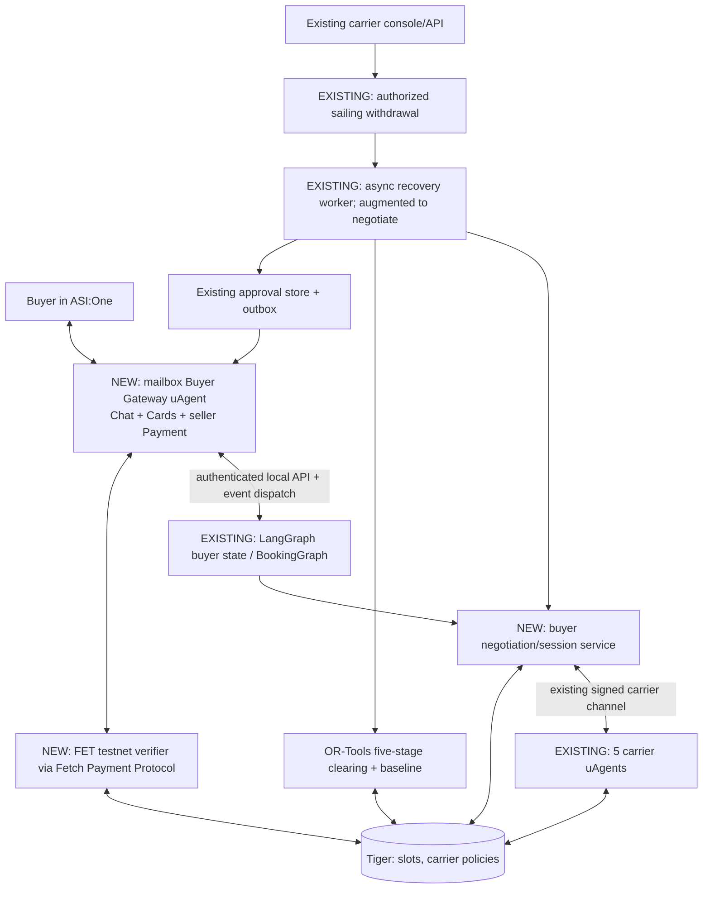

# Hormuz Exchange — Two-Sided Autonomous Freight Market

**Product Requirements Document · v2.0 · October 17, 2026**  
**Event:** LA Hacks AI 2026, Fetch.ai challenge · **Submission deadline:** Sunday, October 18, 2026, 12:00 PDT  
**Status:** Implementation specification based on the existing Part 1 build and `two-sided-freight-market.md`  
**Pitch:** **Agents negotiate the price, the exchange decides the match, and nobody has to reveal their secrets.**

> **Source of truth and precedence.** (1) The team's **new two-sided market design** supersedes the October 16 Part 1 PRD where they conflict. (2) The user's explicit October 17 decisions supersede both: **Interactive Cards and Fetch Payment Protocol first; two-sided normal AND recovery negotiation is in scope; rename the 60-second bid window `recovery_negotiation_timeout_seconds`; proper carrier dashboard UI is a later task.** (3) The existing implementation is the baseline, not a greenfield project. (4) Fetch's official documentation controls SDK/wire details. This document makes explicit integration choices and clarifications; such choices are identified rather than attributed to the source files.

**Companion executable specifications:** `phase-01-uagent-gateway.md`, `phase-02-interactive-cards.md`, `phase-03-fetch-payment.md`, `phase-04-two-sided-negotiation.md`, `phase-05-recovery-clearing-and-release.md`.

---

## 1. Executive product definition

Cargo buyers describe shipment needs entirely within **ASI:One**. Their private buyer-agent state negotiates directly with company-owned **carrier uAgents**, using competition and urgency without sending private budgets. Carriers price with private cost floors, current vessel utilization, and commercial policy. Buyers compare final offers, select, authorize, pay a separately disclosed **demo booking-coordination service charge using Fetch Payment Protocol**, and receive durable simulated bookings. When a carrier withdraws a sailing, the Exchange pairs stranded buyers with viable carriers, runs bounded parallel buyer–carrier negotiations, validates final bids against real available capacity, and jointly clears all displaced bookings using **OR-Tools**. Within previously authorized buyer recovery limits, replacements auto-confirm; otherwise the buyer receives an approval card in an existing ASI:One conversation.

The Exchange is a **referee**, not a bargaining party. All freight inventory, pricing and vessel locations are **simulated**; the agents, signed messages, database transactions, optimization, ASI:One cards, and verified **testnet** payment are actual technical operations. No real-world ocean freight is sold.

### Success looks like

1. In ASI:One, a buyer says “I need to ship cargo”; an actual **form card** opens; submitting it creates one validated request.
2. Distinct carrier agents issue real signed offers; a separate buyer policy counters each of them at most twice. A carousel/review leads to a held and **verified Fetch-paid** booking, with receipt.
3. A carrier cancels one sailing via the existing console/API; two or more committed bookings are disrupted, and unaffected commitments remain unchanged.
4. The recovery worker opens agent negotiation sessions with a **maximum 60-second negotiation-session deadline**, ends earlier if all finish, then runs OR-Tools once on the final valid offers (with at most one re-clear for a failed reservation/approval).
5. The solver applies the agreed five-stage lexicographic policy, obtains real holds, respects approvals, confirms replacements, preserves superseded originals, and pushes truthful result cards into existing buyer chats.
6. Judges can observe the live negotiation trace, solver-versus-first-come-first-served baseline and Tiger event history. Every showcased action is substantiated by persisted evidence.

## 2. Source and decision register

| Decision | New locked behavior | Replaces/clarifies |
|---|---|---|
| UX-1 | Buyer UX in ASI:One using native interactive `form`, `carousel`, `review`, and `detail` cards, with text fallbacks | Plain text `select atlas`, `approve BK-...` remains fallback only |
| ARCH-1 | **One mailbox uAgent gateway** publishes both Chat and seller Payment protocols, forwards business intents to the existing LangGraph service | Direct LangGraph-to-Agentverse remains internal/legacy; no SDK monkey patch as primary approach |
| PAY-1 | Verified **Fetch Agent Payment Protocol** path before booking completion | Stripe TEST checkout link alone is insufficient |
| PAY-2 | Primary demo rail: **FET stable testnet** at a small **fixed FET-denominated fee** for a disclosed *booking coordination service*; freight quotes continue as simulated USD figures | Prior simulated freight + USD $25 Stripe TEST charge is retained only as legacy/test mode; it is **not additionally charged** in the Fetch demo |
| NEG-1 | Normal booking: concurrent eligible carrier sessions, at most **two** buyer counters | Part 1's at-most-one-counter policy |
| NEG-2 | Recovery: private surge bids and buyer-agent counters, at most **two** counters per session | Part 1's one-shot recovery offers |
| TIME-1 | `recovery_negotiation_timeout_seconds = 60` **maximum** concurrent negotiation deadline; no forced wait when all sessions finish | `bid_window` / mistaken impression of 60 seconds of idle waiting |
| SOLVER-1 | Lexicographic: **must-deliver count → total whole bookings → fewest approvals → lowest extra cost → earliest arrival** | Part 1 cost-first rule; accepts prior approval-priority change |
| BASE-1 | Record first-come-first-served baseline against identical final offers, using deterministic posting order | No baseline in original PRD |
| LIMIT-1 | `20GP` only; preserve 5 carriers, 5 corridors, 23 sailing fixture if current seed provides it | Original minimum 3 carriers/one corridor |
| AUTH-1 | Auto-confirm recovery inside explicit existing authority; otherwise request approval; `must_deliver` **never** overrides payment/approval authority | Existing approval behavior retained |
| UI-2 | **Full carrier dashboard redesign is next work, not any of the five phases.** Keep the current carrier console/API operational for withdrawal and policy-seeding | Expansive map/signup/analytics/ship-edit UI removed from current critical path |

**Implementation selections (not claims about prior approval):** The gateway is a local mailbox uAgent using the *documented* Chat and Payment protocols; FET testnet is the first payment rail because the Stripe embedded checkout example warns that ordinary ASI:One chat may not render its checkout. A successful ASI:One test must confirm FET wallet metadata and actual on-chain verification; if not, the documented Skyfire USDC rail is a contingency subject to its own real end-to-end verification. A text link, fake transaction hash or inspector-only checkout does not meet our ASI:One acceptance criteria. The proposed FET fee (e.g. `0.1 FET` **testnet only**) is **not** asserted to equal USD $25.

## 3. Hackathon eligibility and scope

Per the official LA Hacks AI 2026 Fetch hackpack, mandatory: ≥1 Agentverse agent; ACP/Chat Protocol; discoverable/usable in ASI:One; substantive actions; complete primary experience within ASI:One; public GitHub/repro steps. Interactive Cards and Payment Protocol are externally **bonus** criteria, but both are **P0 internal requirements**, never cuts.

**P0 — phases 1–5:** gateway, four required buyer cards, verified Fetch payment, preserved booking/hold semantics, 2-round price strategies for both normal/recovery, session guards, carrier policy additions, joint recovery solver plus deterministic baseline, accurate ASI:One pushes, audit events, demo evidence, publishing/submission.

**P1 — next after submission:** carrier self-service account/onboarding, authentication/authorization, fleet and sailing CRUD, pause/cancel workflows, commercial presets UI, vessel map, KPIs, charting, risk feed and carrier agent audit explorer. Only their pre-existing minimal console/API is used this weekend.

**Out of scope now:** live carrier inventories, actual freight transfer/insurance/refunds, automatic physical vessel control, production payments, real-time AIS, new external risk feeds, Sentry rollout, full exchange operations dashboard, extra agents or model-powered price selection, first-class user-agent process per buyer.

## 4. Roles, ownership, trust boundaries

| Component | Owns | May reveal | Must not reveal |
|---|---|---|---|
| Human buyer via ASI:One | Cargo requirement, preferences, recovery consent, payment authorization | Public shipping requirements, explicitly selected offer | Hidden reserve budget, private urgency, competing buyer details |
| Logical **buyer agent** (isolated state per buyer inside existing LangGraph process) | Buyer limit, strategy, counter proposals, buyer-facing messages | Final bid/counter, public rival *offer* evidence | Raw max budget and full recovery allowance to carriers |
| Company **carrier uAgent**, 5 independently addressed | Sailing eligibility, floor, target, premiums/surcharges, signed responses | Authorized offers, public schedule/inventory | Private floor, policy coefficients, competitors' state |
| **Exchange** (internal deterministic service/worker) | Pairs, opens sessions, validates envelopes and inventory, orchestrates solver, holds and approval gates | Public stranded-cargo board; final allocation results | Buyer agent's hidden max budget; carrier floors |
| **Gateway uAgent** | ACP messages, chat identity, Cards, Fetch Payment seller protocol, ASI:One delivery | Only buyer-authorized UI/payment information | Seller private policy, buyer private limits to other participants |
| Tiger Postgres | Transactional truth, hold/commit ownership, append-only events, session/approval/payment state | Role-scoped views | Cross-carrier private fields via buyer/carrier API |
| Existing carrier console | Carrier-scoped withdrawal/policy inputs | Own sailings/bookings | Other carriers' private strategy |

**Nuance:** the Exchange must enforce hard budget/approval constraints but need not read the buyer's raw hidden reserve price: the buyer agent returns a **signed/validated per-edge eligible/not-eligible decision** and its price/authority flags for clearing. The approval store/exchange can read the previously authorized recovery allowance where its existing enforcement code requires it. A checkbox `must_deliver` is a **buyer-declared clearing priority**, not certified emergency freight, and can never bypass a hard deadline or consent.

## 5. Architecture — minimal change to working Part 1



**Do not add a second orchestrator.** The new uAgent is a protocol/UI facade, not an LLM agent running independent business logic. Keep the existing recovery polling worker; it is required because a withdrawal can happen outside a human chat turn. Keep the proven signed direct carrier channel rather than relaying carrier replies into `BookingGraph` or the buyer's Chat Protocol.

### Runtime topology

- **One new process:** `buyer_gateway` (`Agent(..., mailbox=True)`), includes `Protocol(spec=chat_protocol_spec)` and `Protocol(spec=payment_protocol_spec, role="seller")`; publish both manifests; register/discover in Agentverse. Pin known-good gateway environment separately if carrier agents have protobuf dependency conflicts.
- **Same existing backend:** LangGraph business methods and Tiger. Suggested localhost internal FastAPI interface; no public tunneling required for Agentverse→gateway mailbox. This backend must be reachable by gateway on its own host/container network (not assume `localhost` if in separate containers).
- **Event delivery:** durable DB outbox/polling call/worker→gateway sends results into **existing** buyer chat session; record ASI sender and actual session identity at the gateway. A new uAgent identity will require buyers to start **new ASI:One chats with the gateway**; existing chats with the old LangGraph address cannot be silently migrated.
- **Auth:** one shared secret/loopback trusted network for gateway→backend commands, correlated `sender_agent_address + chat_session_id + buyer_id` binding; never allow caller-provided buyer IDs to impersonate another account.
- **Source code policy:** no duplicate `bookings` tables, no alternative capacity manager, no duplicate agent pricing implementation, no direct dashboard→agent RPC.

### Core gateway API contract (internal; illustrative paths)

| Method | Endpoint | Request | Result |
|---|---|---|---|
| `POST` | `/internal/chat/intent` | `{event_id, sender_agent_address, chat_session_id, text_or_action, card_revision}` | `{kind: CARD\|TEXT\|PAYMENT_REQUEST\|PENDING, ...}` |
| `POST` | `/internal/chat/payment-verified` | `{reference, provider_tx_id, sender_agent_address, method, verified_at}` (trusted gateway only) | Idempotent payment transition; potential booking continuation |
| `GET` | `/internal/chat/outbox?consumer=gateway` | authenticated batch request | Pending chat/card notifications, bound recipient/session |
| `POST` | `/internal/chat/outbox/{id}/ack` | gateway delivery receipt | Dispatch acknowledged without duplicating business effects |

Actual repo/API paths may differ; adapt to current services. Use typed service contracts; a `PENDING` response is normal for asynchronous negotiation. **Do not hold a chat handler open for up to 60 seconds.** The worker sends an eventual offer or recovery notice into the established session.

## 6. ASI:One buyer conversation and card contracts

**Authoritative wire format:** `ChatMessage(content=[TextContent(...), MetadataContent(type="metadata", metadata={...})])` with **string** metadata keys `card_protocol_version="1"`, `requires_card_interaction="true"`, `card_kind`, `card_payload=json.dumps(payload)`; optional `is_terminal="true"` for informational cards. Do not set `is_terminal` on forms/approvals. Payload ≤64KB; invalid cards silently appear as text. Input action comes back as a new `TextContent`: structured JSON for direct @mention or narrated prose when planner-mediated. Both must be tested.

| Moment | Card kind | Required fields/actions | Side effect |
|---|---|---|---|
| Intent (“ship cargo”) | `form` | origin, destination, quantity, deadline, departure, split, cargo class, max total, priority, must-deliver, recovery allowance; `submit_cargo_request` | Validate and persist exactly one request; start negotiation |
| Negotiation ends | `carousel` | valid per-carrier final offer(s), total simulated USD, sailings, arrival, optional transparent counter trace; `select_offer` | Persist selected **non-expired** offer; never reserve on mere display |
| Buyer ready to book | `review` | sailing, date, simulated freight, separate testnet-FET service fee disclosure; `confirm_booking`/`cancel_booking` | Validate intent; ask carrier for hold; begin Fetch payment |
| After booking | `detail` or text/card | booking ID, sailing, simulated freight, verified demo fee, links/status; read-only | Receipt only after carrier confirmation |
| Disruption pending | `detail`/text | disrupted booking, recovery running, status | Inform in original live gateway conversation |
| Recovery exceeds authority | `review` | replacement and price/delay delta, expiry; `approve_recovery`/`decline_recovery` | Bind to exact recovery assignment/approval ID |
| Recovery done | `detail`/`review` read-only | original → replacement or unresolved, actual confirmation state | No false claims of recovered freight |

**Form mechanics:** official form supports `text`, `number`, `email`, `select`, `checkbox`; **no native date picker**. Build departure and arrival `select` options from active candidate sailings or use a validated ISO-date text field when no dates fit. Container type fixed `20GP` (not requested from buyer). Avoid `hazardous` in live fixture unless policy/eligibility safely implemented; schema may support it. Preserve all new fields from the two-sided-market spec.

**Security rules:** every card CTA carries `action` plus relevant `request_id`, `offer_id`, `booking_id` or `approval_id` and opaque `card_instance_id` where appropriate. The backend derives sender/session from verified gateway context; no card-generated ID or submitted price is authoritative. Version and expiration checks; idempotency for duplicate clicks. For ambiguous planner text, do not guess among multiple offers; ask a targeted clarification. Text fallback must operate end-to-end without making unverified payments look completed.

## 7. Fetch payment — actual protocol, no fake protocol success

### Product and amount

- **Charged item:** *Hormuz Exchange simulated-booking coordination service* — a testnet payment for using the demo agent system, **not payment for real freight or financial settlement with carrier companies**.
- **Primary rail:** `Funds(currency="FET", amount=<configured fixed positive decimal>, payment_method="fet_direct")`, `FET_USE_TESTNET=true`, `fet_network="stable-testnet"`. Default demo example `0.1 FET testnet`; keep this configurable and explicit in user review. There is no representation that FET equals the old USD $25 fee.
- **Legacy Stripe test checkout:** feature flag `legacy_stripe_checkout` usable by developers when proving old behavior, disabled for showcased Fetch paid-booking flow. Never process both charges for one booking; the original Stripe mock freight+$25 amount is a separate legacy route.
- **Contingency rail:** Skyfire USDC **only if** the team obtains the required credentials and confirms native ASI:One payment interaction; no claim based on mocked payment or inspector-only success.

### Required sequence and invariants

```mermaid
sequenceDiagram
 participant B as Buyer/ASI:One
 participant G as Buyer Gateway uAgent
 participant X as Booking service + Tiger
 participant C as Carrier uAgent
 participant F as Fetch ledger (testnet)
 B->>G: Confirm booking card
 G->>X: Validated buyer authorization
 X->>C: REQUEST_HOLD
 C-->>X: HOLD_GRANTED, expires_at
 X-->>G: Payment intent with hold, expected fee
 G->>B: RequestPayment (FET testnet, reference)
 B->>F: Testnet FET transfer
 B->>G: CommitPayment(tx_id + buyer_fet_wallet)
 G->>F: Verify tx, from/to, amount, network, success
 F-->>G: Verified or rejected
 alt Verified and hold valid
   G->>X: Idempotent payment-verified callback
   G->>B: CompletePayment(tx_id)
   X->>C: CONFIRM_BOOKING
   C-->>X: carrier confirmation
   X-->>G: Committed booking + receipt
   G->>B: Receipt detail card
 else invalid/expired/uncertain
   G->>B: CancelPayment on invalid commit OR explanatory status
   X->>X: Release hold or reconciliation; no fake booking
 end
```

**Protocol caveat:** the buyer's `CommitPayment.metadata` must contain `buyer_fet_wallet` or `buyer_fet_address`, and the verified transfer must have correct sender, recipient wallet, amount, denomination, network, and transaction status. The Fetch FET example explicitly cancels if that wallet field is missing. **Live ASI:One support for the wallet metadata is a phase-1/3 verification gate**, not an assumed feature. Do not treat `CommitPayment` alone as proof. Use the canonical SDK `RequestPayment`, `CommitPayment`, `CompletePayment`, `CancelPayment`, `RejectPayment` message types and role-specific transitions.

**Persistence:** a unique payment reference binds `{buyer, chat session, booking intent, hold, method, fee, expiry}`. Verify against saved expectations and a unique provider transaction ID; store pending/verified/rejected/expired/reconciliation state. Prevent replaying one transaction hash for multiple bookings. A payment that succeeds after the hold becomes invalid requires **reconciliation**; never silently book nonexistent capacity or claim automatic testnet refund. Prefer durable verified state before sending `CompletePayment`; send the protocol message exactly once logically (retry transport safely).

## 8. Normal-time two-sided negotiation

### Pairing and session lifecycle

- `pair_candidates(request, inventory)` selects every carrier satisfying lane, cargo class, earliest departure, latest arrival, type and capacity (whole quantity when `allow_split=false`; at least one compatible slot otherwise). Max five carrier companies.
- For every candidate, `open_negotiation(buyer_agent, carrier_agent, request_id, rounds_max=2, expires_at)` makes a Tiger row. Buyer agent is **logical, per-buyer isolated**; carrier is a real signed uAgent; direct carrier messaging channel remains as currently proven.
- Session guard validates sender address→carrier identity, signature as provided by existing channel, correlation/session ID, schema version, monotonic round, expiry, and allowed actor. Reject side deals/out-of-session replies; verify offers are from their owning carrier.
- Two buyer counter rounds **maximum**; second only for an intermediate concession that could change rank. Close on final acceptance/rejection, round exhaustion, expiry or timeout. If one carrier times out, remaining valid offers still proceed. UI displays final results only.
- No time-batched market clearing for ordinary single-buyer booking; offer ranking is price/priority/arrival aware, with buyer selection the final authority.

### Private deterministic carrier policy

Read `carrier_policies.policy` for the **owning company** before each quote; legacy keys remain supported through an explicit migration/normalization function. Carrier selects one feasible sailing and price. Define `utilization = 1 - sellable_available_slots / total_capacity_slots` (clamp 0..1) using live transactional slots. With carrier-private coefficients:

```text
opening = target_price_per_unit
        × (1 + utilization_premium_pct × utilization)
        × (1 + disruption_surge_pct, recovery only)
        × (1 + cargo_surcharge_pct for cargo_class)
        × (1 - bulk_discount_pct if bulk threshold reached)
concession = concession_empty_pct
           + (concession_full_pct - concession_empty_pct) × utilization
lowest_offer = max(min_price_per_unit, opening × (1 - concession))
```

Percentages above are **fractions internally** (`12%`→`0.12`). Currency math uses Decimal/integer minor units, never binary float for commitments. Quote and counters may never fall below private per-unit floor. Default policy presets: `fill_ship`, `balanced`, `protect_margin` (exact knobs seeded and recorded). Hazardous refusal or class surcharge is policy-driven. Carrier can respond accept, partial concession/counter, reject, and sign final offer. Its private policy and floor never go into ACP or public events.

### Private deterministic buyer strategy

`priority` = `cheapest | balanced | fastest`. Compare other *valid*, compatible rival quotes with an arrival-time penalty. `urgency` derived from time to deadline and buyer-declared must-deliver. For each round, `buyer_counter(own_offer, rival_offers, buyer_private_state, round_number)` returns `COUNTER(amount, limited public rationale)` or `NO_COUNTER`. It must not disclose raw `max_total_price`, urgency or allowances. No rival: use a bounded policy step if useful. Invalid/expired rival: exclude it. Hard deadline always overrides soft priority. Two rounds cannot result in increases beyond current valid offer or user's private max. Deterministically rank finalized offers per buyer preference; buyer picks.

## 9. Disruption-time negotiations and clearing

### Recovery session deadline

`recovery_negotiation_timeout_seconds = 60` is a **maximum wall-clock deadline after sessions open**, not a mandatory waiting period. Sessions proceed concurrently. Start clearing when all sessions close or the deadline passes, whichever is earlier. Reject late messages; accept only final policy-valid offers completed in time. `approval_window_seconds = 1800`; `recovery_clears_max = 2` including first attempt.

### Recovery execution

1. Authorized operator withdraws specific sailing through existing console/API. Dedupe the withdrawal; move *only bookings on this sailing* into `DISRUPTED`, preserve unaffected.
2. Publish board of stranded jobs (lane, count, deadline, class, splitting). **Never publish** raw budgets, allowances, priority `must_deliver`, or hidden willingness to pay.
3. Rule-based pairing against available inventory; open one `recovery` negotiation session per displaced buyer×eligible company.
4. Carrier agent quotes with crisis surge, buyer agent counters with private limits, up to 2 rounds. Log steps. Session concludes within the bounded negotiation deadline.
5. Claim-check all final offers with Tiger and validate agent identity, capacity, risk, time, expiration, buyer compatibility. Do **not** treat bids as holds.
6. Construct one shared assignment problem across every displaced booking. Freeze unrelated commitments outside the model; reservations still occur after solving.
7. Solve five strict lexicographic stages with OR-Tools CP-SAT:
   1. Maximize **count of recovered `must_deliver` bookings**.
   2. With stage 1 fixed, maximize **total whole bookings recovered**.
   3. With 1–2 fixed, **minimize new buyer approvals**.
   4. With 1–3 fixed, **minimize total incremental simulated freight cost**.
   5. With 1–4 fixed, **minimize arrival time**, with a deterministic stable-ID tie breaker.
8. Compute a **deterministic first-come-first-served baseline** using exactly the same final offers and availability (posting order stable). Display baseline vs optimized recovered count; never say the baseline executed as actual bookings.
9. Hold selected capacity in deterministic order. On hold failure, release partial holds, refresh capacity, and re-clear at most once. Requests beyond authorized recovery allowance become `AWAITING_APPROVAL` with 30-minute card; only confirm within allowed scope and valid hold.
10. Carrier confirms replacement and Tiger commits new booking; old booking becomes `SUPERSEDED` (never deleted). Append market events in the same transaction where possible. Notify **each** buyer in their existing chat. Unresolved/expired/rejected gets clear status.

**Hard constraints at every solver stage:** slot capacity, a single active owner per slot, exact container type, lane/cargo/risk match, departure and arrival constraints, split rules, finalized offer expiration, buyer-per-edge acceptance, maximum price authority (or distinct `approval_required` edge), and no assignment of an indivisible booking across multiple sailings. **Potential nuance:** budget above the preapproval envelope can be proposed *only* as an approval-required candidate, with explicit maximum permissible total and clear pending state; it must never auto-charge or auto-confirm.

### Deterministic example (source doc, verify with fixtures)

- Displaced: A=2 containers/deadline Oct 25; B=1/deadline Oct 22/must-deliver; C=1/deadline Oct 22.
- Available: Beacon=2 slots/arrives Oct 22; Cove=2 slots/arrives Oct 24.
- Naive first come: A takes Beacon's 2 → 1/3 recovered; joint clearing: A→Cove, B+C→Beacon → 3/3 recovered **if** the finalized per-booking offers/budgets/approval constraints permit those assignments.
- Showcase actual recorded negotiated bids, not preloaded pretend ones. Approval example C has zero allowance and needs permission for a cost increase; before permission the dashboard must say **pending**, not recovered.

## 10. Canonical data, persistence, and event contracts

### Reuse unchanged business tables

`carriers`, `carrier_policies`, `vessels`, `sailings`, `capacity_slots`, `cargo_requests`, `offers`, `holds`, `hold_slots`, `bookings`, `booking_slots`, `recovery_runs`, `recovery_assignments`, `payment_records`, `agent_messages`, `market_events` (Tiger hypertable), `market_snapshots` where already present. No destructive migration and no silent reinterpretation of old money fields.

### Additive columns/tables only (names illustrative; confirm actual migration)

| Record | Fields | Key integrity rules |
|---|---|---|
| `cargo_requests` | `cargo_class`, `priority`, `must_deliver`, private buyer settings keyed to buyer, `chat_session_id`, `gateway_agent_address` | All new fields default safely; private data access is scoped |
| `negotiation_sessions` (new) | `session_id`, `buyer_agent_key`, `carrier_id`, `carrier_agent_address`, `request_id/booking_id`, `recovery_id`, `kind`, `round`, `rounds_max`, `status`, `opened_at`, `expires_at`, `closed_at`, `final_offer_id` | Unique per `(run/request, booking, carrier)` as appropriate; guarded transitions |
| `negotiation_messages` | `session_id`, `sender`, `message_id`, `round`, `type`, `public_terms`, `ts` | Unique `(sender,message_id)`; no private floors/budgets |
| `payment_records` (extend) | `reference`, `gateway_address`, `sender_address`, `method`, `network`, `funds_amount`, `funds_currency`, `provider_tx_id`, `provider_verified_at`, `hold_id`, `booking_intent_id`, `status` | Unique reference, unique provider tx usage; exact expected fee |
| `chat_sessions`/binding (new if absent) | `buyer_id`, `sender_agent_address`, `chat_session_id`, `gateway_agent_address`, `active`, timestamps | Session/agent ownership immutable per buyer |
| `chat_outbox` (new if absent) | `event_id`, `buyer_id`, `chat_session_id`, `payload_kind`, `payload_json`, `status`, retry count | Unique business event; retry idempotently |
| `recovery_assignments` | `approval_required`, `approval_id`, `comparison_baseline_id`, cost/delay fields | Cannot commit unapproved assignment |
| `carrier_policies.policy` JSON | goal, utilization premium, empty/full concessions, disruption surge, class surcharge/refusal, bulk discount, selection | Validate min≤target, ranges and old key fallback |

**Market events (at least):** `NEGOTIATION_OPENED`, `OFFER_SENT`, `COUNTER_SENT`, `OFFER_ACCEPTED`, `OFFER_REJECTED`, `NEGOTIATION_CLOSED`, `PAYMENT_REQUESTED`, `PAYMENT_VERIFIED`, `PAYMENT_FAILED`, `CLEARING_DONE` (including baseline), `SAILING_WITHDRAWN`, `BOOKING_DISRUPTED`, `HOLD_GRANTED`, `BOOKING_COMMITTED`, `BOOKING_SUPERSEDED`, `RECOVERY_APPROVAL_REQUESTED`, `RECOVERY_COMPLETED`. `correlation_id = session_id` for negotiation steps, with `recovery_id/request_id` elsewhere. Never emit private prices/floors/limits accidentally in market event metadata.

**Slot invariant:** A slot has at most one active hold or committed ownership. A withdrawn sailing cannot be offered or held. Hold is not booking, bid is not hold, `CommitPayment` is not verified payment, solver assignment is not committed recovery. Persist each critical business transition and its corresponding event transactionally; use idempotent notification outbox. Across carriers, holds are a **compensating saga**, not distributed DB two-phase commit.

## 11. State machines

```text
REQUEST:   DRAFT -> VALIDATED -> NEGOTIATING -> OFFERED -> SELECTED -> BOOKED
SESSION:   OPEN -> ACCEPTED | REJECTED | EXHAUSTED | EXPIRED
OFFER:     PROPOSED -> VALIDATED -> COUNTERED* -> FINAL -> SELECTED -> HELD -> CONSUMED
HOLD:      HELD -> COMMITTED | RELEASED | EXPIRED (cannot commit after expiry)
PAYMENT:   NOT_REQUESTED -> REQUESTED -> COMMIT_RECEIVED -> VERIFYING
           -> VERIFIED -> COMPLETE_SENT | VERIFICATION_FAILED | RECONCILIATION_REQUIRED
BOOKING:   PENDING_CONFIRMATION -> COMMITTED -> DISRUPTED -> SUPERSEDED
           replacement is a new separately COMMITTED row
RECOVERY:  STARTED -> NEGOTIATING -> CLEARING -> HOLDING
           -> AWAITING_APPROVAL? -> CONFIRMING -> COMPLETED | PARTIAL | UNRESOLVED
```

A single failed buyer approval does not erase other confirmed assignments. All approved replacements have stable old→new references.

## 12. Acceptance criteria, evidence and regression requirements

| ID | Acceptance condition | Evidence |
|---|---|---|
| G01 | One public/discoverable mailbox gateway receives ASI:One natural-language chat and publishes Chat+Payment manifests | Agentverse profile, logs |
| G02 | Gateway calls existing graph services; no tunnel needed; carrier replies remain on existing signed path | Integration trace |
| C01 | Native **form** renders in ASI:One, submitting saves one validated `CargoRequest`; fallback text path works | Live ASI:One interaction + Tiger row |
| C02 | Native **carousel** and **review** render; selection and approval/reject resolve correct persisted IDs | ASI:One run, API tests |
| C03 | Both direct JSON and planner-mediated text are parsed securely; stale/duplicate CTAs cannot create bookings | Automated cases |
| P01 | `RequestPayment` renders a real payment step **inside ASI:One** and `CommitPayment` arrives | Live evidence |
| P02 | Testnet transaction is verified independently (sender, recipient, amount, tx hash, chain), sends `CompletePayment`, and persists unique payment record | Ledger evidence + DB row |
| P03 | Missing wallet metadata, incorrect or replayed tx, expiry or failed verification never confirm shipment | Negative tests |
| N01 | Each normal request opens distinct permitted sessions with up to two counters, per-carrier private policy and buyer private budget | signed messages + session/event rows |
| N02 | Policy presets/utilization/urgency change published quote behavior; floor/budget are never exposed | Unit tests + trace |
| R01 | One authorized cancellation disrupts ≥2 bookings, preserves unrelated and old records | Before/after SQL |
| R02 | Recovery opens parallel sessions, has a **60-second maximum** and early closes on all responses | Controlled-clock tests |
| R03 | CP-SAT implements all five priority stages exactly, with first-come baseline using identical bids | Deterministic solver tests |
| R04 | Approval request only when out of authority; no auto-approval from must-deliver; after actual holds and confirmations old becomes `SUPERSEDED` | ASI:One + Tiger + cases |
| R05 | One failed hold or expired approval permits at most one re-clear; no double-ownership | Concurrency tests |
| D01 | Live Tiger events show signed negotiation→payment→withdrawal→clearing→recovery; labels simulated truthfully | SQL/demo screen |
| D02 | Public GitHub README with badge links and agent addresses, Devpost + ASI Submission Agent, 3–5 min video and chat session URL | Submission artifacts |

**Tests are part of phases, not postponed until the end.** Preserve all prior regression tests: booking holds, slot double-booking, duplicate withdrawal, duplicate events, payment verification, repeated approvals, no-split, hard deadline, partial recovery, unaffected booking immutability, seeded five-carrier scenario. New session and card tests add to them.

## 13. Five phases and development order

| Phase | Spec file | Goal | Exit gate |
|---|---|---|---|
| **1** | `phase-01-uagent-gateway.md` | Make a standalone mailbox uAgent facade that can transport **one real card** and **one Payment Protocol request** to/from ASI:One, without modifying negotiation logic | Visible native form + received action; Payment protocol handler capable of request/response; backend round trip |
| **2** | `phase-02-interactive-cards.md` | Replace plain-text buyer actions with native form/carousel/review/detail while keeping existing booking functional | Card-only request→offer→select/review→legacy/dev completion plus recovery approval/result is navigable; negative CTA tests pass |
| **3** | `phase-03-fetch-payment.md` | Replace demo checkout with verified **Fetch FET testnet** fee end-to-end for normal bookings | Wallet metadata + real transaction verified; confirmed booking after hold; failure behavior truthful |
| **4** | `phase-04-two-sided-negotiation.md` | Add private carrier/buyer strategies and up-to-two-round session engine for normal requests | Two actual carrier agent negotiations with audit events and new final offers drive booking |
| **5** | `phase-05-recovery-clearing-and-release.md` | Change recovery from one-shot quotes to timed sessions, five-stage solver + baseline, approvals/push, test + evidence + submission | Whole ASI:One demo with ≥2 displaced buyers, verifiable outcome, repo/submission complete |

**Development discipline:** one phase = one narrowly scoped PR or commit set; schema migrations additive; contract tests first; feature flags/parallel path until proven; demonstrate gate before beginning next. Owners can work concurrently on nonconflicting files, but merging still observes gates. Owner: **Parth does all five phases** (gateway, cards, payment, negotiation, solver/baseline, console usage, demo); Tisya is not working on these phases.

**Priority if schedule tight:** first preserve mandatory ACP and an end-to-end ASI:One action; then finish Cards and verified Payment Protocol; then minimal 2-round normal/recovery negotiation, solver priorities, valid recorded demo. **Do not cut cards, payment, two-sided recovery negotiation, or committed multi-buyer recovery** from declared requirements. Cut nonessential UI decorations, analytics, shipment-page map, cargo-class variations or additional counter presentation instead (not correctness or protocol verification).

## 14. Later phase: proper carrier dashboard — explicitly not implemented here

Next design task: carrier signup/auth and invitation model; carrier-owned fleet/vessels/sailings add/edit/archive/cancel; operational map and per-sailing capacity; booking and revenue KPIs; live pricing presets and min-floor editor; signed agent negotiation audit; cancellation impact preview and recovery analytics. In this five-phase build **only maintain existing minimum console/API for authenticated withdrawal and policy changes or fixture edits**. No speculative UI work may block gateway, cards, payment or solver work.

## 15. Demo flow and submission checklist

**Deterministic run:** reset seeds five companies / multiple corridors; establish buyer A + B (+ C for baseline) commitment on affected sailing; ASI:One buyer starts new conversation with gateway, completes card, views 2+ carrier bids, selects, pays testnet FET booking service, gets confirmed receipt. Carrier withdraws affected sailing through existing API/console; buyer agents negotiate with eligible independent carriers until complete or at most 60 seconds; joint solver assigns with five-stage objective; ASI:One shows pending approval if needed and genuine confirmed replacements after consent/hold/commit. Show Tiger slot/booking/event proof and read-only market trace if already available. Distinguish demo payments from the simulated freight ledger.

**README must include:** setup/venvs/dependency pins, env names (no secrets), gateway+carrier Agentverse identities, ASI:One instructions, deterministic fixture and reset, tests, known integration limits, public repo badge links `innovationlab`/`hackathon`, screenshots or shared chat recording. **Submit via both Devpost and ASI:One Submission Agent**, and attach a 3–5-minute real demo video.

## 16. Sources and technical verification status

**User-provided project specifications:** original `PRD.md` (October 16, 2026), `two-sided-freight-market.md` (October 17, 2026), user summary of completed Part 1 and decision records (as described; **the actual repository and decision files were not inspected**). Any package paths/API endpoints proposed here are suggestions to adapt after looking at the code tree.

**Official Fetch references, checked October 17, 2026:**

- Challenge: https://innovationlab.fetch.ai/events/hackathons/la-hacks-ai-hackathon-2026/hackpack
- Interactive Cards (metadata, schemas, text/JSON return): https://innovationlab.fetch.ai/resources/docs/interactive-cards/asi-interactive-cards
- Agent Chat Protocol: https://innovationlab.fetch.ai/resources/docs/agent-communication/agent-chat-protocol
- Agent Payment Protocol (roles, transitions, rails): https://innovationlab.fetch.ai/resources/docs/agent-transaction/agent-payment-protocol
- FET testnet payment with on-chain verification: https://innovationlab.fetch.ai/resources/docs/examples/agent-transaction/fet-image-agent-payment-protocol
- Skyfire USDC alternative: https://innovationlab.fetch.ai/resources/docs/examples/agent-transaction/image-agent-payment-protocol
- Stripe example **warning about ordinary ASI:One UI:** https://innovationlab.fetch.ai/resources/docs/examples/agent-transaction/stripe-horoscope-payment-protocol
- Gateway/mailbox usage: https://innovationlab.fetch.ai/resources/docs/agent-creation/uagent-creation

**Not verified until actual implementation:** native gateway→ASI:One card rendering, planner-mediated action routing, FET payment UI availability in your ASI:One account, `buyer_fet_wallet` metadata and testnet ledger finalization, background push delivery into existing gateway sessions, exact installed versions and file layout. The phase exit gates explicitly require live verification. A `RequestPayment` sent and a simulated `CompletePayment` **do not** establish working payment integration.

---

**Product status:** v2.0 target scope locked as above. **Next after these five phases:** design/build the proper carrier dashboard UI, without changing the two-sided architecture or buyer's ASI:One-first model.
