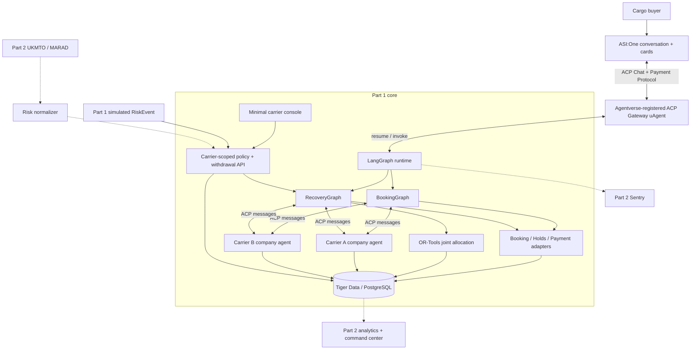
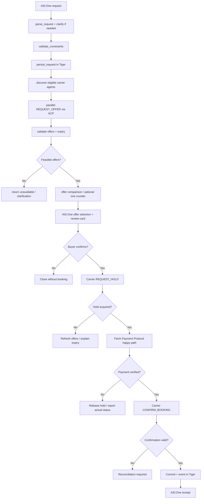
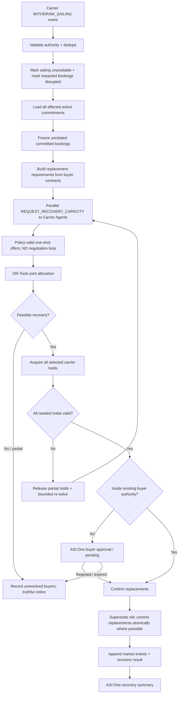

# Autonomous Freight Recovery Network — Product Requirements Document

> **Working codename:** Hormuz Exchange (not final branding)  
> **Event:** LA Hacks AI 2026 · Fetch.ai challenge  
> **Document version:** 1.0 — scope-lock candidate  
> **Prepared:** October 16, 2026  
> **Status:** Ready to implement **subject to the explicit decisions in §21**  
> **Project type:** Hackathon prototype using **simulated commercial freight data**, actual agent communications, durable bookings, deterministic recovery, and Fetch-native user interaction.

## 0. How to read this PRD

This document distinguishes:

- **[LOCKED]** — decisions explicitly agreed during product scoping.
- **[PROPOSED]** — a recommended implementation default, not a user-approved or externally mandated fact.
- **[VERIFY]** — a capability requiring a live integration test against the relevant SDK/provider.
- **[OPEN]** — a material decision requiring team confirmation, collected in §21.
- **Part 1** — mandatory implementation; **Part 2** starts **only once Part 1 passes its exit criteria**.

The [official Fetch.ai LA Hacks AI 2026 hackpack](https://www.fetch.ai/events/hackathons/la-hacks-ai-hackathon-2026/hackpack) is authoritative for the challenge. Framework, services, and algorithms beyond that are **our engineering choices**, not Fetch mandates. This PRD is not a production-grade ocean freight booking or maritime safety specification.

---

## 1. Executive summary

### 1.1 Product thesis

**When a shipping disruption invalidates multiple existing bookings, the system coordinates independently governed carrier-company agents to find replacement capacity and jointly allocate it to affected buyers without disturbing unrelated commitments.**

Normal procurement is intentionally straightforward: one cargo owner asks to ship cargo, multiple carrier-company agents return and optionally negotiate offers, the buyer accepts, and a booking is committed. **There is no time-batched Market Round Coordinator.**

Disruption recovery is the differentiated feature: a single sailing withdrawal may invalidate several previously committed buyers at once. The **RecoveryGraph** obtains independent replacement offers and uses **OR-Tools** to produce one constrained joint allocation. This replaces panic-driven manual coordination with a governed, auditable workflow.

### 1.2 User-facing promise

> “Your sailing was withdrawn. We identified the affected shipments, contacted alternative shipping companies, allocated the remaining capacity within your constraints, and preserved every unrelated booking. You can review the outcome in ASI:One.”

Only state “recovered” for **actually confirmed replacement bookings** in the simulated market, not for provisional solver output.

### 1.3 Differentiation (credible, narrow claim)

The project is **not** a shipping route planner, AIS tracker, Freightos replacement, or project44 feature-for-feature clone. Its distinctive *demonstrated combination* is:

1. Independently addressed **company-owned Carrier Agents** with separate private commercial rules and sailing inventories.
2. Buyer/carrier **negotiation at initial booking**, with bounded counters and deterministic guardrails.
3. **Joint** recovery allocation when one operational disruption displaces **several** shipments.
4. Commitment-aware preservation of unaffected bookings, including atomic capacity reservations and durable state transitions.
5. A Fetch-native conversational user experience, with **Tiger Data** supporting both transactions and temporal market state.

The individual concepts of negotiation, constraint optimization, and disruption recovery are established techniques. The innovation claim concerns this **specific agent-native coordination architecture and execution**, not invention of a new mathematical optimization algorithm.

### 1.4 Problem boundaries

**In scope:** Standardized demo container capacity on preconfigured sailings; simulated shipping prices, inventories and carriers; actual ACP messages; one carrier withdrawal; two or more disrupted bookings; real solver and database operations.

**Not claimed:** Live bookable inventory from real shipping lines; legally restricted maritime zones; operational vessel control; freight carriage contracts with actual carriers; automatic settlement or refunds of actual ocean freight payments.

---

## 2. Competition requirements and acceptance mapping

Source: [Fetch.ai LA Hacks AI 2026 hackpack](https://www.fetch.ai/events/hackathons/la-hacks-ai-hackathon-2026/hackpack), accessed October 16, 2026.

| Hackpack requirement | Status | How we satisfy it | Verification evidence |
|---|---|---|---|
| Register ≥1 agent on Agentverse | **Mandatory** | Register the buyer-facing **ACP Gateway**; register independent carrier instances as well | Public Agentverse profile and working address |
| Implement Agent Chat Protocol (ACP) | **Mandatory** | Gateway handles ASI:One Chat Protocol; carrier messages use ACP-compatible agent messaging | Captured message exchange, protocol manifest |
| Discoverable and directly usable via ASI:One | **Mandatory** | Discoverable gateway profile, relevant keywords, successful natural-language call | Live ASI:One interaction |
| Meaningful tool execution / orchestration | **Mandatory** | Carrier messaging, pricing checks, Tiger transactions, recovery OR-Tools solve | End-to-end trace and actual updated records |
| Primary workflow completes in ASI:One | **Mandatory** | Buyer request → offers → approval/payment → booking → recovery result via conversation/cards | Full recorded ASI:One run; no buyer dashboard dependency |
| Public GitHub repo with run/test instructions | **Mandatory** | Source, `.env.example`, tests, seeds, schema, setup/readme | Public repository |
| Real multi-agent collaboration | Bonus | Independent carrier policies/inventories; real ACP calls | Offer-response logs and agent addresses |
| Payment Protocol with monetization | Bonus; **team scope: required** | Verified Fetch payment happy path for a clearly defined service | Successful supported payment message flow |
| ASI Interactive Cards | Bonus; **team scope: required** | Form, offer carousel, review, confirmation/recovery summary | In-conversation UI |
| Reliability/recovery | Bonus | Idempotency, expired holds, partial failure, joint recovery | Automated tests + demo |
| Real-time data/external services | Bonus; **Part 2** | UKMTO/MARAD adapter, same risk schema used in Part 1 | Provenance-linked incident, if Part 2 built |
| Post-hackathon business viability | Bonus | Capacity recovery coordination / transaction fee model | Pitch and README |

**Submission requirements from the hackpack:** Devpost **and** the LAHacks AI Hackathon ASI:One Submission Agent; public GitHub repository; project README with agent addresses and run instructions; `innovationlab` and `hackathon` badges; **3–5-minute demo video**. Confirm exact submission details at check-in and see §20.

**Judging weights:** technical implementation **25%**, Fetch usage **20%**, innovation **20%**, impact **20%**, UX/presentation **15%**.

---

## 3. Personas and interfaces

| Role | Where they interact | Can see/do | Cannot see/do |
|---|---|---|---|
| **Cargo buyer** | **ASI:One** | Submit requirements, review offers, confirm purchase, set rebooking envelope, view recovery | Other buyers' private terms or carrier internal floors |
| **Carrier company operator** | Minimal **Carrier Console** (Part 1) | View its sailings, set private pricing rules, approve capacity withdrawal | Another carrier's strategies or other buyers' confidential details |
| **Carrier company agent** | Independently addressed Fetch agent | Select sailing, price offer, accept/reject counter, hold/release its inventory | Another company's inventory; override platform/DB invariants |
| **Platform operator** | API/CLI in Part 1; Command Center in Part 2 | Seed simulation, trigger a clearly labeled disruption, inspect status, resolve stuck transactions | Arbitrarily override private carrier floors |
| **Risk ingestion service** | Demo event injection in Part 1; maritime source adapter in Part 2 | Normalize sourced or simulated incident and signal sailing exposure | Unilaterally cancel real vessels or assert official exclusion zones |

**[LOCKED] Two buyer-facing surfaces only:** ASI:One is the **complete buyer experience**; a minimal private web interface is used for carrier configuration/withdrawal. A separate **Market Command Center is Part 2 only**.

### 3.1 Specific ASI:One screens

1. **Request form / chat clarification:** container count, origin, destination, latest arrival, preferred departure, budget, splitting policy, risk tolerance and allowed recovery envelope.
2. **Offer carousel:** carrier name, sailing ID, quantity, quoted total, departure, arrival, validity, optional reason for recommendation; “Select” action.
3. **Booking review card:** full terms, buyer commitment/fee disclosure, confirm/reject actions.
4. **Payment interaction:** supported Payment Protocol messages, never merely a simulated button that says paid.
5. **Booking detail / receipt:** committed booking ID, selected sailing, payment outcome, recovery preferences.
6. **Disruption notice:** affected booking, affected sailing, source of withdrawal, progress state.
7. **Recovery summary card:** original vs replacement, deadline, price change in **simulated freight** currency, preserved unaffected bookings, confirmed/pending status.
8. **Failure message:** accurate `NO_REPLACEMENT_AVAILABLE` or `APPROVAL_REQUIRED` outcome rather than falsely claiming success.

ASI cards officially support `form`, `carousel`, `detail`, `review`, and `custom`. Required card metadata is documented in [ASI Interactive Cards](https://innovationlab.fetch.ai/resources/docs/interactive-cards/asi-interactive-cards). Card actions return either natural-language intent or structured JSON depending on the interaction route; the gateway must handle **both**.

### 3.2 Carrier Console — minimum viable version

**Required pages only:**

- **Fleet & Policies:** list its own sailings (capacity, departure/arrival, status, corridor ID), edit approved price floor/target and recovery-offer policy; save through carrier-scoped API.
- **Sailing Review:** list affected sailing and eligible bookings; operator may `KEEP_ACTIVE`, `PAUSE_NEW_OFFERS`, or `WITHDRAW_SAILING` with confirmation.

No public carrier signup, SSO, billing system, vessel tracker, or giant map in Part 1. Pre-provision the demo carrier identities. Carrier settings **must actually affect** subsequent agent replies.

---

## 4. Scope: explicit Part 1 / Part 2 contract

### 4.1 Part 1 — build and complete first **[LOCKED]**

**P0 / must work end-to-end:**

- Registered, discoverable, ACP-compatible ASI:One gateway.
- `BookingGraph` in LangGraph, called through gateway adapter.
- ≥2 independently addressed carrier-company agents (same implementation, independent identity and policy); third instance desirable if trivial to deploy.
- Private carrier policies, sailing selection, bounded initial price negotiation (one initial quote + at most one counter).
- No periodic batch clearing. Initial booking attempts an immediate feasible offer and holds capacity before commitment.
- Tiger PostgreSQL transactional tables, atomic capacity holds, commitment history, idempotency.
- Tiger **time-series hypertable** for market/business events; queryable timestamps and event history from actual test runs.
- Fetch Payment Protocol **real supported happy path** with a clearly identified charged service (payment business decision pending; see §15 and §21).
- ASI Interactive Cards for selection, approval and result.
- Carrier Console for inspecting and withdrawing a specific sailing; simulate disruption via the **same schema** Part 2 sources will use.
- `RecoveryGraph`: one withdrawal invalidates ≥2 committed bookings; fetches fresh one-shot replacement offers; OR-Tools jointly allocates eligible inventory; atomic holds, confirmed replacement bookings, preservation of unrelated bookings.
- Meaningful errors, truthful pending status, basic test suite, a reproducible deterministic demo fixture.
- Public repo, video, Agentverse profiles, submissions.

**Part 1 is complete only when the P0 acceptance checklist (§18) is green.** A static dashboard or textual “agent decided” output cannot substitute for executed ACP, solver, payment and Tiger operations.

### 4.2 Part 2 — strictly after Part 1 green **[LOCKED]**

- Real UKMTO and/or MARAD incident/advisory ingestion, source links, region/coordinate parsing and a carrier review prompt.
- Sentry distributed tracing, agent/tool performance monitoring, errors and optional AI monitoring.
- Exchange **Market Command Center** with risk/capacity map, business timeline, supply/demand history, agent-health links and recovery view.
- Tiger continuous aggregates and richer historical visualizations (price movement, scarcity, recovery state, utilization). Optional initial seeded history, **clearly marked simulated**.
- More carriers or smarter policies only if reliable and independently useful.

### 4.3 Out of scope for this hackathon **[LOCKED]**

- Escrow, settlement guarantees, actual ocean freight refunds or compensation; cancellation/refund edge may be answered verbally but is **not** in the main demo.
- Real carriers and physical ship control; AIS tracking, route optimization, insurance workflows, customs, multi-leg multimodal shipment planning.
- Carrier onboarding automation, full authentication system, external payment processor reconciliation, production compliance.
- Time-triggered Market Round Coordinator, full combinatorial marketplace auction, negotiation among carriers, recovery bargaining loops.
- Research benchmark against a naive optimizer; broad performance comparison not required.

**Safety/accuracy note:** Deferring refunds is a scope choice, **not** permission to claim a completed payment is refundable through Fetch's `CancelPayment`. Do not say “refunded” unless actual return funds are verified.

---

## 5. Architectural principles

1. **One central LangGraph workflow core, not an invented “Exchange LLM Agent.”** The externally discoverable **gateway** is a protocol adapter; the orchestration engine is code.
2. **Carrier Agent = company, not vessel.** Every company owns **many vessels**, and each vessel may have **multiple sailings**. Capacity is sold against a specific **sailing**, not a whole carrier.
3. **Company autonomy is meaningful:** a carrier agent has private pricing, inventory, policy and accept/reject authority; the coordinator sees only offered terms.
4. **LLMs propose, deterministic systems enforce:** Pydantic/schema validation, private policy code, OR-Tools and Tiger SQL are the enforcement boundaries.
5. **Tiger is business truth.** LangGraph checkpoints hold workflow state and IDs, not inventory authority. Sentry (when added) holds telemetry, not booking truth.
6. **Simulated data has real-data-compatible shape.** Every capacity, offer and risk object includes explicit `source_kind`, timestamps and provenance where available.
7. **Every state change is reproducible and auditable.** Transactions update current tables and append `market_events`; use a transactional outbox if needed for ACP notifications.
8. **Make no false completion claims.** A suggested allocation is not a hold; a hold is not a booking; a payment request is not a verified payment; a risk signal is not a carrier withdrawal.

---

## 6. Component architecture



**Important:** Arrows to Tiger mean role-scoped backend queries/transactions—not arbitrary LLM-generated SQL or direct cross-company access.

### 6.1 Deployment recommendation **[PROPOSED]**

**Prefer the most documented payment/card path:**

- **ACP Gateway:** small uAgent implementing Chat Protocol, Interactive Card message construction, Payment Protocol handlers, and binding incoming ASI:One turns to LangGraph `thread_id`/request IDs.
- **LangGraph runtime:** Python service in the same backend deployment/process where practical; `BookingGraph` and `RecoveryGraph` share pure service methods.
- **Carrier Agents:** two or three separately addressed/registered uAgent instances, instantiated from one carrier codebase and independent private config.
- **Tiger:** one hosted PostgreSQL/TimescaleDB instance, containing platform market tables and carrier-scoped policy/inventory tables in the demo. In production, individual carriers would have their own authoritative systems.
- **Carrier Console:** minimal React UI talking to a FastAPI backend; this is *not* buyer-critical.

**Why a uAgent gateway instead of registering LangGraph directly?** Both approaches are possible. [Agentverse SDK supports LangGraph](https://docs.agentverse.ai/documentation/launch-agents/agentverse-sdk/lang-graph), but Fetch's published Chat + Cards + Payment example is directly implementable using uAgent protocol handlers. Using a thin uAgent protocol adapter reduces uncertainty about how native payment messages and card metadata interact with an external LangGraph SDK adapter. **Do not build two competing orchestrators.** The gateway does not make market decisions.

**[VERIFY EARLY]** Demonstrate ASI:One → gateway → graph → gateway → ASI:One; separately test Payment Protocol and Interactive Cards. If direct LangGraph SDK supports all needed message types in your environment, simplify the gateway later without changing domain logic.

### 6.2 Agent identities and communication

- `gateway_agent_address` — discoverable buyer entrypoint.
- `carrier_agent_address` — one per independent company; stored in `carriers`.
- ACP business messages include `schema_version`, `message_type`, `message_id`, `correlation_id`, `request_id` or `recovery_id`, `sender_agent_address`, `recipient_agent_address`, `created_at` (UTC), `expires_at` when relevant, and typed `payload`.
- Carrier addresses must be validated against registered `carrier_id`; an untrusted message cannot claim another carrier's ID.
- Use supported structured agent messages or schema-validated JSON in Chat Protocol `TextContent`, as verified in the first integration spike. **The business message names below are ours**, not built-in ACP message names.

### 6.3 Asynchronous control boundary

ACP replies can arrive after the original chat handler has returned. The gateway therefore routes incoming replies using `correlation_id` to a persisted pending-request record or an in-process future, and resumes the appropriate graph. The agent handler must not block indefinitely waiting for a carrier; every remote step has a deadline.

For the demo, an async request/reply registry backed by Tiger is adequate. Use a persistent outbox and retry dispatcher only if needed for reliability. Incoming duplicate ACP messages must be idempotent.

---

## 7. BookingGraph — normal procurement and bounded negotiation

**Trigger:** one validated buyer request in ASI:One. **No batching and no multi-buyer OR-Tools requirement.**



### 7.1 Booking business rules

- A buyer can submit a standard cargo request for a predefined corridor and compatible departure/arrival window.
- Carrier discovery is based on service coverage and registered agent identity; no need for semantic carrier search for a fixed demo fleet.
- Each Carrier Agent chooses an eligible sailing and quote using **its own** private policy and remaining sellable inventory.
- Exchange core may request **at most one** buyer-authorized counteroffer per carrier. Carrier can accept, counter within its own floor, or reject. No free-form infinite chat.
- Offer expires at `expires_at` and references a precise sailing and quantity. Never treat an old offer as inventory reservation.
- Buyer reviews an offer and approves. After that, obtain a short-lived **carrier-owned hold**, then perform the selected Fetch payment flow, then confirm.
- If the hold expires during payment/approval, fail safely and re-quote; do not mark booked.
- A successful booking has an immutable reference to the original offer and payment verification record.

### 7.2 Negotiation policy — realistic MVP

**[PROPOSED] One counter round maximum**, e.g.:

1. Buyer requests two units arriving by Friday and maximum simulated freight price `$5,600`.
2. Carrier B Agent selects `B104` and offers `$5,450` within its private permitted floor.
3. Buyer/booking coordinator asks if `$5,200` is possible, **without disclosing private maximum willingness to pay** unless needed.
4. Carrier B's policy/LLM response is `$5,250`, valid for 90 seconds; **validator enforces carrier floor**.
5. Buyer chooses the quote. Inventory and payment steps follow.

**Commercial decisions:**

- LLM may select a sailing among a finite feasible list and propose a price/counteroffer, considering policy-sanctioned historical indicators from Tiger.
- Deterministic validation checks floor, capacity, timing, quantity, risk, currency, and allowed rounds.
- If LLM output is malformed or slow, the carrier falls back to a deterministic quoted price. **Never** publish an unauthorized LLM-generated quote.

### 7.3 Initial booking optimization

Do **not** run a multi-buyer market-clearing solver during normal single-buyer booking. Rank feasible finalized offers deterministically (lowest total price subject to buyer requirements; tie-break earliest valid arrival, then stable offer ID), with an explanatory recommendation. The buyer still chooses and authorizes the final offer.

---

## 8. RecoveryGraph — the distinctive joint capacity allocation

**Trigger:** carrier-authorized `SAILING_WITHDRAWN` or a carrier-confirmed reduction of specified capacity. **Not** a risk alert alone.



### 8.1 Recovery rules **[LOCKED]**

- One withdrawn sailing may affect **multiple already committed cargo buyers**, even if those bookings were originally made hours/days apart.
- **Never** re-optimize valid unrelated bookings merely to reduce costs.
- Recovery agents **do not bargain**. They submit independently policy-valid one-shot replacement capacity/price offers.
- Replacements must satisfy buyers' hard requirements: capacity, latest arrival, indivisibility, risk policy, maximum authorized commercial change.
- OR-Tools selects a **joint** allocation across all eligible displaced bookings and submitted alternative sailings.
- A solver result is provisional. Actual ownership requires atomic holds, then actual confirmation.
- Partially feasible outcomes must explicitly report which shipments were **not** recovered.
- No need to rerun the complete original procurement flow for each displaced buyer.

### 8.2 Proposed optimization model **[PROPOSED]**

The solver sees **proposed capacity offers**, already validated by owning Carrier Agents. In the demo, capacity is counted in a standardized container-slot unit (§21).

- Sets: displaced bookings `B`; candidate sailings `S`.
- For each booking `b`: required units `q_b`, latest arrival, total authorized price ceiling, `allow_split` flag.
- For each sailing `s`: `available_units_s`, quoted price per unit, arrival time, risk class, carrier authorization.
- Binary `y[b,s]` if an indivisible booking uses sailing `s`; integer `x[b,s]` units if splitting is supported.
- Hard constraints: `sum_b x[b,s] <= available_units_s`; booking quantity satisfied if recovered; zero assignments outside deadline/risk/budget; indivisible requests allocated on one sailing only.
- Objective: **lexicographically** (1) maximize number of fully recovered valid bookings (or declared contractual priority, **[OPEN]**), (2) minimize incremental simulated freight cost; (3) tie-break on earlier arrival and stable IDs.
- Keep all unaffected commitments fixed **outside** this solver. This is how we guarantee zero unrelated booking churn, not merely a low penalty weight.

**Important scope question:** if a 2-container booking and two 1-container bookings compete for only 2 slots, which group gets priority? The PRD cannot silently declare one “fair.” A **[PROPOSED]** demo rule is maximize *number of whole bookings recovered* subject to declared service priority, then minimize cost. This must be confirmed before coding; see §21.

### 8.3 Recovery payment and commercial boundaries

For Part 1, freight rates are **simulated commercial terms** and not real shipper-to-carrier transfers. We can record and authorize a replacement price within the customer's pre-agreed envelope, but **must not claim a real difference was charged/refunded** unless a payment operation actually happened.

The selected **Fetch Payment Protocol** happy path concerns a separately identified platform service/booking fee (recommended; pending confirmation). Recovery commitments can be completed in the simulated freight ledger without pretending freight cost differences have settled on-chain. If payment adjustment is a required business condition, use `PAYMENT_ADJUSTMENT_PENDING` until actually handled.

**Strong recommended demo fixture:** at least two disrupted buyers can be recovered with commercial terms already authorized; choose the fixture so no extra real-money payment/refund operation is needed mid-recovery.

---
## 9. Message contracts and canonical types

**All values below are synthetic examples unless stated otherwise.** JSON uses ISO 8601 timestamps with timezone offsets (UTC `Z` recommended). Financial amounts should use **decimal strings or integer minor units**, not binary floating point.

### 9.1 Canonical cargo request

```json
{
  "schema_version": "1.0",
  "request_id": "req_x001",
  "buyer_id": "buyer_x",
  "source_kind": "SIMULATED_BUYER",
  "origin_port_code": "AEJEA",
  "destination_port_code": "INBOM",
  "market_corridor_id": "gulf_to_mumbai",
  "container_type": "20GP",
  "quantity": 2,
  "latest_arrival_at": "2026-10-23T23:59:00Z",
  "allow_split": false,
  "max_freight_total": {"amount": "5600.00", "currency": "USD"},
  "max_route_risk_level": 2,
  "recovery_authority": {
    "enabled": true,
    "max_additional_freight_cost": {"amount": "250.00", "currency": "USD"},
    "max_extra_arrival_delay_hours": 12,
    "requires_confirmation_if_exceeded": true
  },
  "created_at": "2026-10-17T19:00:00Z"
}
```

`20GP`, the sample ports, prices and exact policy values are **demo defaults only**, not claimed live rates/availability. Port codes are convenient for eventual real integration but must be validated by the application's port reference table. Quantities refer to **one consistent container type**, never mixed TEU vs FEU without conversion.

### 9.2 Carrier inventory and commercial policy — private

```json
{
  "carrier_id": "carrier_b",
  "agent_address": "<real Agentverse address>",
  "source_kind": "SIMULATED_CARRIER",
  "commercial_policy": {
    "currency": "USD",
    "minimum_price_per_unit": "2300.00",
    "target_price_per_unit": "2700.00",
    "max_counter_rounds": 1,
    "allow_recovery_offers": true,
    "requires_operator_approval_to_withdraw": true
  },
  "sailings": [
    {
      "sailing_id": "B104",
      "vessel_id": "vessel_b1",
      "origin_port_code": "AEJEA",
      "destination_port_code": "INBOM",
      "market_corridor_id": "gulf_to_mumbai",
      "departure_at": "2026-10-20T12:00:00Z",
      "arrival_at": "2026-10-22T08:00:00Z",
      "route_corridor_ids": ["STRAIT_OF_HORMUZ"],
      "container_type": "20GP",
      "total_capacity_units": 3,
      "status": "ACTIVE"
    }
  ]
}
```

The private policy object must never be forwarded to buyers, other carriers, or the public market analytics feed. The Exchange sees only authorized offers and public sailing facts.

### 9.3 Carrier offer / counteroffer

```json
{
  "schema_version": "1.0",
  "message_type": "PROPOSE_OFFER",
  "message_id": "msg_abc",
  "correlation_id": "flow_req_x001",
  "negotiation_id": "neg_123",
  "offer_id": "offer_b104_01",
  "request_id": "req_x001",
  "carrier_id": "carrier_b",
  "sailing_id": "B104",
  "quantity": 2,
  "container_type": "20GP",
  "total_price": {"amount": "5150.00", "currency": "USD"},
  "departure_at": "2026-10-20T12:00:00Z",
  "arrival_at": "2026-10-22T08:00:00Z",
  "risk_level": 1,
  "round": 1,
  "expires_at": "2026-10-17T19:02:00Z",
  "source_kind": "SIMULATED_CARRIER",
  "created_at": "2026-10-17T19:00:30Z"
}
```

For recovery, one response may contain an **array of sailing offers** with capacity and quotes. Every quoted capacity belongs to the same identified carrier; offers are not guaranteed reservations.

### 9.4 Message catalogue

| Type | Sender → receiver | Purpose | Expected response |
|---|---|---|---|
| `REQUEST_OFFER` | BookingGraph/gateway → Carrier Agent | Ask for feasible options for one cargo request | `PROPOSE_OFFER` / `REJECT_OFFER` |
| `COUNTER_OFFER` | BookingGraph/gateway → Carrier Agent | One bounded modification of existing offer terms | `PROPOSE_OFFER` / `ACCEPT_OFFER` / `REJECT_OFFER` |
| `REQUEST_RECOVERY_CAPACITY` | RecoveryGraph/gateway → Carrier Agent | Request **one-shot** replacement capacity for affected requests | `RECOVERY_CAPACITY_OFFERS` |
| `REQUEST_HOLD` | Core → owning Carrier Agent | Attempt short-lived atomic reservation of specific inventory | `HOLD_GRANTED` / `HOLD_REJECTED` |
| `RELEASE_HOLD` | Core → owning Carrier Agent | Idempotently release unused/expired hold | `HOLD_RELEASED` |
| `CONFIRM_BOOKING` | Core → owning Carrier Agent | Confirm hold-backed capacity commitment | `BOOKING_CONFIRMED` / `BOOKING_REJECTED` |
| `SAILING_REVIEW_REQUIRED` | Risk service → Carrier Agent / carrier console | Exposure signal needing carrier choice | Acknowledgment, no withdrawal by implication |
| `SAILING_WITHDRAWN` | Carrier Agent/authorized operator → core | Actual capacity invalidation for specific sailing | `WITHDRAWAL_ACCEPTED` and recovery start |
| `BOOKING_RECOVERED` | RecoveryGraph → gateway/ASI:One | Verified replacement and commercial terms | Confirmation displayed |

Any `ACCEPT_OFFER` is **acceptance of commercial terms**, not an inventory hold or final booked state. Each command is independently authorized, schema-validated, and idempotent.

### 9.5 Communication envelope

```json
{
  "schema_version": "1.0",
  "message_id": "msg_001",
  "correlation_id": "flow_001",
  "causation_id": "msg_parent_000",
  "type": "REQUEST_RECOVERY_CAPACITY",
  "sender_agent_address": "agent1...gateway",
  "recipient_agent_address": "agent1...carrierb",
  "sent_at": "2026-10-17T19:05:00Z",
  "expires_at": "2026-10-17T19:05:30Z",
  "payload": {"recovery_id": "rec_001", "affected_request_ids": ["req_x", "req_y"]}
}
```

**[VERIFY]** Whether ACP/SDK should encode this as dedicated typed agent messages or text JSON is an implementation detail. The *logical envelope schema* remains stable either way.

### 9.6 RiskEvent — single format for simulated and real source data

```json
{
  "schema_version": "1.0",
  "event_id": "risk_2026_001",
  "source_kind": "DEMO_SIMULATOR",
  "source_name": "hackathon_demo",
  "source_report_id": "SIM-HORMUZ-001",
  "source_uri": null,
  "published_at": "2026-10-17T19:10:00Z",
  "observed_at": "2026-10-17T19:10:00Z",
  "ingested_at": "2026-10-17T19:10:01Z",
  "incident_type": "MARITIME_SECURITY_ALERT",
  "location_text": "Strait of Hormuz",
  "region_id": "STRAIT_OF_HORMUZ",
  "geometry": null,
  "geometry_accuracy": "REGION_ONLY",
  "app_risk_severity": "HIGH",
  "official_restriction": false,
  "review_required": true,
  "simulated": true,
  "raw_evidence_excerpt": null
}
```

**Part 2 integration** swaps `source_kind` for `UKMTO` or `MARAD`, fills `source_report_id`/`source_uri`, and supplies `geometry` only when verifiably supported. GeoJSON `Point` uses `[longitude, latitude]`; `Polygon` represents a sourced or explicitly labeled inferred area. **Neither coordinates nor an incident buffer automatically create an official restricted zone.** `app_risk_severity` is an internal assessment; do not misattribute it to an official authority.

### 9.7 Withdrawal event

```json
{
  "schema_version": "1.0",
  "event_id": "withdraw_001",
  "carrier_id": "carrier_a",
  "authorized_by": "demo_operator_a",
  "sailing_id": "A101",
  "reason": "CARRIER_AUTHORIZED_SECURITY_RESPONSE",
  "related_risk_event_id": "risk_2026_001",
  "occurred_at": "2026-10-17T19:11:00Z",
  "source_kind": "SIMULATED_OPERATOR_ACTION"
}
```

The associated `SAILING_WITHDRAWN` event is what actually changes committed capacity. The risk event by itself only triggers review.

---

## 10. Tiger Data — transactional model

### 10.1 Relational tables

| Table | Key fields | Purpose |
|---|---|---|
| `carriers` | `carrier_id`, `agent_address`, `source_kind`, `active` | Carrier identity |
| `carrier_policies` | `carrier_id`, `policy_json`, `version`, `updated_at` | Private carrier rules (restricted APIs) |
| `vessels` | `vessel_id`, `carrier_id`, `name`, `source_kind` | Physical resources |
| `sailings` | `sailing_id`, `vessel_id`, `carrier_id`, `ports`, `departure_at`, `arrival_at`, `status`, `corridor_ids` | Scheduled service / disruption unit |
| `capacity_slots` | `slot_id`, `sailing_id`, `container_type`, `status`, `version` | Specific sellable inventory units |
| `cargo_requests` | `request_id`, `buyer_id`, `requirements_json`, `status`, `created_at` | User procurement requirements |
| `offers` | `offer_id`, `carrier_id`, `sailing_id`, `request_id`, `quantity`, `total_price`, `expires_at`, `status` | Historical and live quote terms |
| `negotiation_messages` | `message_id`, `negotiation_id`, `round`, `source_agent`, `terms_json`, `ts` | Auditable offer/counteroffer chain |
| `holds` | `hold_id`, `buyer_id`, `carrier_id`, `status`, `expires_at`, `idempotency_key` | Reservation attempts |
| `hold_slots` | `hold_id`, `slot_id`, `status` | Exact held inventory |
| `bookings` | `booking_id`, `buyer_id`, `request_id`, `offer_id`, `sailing_id`, `status`, `price`, `created_at` | Booked freight commitment |
| `booking_slots` | `booking_id`, `slot_id`, `status` | Specific committed inventory |
| `recovery_runs` | `recovery_id`, `withdrawal_event_id`, `status`, `solver_run_id` | Recovery lifecycle |
| `recovery_assignments` | `recovery_id`, `old_booking_id`, `replacement_booking_id`, `status` | Old → new commitment linkage |
| `payment_records` | `payment_id`, `reference`, `purpose`, `method`, `status`, `verified_at` | Payment Protocol result and audit |
| `risk_events` | normalized `RiskEvent` fields | Incident data with provenance |
| `agent_messages` | `message_id`, `correlation_id`, `direction`, `ack_status`, `ts` | Idempotent ACP transport tracking |
| `market_events` | `ts`, `event_id`, `event_type`, IDs, dimensions, `metadata` | **Tiger hypertable**, append-only business history |
| `market_snapshots` | `ts`, `corridor_id`, `departure_window`, supply/demand/price measurements | **Tiger hypertable**, temporal measures |

This is a **logical schema**. Do not block the prototype on fully normalizing every table. The minimum working set is carriers/policies, sailings, slots, cargo requests, offers, holds, bookings, recovery runs, payments, market events, and snapshots. The exact SQL migration should use constraints, foreign keys and indexes appropriate to those fields.

### 10.2 Capacity invariants

**INV-1: One slot, at most one active hold/commitment**

`forall slot_id: count(active_owners(slot_id)) <= 1`

**INV-2:** A `WITHDRAWN` sailing's units are not offered or newly held.

**INV-3:** An `EXPIRED`, `RELEASED` or `CANCELLED` hold cannot become `COMMITTED`.

**INV-4:** Booking confirmation references a currently valid hold owned by that carrier and buyer.

**INV-5:** Every booking has a real `offer_id`, `sailing_id`, `buyer_id`, and explicit `source_kind`.

**INV-6:** A recovery must not change unrelated still-feasible committed bookings.

**INV-7:** No duplicate payment/reference creates duplicate bookings; repeated withdrawal messages cannot start conflicting recovery runs.

### 10.3 Atomic hold transaction — design sketch

```sql
BEGIN;

-- Lock exactly the carrier-authorized, correct-type, unsold slots
SELECT slot_id
FROM capacity_slots
WHERE sailing_id = :sailing_id
  AND container_type = :container_type
  AND status = 'AVAILABLE'
ORDER BY slot_id
FOR UPDATE SKIP LOCKED
LIMIT :requested_quantity;

-- Application checks returned row count == :requested_quantity.
-- If not, ROLLBACK and return HOLD_REJECTED.

-- Insert hold with a UNIQUE idempotency key, then mark exactly
-- those slots HELD and associate them with the hold in this tx.
-- Verify affected row count and all slot/offer constraints.

COMMIT;
```

**Do not implement the sketch alone as a complete solution:** include hold-expiry handling, unique constraints, transaction ownership and affected-row checks. A duplicate request should return the **existing hold result** rather than create a new set of held slots.

**Suggested DB constraints:** unique active assignment/hold per slot; unique `hold.idempotency_key`; unique `booking.confirmation_key`; unique `(carrier_id, withdrawal_event_id)` recovery initiation; unique inbound `message_id` per sender; conditional state transition checks. Use a single authoritative slot status transaction path so a hold and booking cannot conflict.

### 10.4 Multiple carriers: partial hold problem

PostgreSQL cannot atomically hold inventory independently owned by multiple real companies with one local transaction. For the hackathon, all simulated carrier inventories use Tiger but remain **carrier-authorized through agent APIs**. When RecoveryGraph selects offers across carriers, it acquires holds in deterministic order; if any hold fails, it releases acquired holds, refreshes supply and reruns a bounded solve.

This is a **compensating transaction / saga**, not global atomicity. Avoid promising distributed two-phase commit.

### 10.5 Durable events and state transitions

When booking state changes in Tiger, **insert the corresponding `market_events` row in the same PostgreSQL transaction**. Publish any needed outbound ACP notice via a transaction-backed outbox or an idempotent retry mechanism to avoid “DB committed but no notification” divergence.

Events are business facts (`BOOKING_COMMITTED`, `SAILING_WITHDRAWN`, etc.), not arbitrary debug statements. Make event IDs unique and preserve exact timestamps.

---

## 11. Tiger Data — mandatory time-series design

Tiger is not merely being used as generic PostgreSQL. **Part 1 creates genuine hypertables and uses time-indexed measurements**; Part 2 adds the richer command center.

### 11.1 Event taxonomy

`CARGO_REQUEST_CREATED`, `OFFER_REQUESTED`, `OFFER_SUBMITTED`, `COUNTER_OFFER_SENT`, `OFFER_ACCEPTED`, `HOLD_CREATED`, `HOLD_FAILED`, `HOLD_EXPIRED`, `PAYMENT_REQUESTED`, `PAYMENT_VERIFIED`, `BOOKING_COMMITTED`, `RISK_EVENT_RECORDED`, `SAILING_WITHDRAWN`, `BOOKING_DISRUPTED`, `RECOVERY_STARTED`, `RECOVERY_OFFERS_RECEIVED`, `RECOVERY_ALLOCATION_PROPOSED`, `RECOVERY_HOLD_FAILED`, `BOOKING_RECOVERED`, `RECOVERY_PARTIAL`, `RECOVERY_UNAVAILABLE`.

### 11.2 Example hypertable migration

**Check installed TimescaleDB version before running any migration**; the following uses broadly documented Timescale syntax.

```sql
CREATE EXTENSION IF NOT EXISTS timescaledb;

CREATE TABLE IF NOT EXISTS market_events (
  ts TIMESTAMPTZ NOT NULL,
  event_id UUID NOT NULL,
  event_type TEXT NOT NULL,
  carrier_id TEXT,
  sailing_id TEXT,
  booking_id TEXT,
  recovery_id TEXT,
  corridor_id TEXT,
  source_kind TEXT NOT NULL,
  metadata JSONB NOT NULL DEFAULT '{}'::jsonb,
  PRIMARY KEY (ts, event_id)
);

SELECT create_hypertable('market_events', 'ts', if_not_exists => TRUE);

CREATE TABLE IF NOT EXISTS market_snapshots (
  ts TIMESTAMPTZ NOT NULL,
  corridor_id TEXT NOT NULL,
  departure_window TEXT NOT NULL,
  requested_units INTEGER NOT NULL,
  sellable_units INTEGER NOT NULL,
  held_units INTEGER NOT NULL,
  committed_units INTEGER NOT NULL,
  avg_offered_unit_price NUMERIC(12, 2),
  source_kind TEXT NOT NULL,
  PRIMARY KEY (ts, corridor_id, departure_window)
);

SELECT create_hypertable('market_snapshots', 'ts', if_not_exists => TRUE);
```

Because unique constraints on hypertables must include their partitioning column, `market_events` has `(ts,event_id)` as a primary key; enforce global event deduplication in a separate ordinary transactional `event_ids`/`inbox` table if needed. **Do not assume the time-series primary key alone prevents duplicate `event_id` at different timestamps.**

The above is a **design sample**, not guaranteed copy-paste SQL across every current Tiger service/version. Apply the vendor-recommended hypertable creation syntax if your provisioned Tiger instance differs.

### 11.3 Materialized continuous aggregate (Part 2 visualization; prepare schema in Part 1)

```sql
CREATE MATERIALIZED VIEW corridor_capacity_1m
WITH (timescaledb.continuous) AS
SELECT
  time_bucket(INTERVAL '1 minute', ts) AS bucket,
  corridor_id,
  departure_window,
  AVG(sellable_units) AS avg_sellable_units,
  AVG(requested_units) AS avg_requested_units,
  AVG(avg_offered_unit_price) AS avg_offer_price
FROM market_snapshots
GROUP BY bucket, corridor_id, departure_window;
```

Use a refresh policy if implementing this. In current TimescaleDB, newly arriving raw rows are **not necessarily included** by default when querying continuous aggregates; either enable the documented real-time behavior or combine history with fresh transactional snapshots for the live view.

References: [Create continuous aggregate](https://www.tigerdata.com/docs/build/continuous-aggregates/create-a-continuous-aggregate) and [Understand continuous aggregates](https://www.tigerdata.com/docs/learn/continuous-aggregates).

### 11.4 What actually gets measured

| Metric | Definition / data | Phase |
|---|---|---|
| Capacity by corridor over time | `sellable_units`, excluding withdrawn and actively held units as separately defined | Part 1 persisted; Part 2 chart |
| Pending demand by corridor | Sum of eligible, not expired uncommitted requests in same compatible market segment | Part 1 recorded; Part 2 chart |
| Initial vs final offer price | Carrier-submitted quotes, currency and per-unit normalization | Part 1 recorded |
| Negotiation rounds / outcome | `negotiation_id`, `round`, accepted/rejected | Part 1 recorded |
| Booking state timeline | State transition event timestamps | Part 1 queryable |
| Recovery duration | First withdrawal event to last verified replacement or terminal failure | Part 1 event timestamps |
| Number of recovered / unresolved bookings | Recovery assignments and status | Part 1 |
| Inventory utilization per sailing | Held + committed over eligible physical capacity, with withdrawn units distinct | Part 2 panel |
| Agent request latency/errors | Sentry technical telemetry (not business truth) | Part 2 |

**Do not call average offer price a market-clearing price** when normal booking simply picks an individually negotiated quote. Different fields distinguish `ask_price`, `accepted_price`, and `paid_platform_fee`.

### 11.5 Time-series history as carrier decision input

If carrier agents use historical indicators, expose only **permitted aggregate market metrics** such as corridor offered-price median, demand pressure, or that carrier's own sailing utilization. Keep company price floors private; never leak individual buyer reservation prices through aggregate endpoints.

For a short hackathon demo, deterministic policy based on current own utilization is sufficient. Historical strategy enhancements can be toggled on when queryable time-series data is actually populated. Do not pretend synthetic historical trends are real market observations.

### 11.6 Seed history versus live events

- All preseeded `market_events` or snapshots have `source_kind=SIMULATED_SEED`.
- Real execution during the hackathon uses `source_kind=DEMO_EXECUTION`.
- Part 2 maritime records use `source_kind=UKMTO`/`MARAD` and preserve `source_uri` and issued timestamp.
- The UI must identify historical simulation separately from current executed platform transactions.

---

## 12. State machines and lifecycle ownership

### 12.1 Cargo request

`DRAFT → VALIDATED → NEGOTIATING → OFFERED → SELECTED → BOOKED`

Alternative terminal states: `NO_FEASIBLE_OFFER`, `DECLINED`, `EXPIRED`, `FAILED`. A request that cannot book immediately can be explicitly saved as `OUTSTANDING` in Tiger, but there is **no background market round** required in Part 1.

### 12.2 Offer

`PROPOSED → VALIDATED → SELECTED → HELD → CONSUMED`

Other states: `REJECTED`, `COUNTERED`, `EXPIRED`, `CANCELLED`. `SELECTED` doesn't confer inventory ownership.

### 12.3 Capacity slot

`AVAILABLE → HELD → COMMITTED`

From `HELD`, may return to `AVAILABLE` on allowed release/expiry **only when sailing remains active**. From any active state, authorized withdrawal marks the slot `WITHDRAWN` (not sellable). Superseding a disrupted booking does **not** make its withdrawn original capacity reusable.

### 12.4 Booking

`PENDING_CONFIRMATION → COMMITTED → DISRUPTED → RECOVERED/SUPERSEDED`

Other outcomes: `FAILED`, `CANCELLED` (state supported for future work; refund processing is not implemented). Recovery creates a **new** replacement booking linked to the old one; avoid overwriting the original booking history.

### 12.5 Recovery run

`STARTED → OFFER_COLLECTION → SOLVING → HOLDING → CONFIRMING → COMPLETED`

Other terminal states: `PARTIALLY_RECOVERED`, `NO_FEASIBLE_RECOVERY`, `AWAITING_APPROVAL`, `RECONCILIATION_REQUIRED`, `FAILED`. Always link the run to exactly one authorized withdrawal or deduplicated event group.

### 12.6 Payment

`NOT_REQUESTED → REQUESTED → COMMITTED_BY_BUYER → VERIFIED/COMPLETED`

Other states: `REJECTED`, `EXPIRED`, `VERIFICATION_FAILED`, `RECONCILIATION_REQUIRED`. The actual protocol may use slightly different wire message state names. This is **our local state machine**, not a verbatim copy of Fetch's internal protocol state.

---

## 13. LangGraph implementation detail

### 13.1 Graph structure

Prefer two small typed `StateGraph`s, plus shared services:

- `BookingGraph`: parse/validate → persist → parallel carriers → negotiate/validate → select → approval → hold → payment → confirm → receipt.
- `RecoveryGraph`: validate withdrawal → load affected → get replacement offers → OR-Tools → holds → buyer authority → confirm → persist → announce.

No separate RiskGraph in Part 1. Risk event injection is an ordinary validated service operation.

### 13.2 Shared services

```text
CarrierClient        # ACP send/receive + validation + timeout
OfferPolicyValidator # public requirements + signed/authorized carrier offers
BookingService       # authoritative Tiger transactions
RecoverySolver       # OR-Tools input and solution validation
PaymentAdapter       # Fetch protocol + verified payment result
RiskNormalizer       # shared RiskEvent schema, simulator now / providers later
EventRecorder        # Tiger market events + snapshots
CardPresenter        # ASI Interactive Card metadata, text fallback
```

### 13.3 Minimal graph state

```python
from typing import TypedDict

class BookingState(TypedDict, total=False):
    request_id: str
    buyer_id: str
    offer_ids: list[str]
    selected_offer_id: str
    hold_id: str
    payment_record_id: str
    booking_id: str
    phase: str
    last_error_code: str

class RecoveryState(TypedDict, total=False):
    recovery_id: str
    withdrawal_event_id: str
    affected_booking_ids: list[str]
    candidate_offer_ids: list[str]
    solver_run_id: str
    replacement_hold_ids: list[str]
    confirmed_replacement_booking_ids: list[str]
    retry_count: int
    phase: str
    last_error_code: str
```

The graph should store **IDs**, not full carrier private policies or entire inventory snapshots. Re-read and validate business state from Tiger on every transition that may have become stale.

### 13.4 Resume and checkpointing

**[PROPOSED]** Use a Tiger-backed PostgreSQL LangGraph checkpointer when supported by the pinned package/database versions; alternatively use a documented lightweight checkpointer for the demo while Tiger remains the durable business source. Correlate ASI:One user/session messages to `thread_id`, but authorization always comes from verified sender/user identity, not from an untrusted text field.

A human approval may arrive as another ASI:One turn rather than a synchronous function result. Re-invoke/resume the appropriate thread only after checking buyer ownership, current offer/hold validity, and action intent. Test both direct @mention JSON selection and planner-mediated natural-language card selection.

### 13.5 At-least-once execution and side effects

Graph nodes can retry/resume. Side-effecting operations **must** use application-level idempotency keys:

- `request_hold: request_id + selected_offer_id + attempt_no`
- `confirm_booking: hold_id + buyer_id`
- `withdraw_sailing: carrier_id + event_id`
- `start_recovery: withdrawal_event_id`
- `payment: invoice_reference / transaction_id`

Do not blindly rerun “charge payment” on replay. Before a side-effecting node, check Tiger for an existing verified operation and return that prior result if present.

---

## 14. Error handling and nonfunctional requirements

### 14.1 Failure matrix

| Failure | Expected behavior |
|---|---|
| Carrier times out | Record timeout; continue with remaining valid carrier offers; never infer acceptance |
| Malformed LLM quote | Reject or deterministically regenerate once; carrier floor and hard constraints still enforced |
| No matching sailing | Explain why no feasible offer exists; no booking/payment claim |
| Offer expired before selection | Ask carrier for refresh; don't hold against expired terms |
| Two buyers concurrently hold last slot | One atomic hold succeeds; the other gets conflict and refresh/alternative |
| Hold expires while awaiting approval/payment | Safe release; buyer sees updated availability; never confirm expired hold |
| Payment request issued but unverified | Booking not marked committed; preserve/reconcile relevant hold as permitted |
| Provider returns uncertain payment result | `RECONCILIATION_REQUIRED`; avoid repeat charge |
| A carrier withdraws the same sailing twice | Ignore duplicate for recovery initiation; return existing recovery ID |
| Recovery solve has insufficient feasible slots | Persist partial/no recovery and accurately notify affected buyers |
| Replacement hold fails | Release partial holds, fresh availability, at most one bounded re-solve |
| Unrelated booked slot selected by solver | Reject proposed solution; never mutate unrelated commitment |
| ACP message replay | Deduplicate by verified sender and message/idempotency key |
| Simulator alert refers to unknown sailing | Record event, no withdrawal; flag validation error |
| Tiger temporarily unavailable | Don't claim success; retry safe reads, defer writes; stop booking if cannot commit |

### 14.2 Nonfunctional requirements

- **Correctness above latency:** no invented performance guarantees in the pitch. Instrument actual durations.
- **Bounded behavior:** finite carrier request deadline, one counteroffer round, finite hold TTL, one recovery re-solve, finite approval window.
- **Consistency:** Tiger transactions for ownership; state machine transitions atomic where possible; compensation for cross-carrier holds.
- **Security:** verify buyer action/sender, carrier identity and policy scope; don't expose margin floors; secret keys in environment, not GitHub.
- **Observability (Part 1):** structured JSON logs including `correlation_id`, `booking_id`, `recovery_id`, `carrier_id`, `sailing_id`, `event_type`; never log payment credentials.
- **Extensibility:** stable normalized RiskEvent/Offer/Sailing schema; provider adapters replace simulator without rewriting RecoveryGraph.
- **Reproducibility:** deterministic seed data, optional deterministic fake model, reset script, frozen dependency versions.
- **Truthfulness:** user cards distinguish offer/hold/commit, payment verification, and simulated freight from live service.

### 14.3 Prompt boundaries

User requests, retrieved maritime advisories and carrier messages are **untrusted text/data**. LLM extraction must use typed outputs and cannot override hard rules, call payment operations directly, or issue a carrier withdrawal. Financial commits and capacity changes require authenticated backend code paths.

---

## 15. Fetch Payment Protocol — bounded, credible implementation

The hackpack considers Payment Protocol a **bonus**; our team treats it as **Part 1 required**. Fetch documents `RequestPayment`, `CommitPayment`, `CompletePayment`, `CancelPayment`, `RejectPayment` messages and a seller-side USDC/Skyfire verification example. See [Fetch Payment Protocol example](https://innovationlab.fetch.ai/resources/docs/examples/agent-transaction/image-agent-payment-protocol).

### 15.1 Critical commercial distinction

**Freight quotes** (`$5,150`, etc.) are **simulated commercial booking terms**. Charging actual shipping fees to actual carriers is not supported by our prototype.

**[PROPOSED]** Charge a clearly labeled small **platform booking-service fee** through a supported Fetch Payment Protocol rail, verified before a demo booking is confirmed. This demonstrates actual monetization capability without suggesting real ocean freight rates were settled. The exact rail, amount and payer are **[OPEN]**. Another valid approach is a test/demo transfer if the chosen Fetch flow supports it, again disclosed accurately.

This choice should be finalized **before implementing the payment adapter**, not guessed by individual team members.

### 15.2 Payment path

1. User selects an offer; platform presents the simulated freight quote **separately** from the platform service fee.
2. Carrier hold succeeds and TTL is sufficient for checkout.
3. Gateway sends `RequestPayment` with supported rail and service description.
4. User performs the native ASI:One payment interaction; payment provider validates the actual transaction.
5. Payment adapter validates the returned transaction/reference and records `PAYMENT_VERIFIED` in Tiger.
6. Only afterward attempt final carrier confirmation and mark the booking committed.
7. On failed/uncertain results, do **not** silently charge again or mark booked. Use reconciliation state.

**[VERIFY]** Native payment UI and message behavior on the chosen ASI:One/Agentverse SDK version with the chosen rail. Don't infer success from `CommitPayment` without provider verification.

### 15.3 Recovery and payment scope

RecoveryGraph may preserve simulated commercial terms and record extra cost approved within the buyer's authorization envelope, but Part 1 does **not** implement a real refund/price-difference settlement. No escrow. If provider-level changes are required to honor the selected real-money product model, mark unresolved rather than claiming settlement.

---

## 16. Part 1 reproducible demo scenario

### 16.1 Deterministic fixture **[PROPOSED]**

Define one compatible Gulf → Mumbai **20GP** shipping segment. Use explicitly fictional carrier names to avoid implying live partnerships:

- **Carrier Atlas** — sailing `ATL-101`, initially active, carries Buyer A and Buyer B, later withdrawn.
- **Carrier Beacon** — sailing `BEA-201`, 2 replacement slots, permitted arrival for Buyer A.
- **Carrier Cove** — sailing `COV-301`, 1 replacement slot, permitted arrival for Buyer B.
- **Another unaffected sailing** — contains Buyer C's valid commitment, must remain untouched.

Buyer A: **2-slot non-splittable** booking. Buyer B: **1-slot** booking. Buyer C: **1-slot unaffected** booking. Buyer A should be the **live ASI:One booking on Atlas**, so the judge later sees that very booking recover; the other committed bookings may be preseeded via the **same booking service/business invariants**, not hand-edited UI fake rows.

At disruption, Atlas withdraws its sailing. Three units become displaced simultaneously; Beacon+Cove offer exactly compatible 2+1 replacements. OR-Tools decides the whole valid assignment. If a carrier offer changes or inventory gets held concurrently, the system must report a failure or re-solve, never double-book.

**No hardcoded solver output.** The fixture is deterministic; the actual chosen allocation comes from current Tiger supply and OR-Tools.

### 16.2 Exact 3–5-minute submission video outline

| Demo step | User sees | Backing proof |
|---|---|---|
| 1. ASI:One request | Enter container requirements; retrieve offers | ACP message, distinct carrier replies |
| 2. Negotiate | Initial price → bounded counter → selected offer | Carrier policy validator + recorded history |
| 3. Book | Card selection, approval, native payment, booking receipt | Tiger hold, verified payment record, committed slots |
| 4. Disrupt | Authorized `WITHDRAW` on one carrier sailing; simulator label | Sailing status changed + `SAILING_WITHDRAWN` event |
| 5. Joint recovery | Two affected bookings, one RecoveryGraph, multiple carrier responses, OR-Tools result | Recorded solver solution and actual replacement holds |
| 6. Confirm | ASI:One recovery summary, Buyer C unaffected | Tiger replacement bookings, zero conflicting active slots |
| 7. Show Tiger | Query or small console output with market events over time | Real hypertable timestamps from execution |

**Optional Part 2 addition:** replace simulator input with an actual sourced UKMTO/MARAD advisory and show Sentry/Command Center; never let this jeopardize the core demo.

### 16.3 Demo interaction examples

**Buyer:** “Move two 20-foot containers from Jebel Ali to Mumbai by October 23. Don't split them. Maximum simulated freight budget $5,600.”

**System:** “I contacted three independent carrier agents. Here are two offers that meet your constraints. One carrier accepted a counteroffer. Select an option to review.”

**After booking:** “Booking BK-1001 is committed against sailing ATL-101. Simulated ocean freight price: $5,250. Platform service fee: [verified value/method].”

**After a later withdrawal affecting previously committed shipments:** “The withdrawn Atlas sailing disrupted Buyers A and B. Replacement capacity has been confirmed on Beacon and Cove. Buyer C's unrelated booking remains unchanged.”

Prices and dates are demonstration inputs. The example assumes correct availability/authorization and may be changed by the fixture; do not display a result that differs from Tiger.

---
## 17. Repository layout, runtime config and local operation

### 17.1 Proposed Python monorepo **[PROPOSED]**

```text
freight-recovery/
├── README.md
├── .env.example
├── pyproject.toml
├── langgraph.json                  # if using LangGraph dev/runtime tooling
├── apps/
│   ├── gateway_uagent/             # ACP Chat + cards + Payment Protocol
│   │   ├── agent.py
│   │   ├── chat_handlers.py
│   │   ├── card_presenter.py
│   │   └── payment_handlers.py
│   ├── carrier_agent/              # one codebase, 2–3 distinct instances
│   │   ├── agent.py
│   │   ├── negotiation.py
│   │   ├── policy_engine.py
│   │   └── inventory_handlers.py
│   ├── api/                        # role-scoped carrier policies / demo events
│   │   ├── main.py
│   │   ├── carrier_routes.py
│   │   └── demo_routes.py
│   └── carrier_console/            # React (minimal)
│       ├── src/
│       └── package.json
├── workflows/
│   ├── booking_graph.py
│   ├── recovery_graph.py
│   ├── graph_state.py
│   └── graph_runtime.py
├── services/
│   ├── carrier_client.py           # ACP transport, correlation, timeouts
│   ├── offer_validation.py
│   ├── booking_service.py          # holds / commit / state transitions
│   ├── recovery_solver.py          # OR-Tools CP-SAT
│   ├── payment_adapter.py
│   ├── risk_normalizer.py
│   ├── events.py
│   └── snapshots.py
├── schemas/
│   ├── cargo.py
│   ├── offer.py
│   ├── sailing.py
│   ├── risk.py
│   └── messages.py
├── db/
│   ├── migrations/
│   ├── models.py
│   └── queries.py
├── fixtures/
│   ├── carriers.json
│   ├── cargo_requests.json
│   ├── maritime_alert_demo.json
│   └── demo_scenario.json
├── scripts/
│   ├── reset_demo.py
│   ├── seed_demo.py
│   ├── verify_agentverse.py
│   └── verify_invariants.py
└── tests/
    ├── unit/
    ├── integration/
    └── e2e/
```

### 17.2 Minimum environment variables (illustrative)

```dotenv
TIGER_DATABASE_URL=
AGENTVERSE_API_KEY=
ASI1_API_KEY=
GATEWAY_AGENT_ADDRESS=
CARRIER_A_AGENT_ADDRESS=
CARRIER_B_AGENT_ADDRESS=
# CARRIER_C_AGENT_ADDRESS=   # optional third carrier
LLM_MODEL=
LLM_API_KEY=
PAYMENT_METHOD=
PAYMENT_SERVICE_ID=
PAYMENT_PROVIDER_SECRET=
DEMO_MODE=true
DEFAULT_HOLD_TTL_SECONDS=
ACP_REQUEST_TIMEOUT_SECONDS=
```

Not all variables are simultaneously required by every SDK; use the **canonical names from whichever supported Fetch payment SDK example is actually chosen** rather than blindly assuming this example `.env` maps to all providers. Store secrets in host configuration; commit only `.env.example` with blanks.

### 17.3 Startup and verification sequence

1. Provision Tiger, verify PostgreSQL connectivity and Timescale extension.
2. Run migration, create hypertables, seed a **resettable** demo scenario.
3. Launch gateway; confirm Agentverse registration, ACP Chat Protocol manifest and ASI:One discoverability.
4. Launch two carrier-company agent processes with distinct addresses/private config; prove ACP request/reply.
5. Launch LangGraph runtime and carrier API; confirm graph invocation and checkpoint resume.
6. Exercise no-payment booking through test harness, then integrate real native payment path.
7. Exercise authorized sailing withdrawal and joint recovery via OR-Tools.
8. Run invariants and E2E tests; rehearse ASI:One interaction end to end.

**Order matters:** working graph/domain logic in a local harness is useful, but by hackathon Hour 3, prove the Fetch gateway and independently addressed carrier connection to avoid late surprise integration failure.

---

## 18. Acceptance criteria and test plan

### 18.1 Part 1 “done” definition — all must pass

| ID | Acceptance condition | Evidence |
|---|---|---|
| A01 | Publicly registered gateway visible on Agentverse; accessible from ASI:One | Agentverse profile + live request |
| A02 | Incoming ACP Chat Protocol request triggers actual BookingGraph | Correlated logs / state |
| A03 | ≥2 distinct carrier addresses return differing policy-valid offers | Message IDs, carrier IDs, offer rows |
| A04 | At least one initial counteroffer results in validated accept/reject | Negotiation history |
| A05 | User can select/approve within ASI:One via valid Interactive Card or text fallback | Live UI demonstration |
| A06 | One real, verified Fetch Payment Protocol happy path succeeds for clearly described charged service | Provider-verified payment record |
| A07 | Carrier-owned hold and booking confirmation transition Tiger records to committed | SQL / API state |
| A08 | Two buyers' bookings on the **same** sailing exist before withdrawal (one live, one seeded with valid state) | Pre-event Tiger query |
| A09 | Authorized withdrawal invalidates precisely those sailing commitments | SAILING_WITHDRAWN + disrupted bookings |
| A10 | RecoveryGraph obtains at least two independent carrier responses over ACP | Message logs |
| A11 | OR-Tools computes a feasible joint assignment; output actually determines replacement selection | Solver input/decision rows |
| A12 | Replacement holds and bookings are committed; unaffected buyer C remains identical | Post-event Tiger query |
| A13 | Duplicate hold and duplicate withdrawal don't create duplicate active ownership or runs | Automated tests |
| A14 | `market_events` is a real Tiger hypertable and contains accurate booking/withdrawal/recovery timeline | SQL queries / Timescale catalog |
| A15 | User can see confirmed recovery and accurate unresolved status within ASI:One | Card/text result |
| A16 | Public repo includes instructions, agent addresses, badges; Devpost + ASI submission + demo video prepared | Submission checklist |

If a metric or action is simulated, the README and presentation clearly disclose the simulation.

### 18.2 Required unit/integration tests

| Test | Setup | Expected result |
|---|---|---|
| Normal feasible booking | Two active carrier sailings | One valid selectable quote, hold, commit |
| Carrier private floor | LLM proposes below minimum | Policy rejects; no unauthorized offer |
| Invalid arrival | Offer arrives after hard deadline | Offer excluded |
| No-split | Two required units, carriers each have one | Infeasible unless a single sailing has both |
| Exact capacity | Two request same final slot | At most one ACTIVE hold/commit |
| Expiring offer/hold | Deadline passed | No commit; accurate failure |
| Agent timeout | One carrier doesn't answer | Other valid carrier still considered |
| Replayed ACP message | Same `message_id` twice | No duplicate offer/booking |
| Repeat payment notification | Same payment reference twice | No duplicate booking or second charge |
| Withdraw unrelated sailing | Risk matches other corridor | Existing booking unchanged |
| One-sailing withdrawal | A + B booked on same sailing | Both disrupted; C unaffected |
| Joint allocation | Recovery capacity 2+1 across carriers | Solver assigns whole A and B |
| Recovery shortage | Only two units for three displaced | Partial/failed recovery, never fake full success |
| Recovery hold race | One replacement slot taken concurrently | Release partial, bounded re-solve/accurate failure |
| Duplicate withdrawal event | Same authorized event repeated | Exactly one active recovery run |
| Unverified payment | Provider verification fails | Not committed; reconciliation/release |
| Event consistency | Commit/withdraw/replace | Corresponding Tiger events with coherent state |
| Source-format compatibility | Demo risk event as RiskEvent schema | Same parser accepts future UKMTO/MARAD-normalized shape |

### 18.3 Final pre-demo checklist

- `reset_demo.py` establishes known fleet, price policies, valid bookings and clean payment/test references.
- Carrier agents, gateway and Tiger are reachable from demo laptop/network.
- First request is discoverable by ASI:One without manually copying a backend URL.
- User action on carousel/review card is parsed correctly in **direct and planner-mediated** modes if both will be used.
- Payment flow verified **in the actual client and payment rail used on stage**.
- All displayed market counts/prices are queried from Tiger, not manually hardcoded in frontend.
- Simulated maritime incident is labeled as simulated; it reaches the same service method a future real-source adapter will use.
- At least two complete successful dry runs; one recorded offline backup.
- No secrets or private carrier floors are exposed in GitHub, public chat cards or telemetry.

---

## 19. Execution plan for the 24-hour event

**The official hackpack lists hacking from Saturday Oct 17, noon PDT through Sunday Oct 18, noon PDT.** Build in parallel; the hour targets are **planning gates, not promises**.

| Elapsed hours | Integration gate | Required demo result |
|---|---|---|
| **0–3** | Fetch + Tiger foundations | ASI:One ↔ gateway; gateway ↔ 1 carrier ACP; database tables/hypertable created |
| **3–8** | Booking vertical slice | Distinct carrier policies, request→offers→counter→hold→persist; basic card response |
| **8–13** | Recovery vertical slice | Seed 2 impacted bookings + 1 unaffected; withdraw sailing; OR-Tools joint allocation; replacement holds |
| **13–17** | Fetch happy path | Real Payment Protocol and complete ASI cards; ASI booking/recovery receipt |
| **17–20** | Part 1 hardening | Carrier console, Tiger event history/snapshots, conflict tests, e2e rehearsal |
| **20–24** | Stabilize and submit | Code freeze, docs, video, public links, Devpost + ASI submission |

**Critical sequencing caveat:** Payment Protocol is a high-risk external integration; start a **small payment spike in parallel during Hours 0–3** rather than waiting until Hour 13 to discover rail/SDK incompatibility. The gate above denotes integration into the full booking flow, not first experimentation.

### 19.1 Contingency cuts that preserve the concept

1. Remove third carrier **instance** if deployment is slow (retain ≥2 independently addressed carriers and compatible recovery fixture).
2. Keep the carrier console to policy JSON editor + authorized `WITHDRAW` action; remove all decoration.
3. Remove explanation-rich LLM narratives, keep deterministic structured negotiation/counters.
4. Show Tiger time-series by one SQL query and simple timestamped event list rather than building a chart.
5. Keep external risk source and Sentry completely deferred to Part 2.
6. If a chosen card layout fails, use a documented simple `review`/`carousel` card plus text fallback; do not remove ASI:One workflow.
7. **Do not cut:** actual ACP messages, real separate Carrier Agents, authoritative booking holds, joint recovery allocation, correct Tiger event history, truthful outcome, and required Fetch submission obligations.

If Payment Protocol remains blocked despite a focused effort, **do not fake it**. Document the blockage and the actual tested status; complete the mandatory core, then judge whether to continue debugging the bonus integration. The team currently intends Payment as required scope, but correctness still takes precedence over a fabricated payment.

### 19.2 Workstreams (assign after team size is confirmed)

| Workstream | Deliverables | Interfaces with |
|---|---|---|
| Fetch / Workflow | Gateway, agent registration, ASI cards, Payment Protocol, LangGraph resume | CarrierClient, BookingService |
| Tiger / Solver | Schema, holds, event hypertables, deterministic recovery optimizer | BookingGraph, RecoveryGraph |
| Carrier / Risk | Carrier-agent instances, policies, negotiation, simulated withdrawal using RiskEvent schema | Gateway, Tiger |
| UI / Integration | Minimal console, seed/reset scripts, e2e tests, demo and submission | All |

A four-person split maps roughly one owner to each workstream. With fewer people, shrink the console and Part 2, **not** the core invariants. Team count is **[OPEN]**.

---

## 20. Part 2 handoff and submission details

### 20.1 Real maritime feed adapter (deferred)

- `fetch_source_document()` — retrieve public advisory/incident using allowed source access and capture source/report URI, published time, original text.
- `normalize_risk_event()` — use structured extraction + deterministic validation to populate the canonical `RiskEvent` from §9.6.
- `match_sailing_exposure()` — start with `region_id` ∩ `sailing.route_corridor_ids`; optional point/polyline proximity when coordinates exist.
- `propose_review()` — create an alert and notify the owning company agent/operator.
- **No automatic withdrawal** solely from an advisory. Company authorization produces `SAILING_WITHDRAWN`.

Official references to evaluate: [UKMTO Recent Incidents](https://www.ukmto.org/recent-incidents), [MARAD Advisories](https://www.maritime.dot.gov/msci-advisories). Some incident reports contain coordinates; others describe broader regions. Do not assume both sources return a standardized public JSON feed or an official closure polygon. Make parsing fallbacks and provenance explicit.

### 20.2 Sentry (deferred)

Instrument LangGraph nodes, ACP inbound/outbound boundaries, LLM/tool calls, solver calls, Tiger transactions, and payment adapter after Part 1 succeeds. Pass `correlation_id`, `booking_id`, `recovery_id` and valid trace context where supported. Never treat Sentry as a booking state store. Add command-center trace links rather than reinventing Sentry's own UI.

### 20.3 Market Command Center (deferred)

For the **exchange platform operator**, not the buyer or individual carrier. One React view with current bookable capacity, disruptions by sailing, affected bookings, restoration status, historical Tiger capacity/demand graphs, event timeline, and optional Sentry health indicators. All data are platform-side facts; carrier private minimum margins remain inaccessible.

### 20.4 Submission checklist (from Fetch hackpack)

- [ ] Devpost submission complete.
- [ ] Registration through the LAHacks AI Hackathon **ASI:One Submission Agent** complete (follow [linked submission instructions](https://www.fetch.ai/events/hackathons/la-hacks-ai-hackathon-2026/hackpack)).
- [ ] Public GitHub repo with runnable README and setup/test commands.
- [ ] Agentverse links, agent names and addresses in README.
- [ ] README badges:

  ```markdown
  
  
  ```

- [ ] 3–5-minute demo video.
- [ ] Real ASI:One conversation demonstrates the full user workflow.
- [ ] Architecture diagram, proof of Tiger/time-series state, and honest simulation disclosures in README.
- [ ] No API keys, wallet seed phrases, customer data, or company-private price floors committed.

---

## 21. Decisions requiring clarification — **do not invent answers**

The main **product direction and architecture are locked**. These few choices still affect implementation and are intentionally not silently decided.

| ID | Decision | Why it matters | Suggested default (not approved) |
|---|---|---|---|
| **D1 — Payment** | **What exactly is paid through Fetch?** Small platform service fee vs simulated entire freight quote? Which rail (Skyfire/USDC, FET, other supported option)? | Determines payment UI, payer, real monetary obligations and demo safety | **Small explicitly labeled platform fee**; freight rates remain simulated; use the easiest verified supported rail |
| **D2 — Team** | Confirmed number of builders and who's comfortable with ACP, Python/SQL, React | Changes console and integration workload | Four workstreams if four builders; cut UI for smaller team |
| **D3 — Freight unit** | One standardized `20GP` container/slot only, or support multiple ISO container types? | Hard constraints and recovery solver capacity accounting | **20GP only** in Part 1; schema includes `container_type` for extension |
| **D4 — Recovery priority** | If not all buyers can be recovered, is priority by number of whole bookings, original contract/service class, urgency, or explicit operator priority? | Makes optimizer's economic objective defensible | Maximize **whole recovered bookings**, tie-break price, then arrival; do not call it universal fairness |
| **D5 — Approval** | May the system auto-rebook within previously approved price/delay limits, or should every recovery require explicit ASI:One confirmation? | Determines graph interruption/notification path | Auto-rebook **only within signed buyer recovery envelope**; otherwise await approval |
| **D6 — Payment/hold timing** | What hold TTL is actually safe for native ASI checkout? Can the carrier extend a hold? | A short hold may expire before payment completes | Configure/test TTL with chosen payment rail, support one authorized extension or safe re-quote |
| **D7 — Agent serving** | Gateway uAgent + LangGraph internal vs direct Agentverse LangGraph SDK (with separate payment handlers if needed) | Affects first 3 hours of Fetch integration | Gateway uAgent for documented cards/payment wire support; LangGraph handles orchestration |
| **D8 — Final product name** | Not yet selected | Readme/Agentverse/branding consistency | Keep neutral codename until name is chosen |

**Highest-priority answer needed before coding:** **D1 (what we're charging through Fetch)**. D3, D4 and D5 should be finalized when writing the data models and solver, while D2 and D7 drive task assignment/integration.

---

## 22. Documentation, terminology and trust boundaries

### 22.1 Exact terminology

- **ACP Gateway uAgent:** Agentverse-registered conversation/payment/card transport adapter. Not a free-running exchange reasoning agent.
- **BookingGraph / RecoveryGraph:** actual LangGraph state machines containing deterministic nodes and limited LLM calls.
- **Carrier Agent:** one company-level commercial actor, independently addressed; manages **many vessels and sailings**.
- **Sailing:** time-specific cargo service; the operational and disruption unit.
- **Capacity slot:** specific sellable standardized container unit on one sailing.
- **Offer:** proposed price and capacity terms; not yet held.
- **Hold:** expiring, exclusive inventory reservation.
- **Booking:** verified, persisted commitment in **simulated** marketplace.
- **RiskEvent:** normalized information or simulation flag; **not** permission to withdraw a sailing.
- **CARC:** commitment-aware re-clearing design implemented by freezing unaffected commitments + joint constrained recovery allocation.
- **Tiger business truth:** current booking/slot/hold state plus append-only temporal history.

### 22.2 What to say honestly during judging

> “The maritime demand, companies, quotes, and physical capacity are a controlled simulation. But the agents actually communicate over Fetch, each company enforces its own private pricing policy, the optimization runs on real live inventory state in Tiger, the reservations are transactionally enforced, and the payment interaction is verified through the supported Fetch flow for the specifically disclosed service. When a sailing is withdrawn, we jointly recover the affected commitments and leave unrelated bookings untouched.”

### 22.3 Primary technical documentation

1. **Official event spec:** [Fetch.ai — LA Hacks AI 2026 Hackpack](https://www.fetch.ai/events/hackathons/la-hacks-ai-hackathon-2026/hackpack).
2. **Agentverse LangGraph bridge:** [Agentverse SDK — LangGraph](https://docs.agentverse.ai/documentation/launch-agents/agentverse-sdk/lang-graph).
3. **Agentverse SDK / ACP:** [Agentverse SDK Overview](https://docs.agentverse.ai/documentation/launch-agents/agentverse-sdk/overview).
4. **ASI:One cards, metadata, result formats:** [ASI Interactive Cards](https://innovationlab.fetch.ai/resources/docs/interactive-cards/asi-interactive-cards).
5. **Payment Protocol example and verification:** [Image Agent Payment Protocol (Skyfire)](https://innovationlab.fetch.ai/resources/docs/examples/agent-transaction/image-agent-payment-protocol).
6. **Tiger time series:** [Create Continuous Aggregate](https://www.tigerdata.com/docs/build/continuous-aggregates/create-a-continuous-aggregate) and [Continuous Aggregates Overview](https://www.tigerdata.com/docs/learn/continuous-aggregates).
7. **Potential later live sources:** [UKMTO](https://www.ukmto.org/recent-incidents) and [U.S. MARAD](https://www.maritime.dot.gov/msci-advisories).

### 22.4 Final scope-freeze statement

**Part 1 must prove one complete ASI:One-mediated initial booking with bounded buyer-to-carrier negotiation, real ACP collaboration, a supported verified Fetch payment, transactional Tiger booking state, and a one-sailing disruption that triggers multi-buyer constrained recovery using one-shot carrier replacement offers.**

**Part 2 does not start until this complete Part 1 scenario works reliably.** Part 2 then adds real maritime sources, Sentry and the platform operator's Market Command Center, reusing the schemas and event history established in Part 1.

---

*End of PRD v1.0.*
