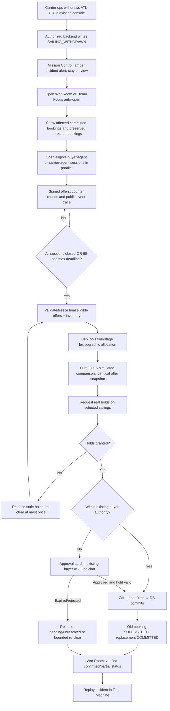
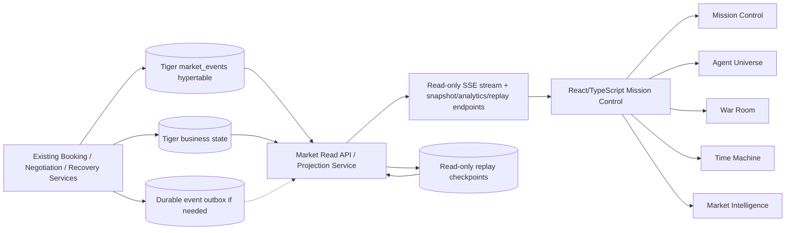
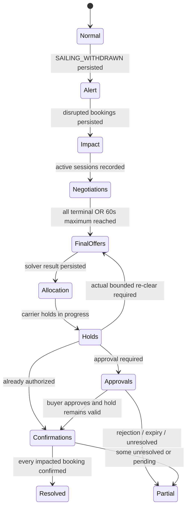

# HORMUZ EXCHANGE — Mission Control & Time Machine

**Full product, UX, visual design and engineering specification**  
**Document ID:** HX-OPS-001 · **Version:** 1.0 · **Date:** October 18, 2026  
**Status:** Approved design direction; implementation-ready proposal, subject to repository schema inspection  
**Primary audience:** Claude Code / React frontend engineers, backend engineers, designer, demo producer  
**Surface:** Exchange operator / judges, **read-only**  
**Companion source of truth:** `freight_spec_v2/PRD.md`, phases 01–05, `two-sided-freight-market.md`, `negotiation-transparency-asi-one.md`

> **Product vision:** A cinematic, technically truthful window into an autonomous freight marketplace. Agents negotiate the price. The Exchange decides the match. Nobody has to reveal their secrets. Every significant animation, chart, comparison, and replay frame is connected to an actual recorded event or verified state.
>
> **No Paper dependency.** Implement in the existing React/TypeScript stack. **No proper carrier-console redesign** is included in this specification; carrier operators use their separate console to authorize sailing withdrawal and manage policies. Buyers remain exclusively in ASI:One.
>
> **Precedence:** The newer two-sided-market design and the user's explicit changes supersede the original Part 1 PRD. In particular, *normal and recovery negotiations both allow up to two buyer counters per session*, recovery negotiations run concurrently with `recovery_negotiation_timeout_seconds = 60` (maximum, with early completion), and the recovery solver uses the agreed five-stage lexicographic objective. This dashboard never changes any of those rules. It **observes** the system; it does not become a second orchestration engine.

---

## 0. One-page implementation brief

### Five synchronized product views

| Navigation | Purpose | Signature visual / interaction |
|---|---|---|
| **01 — Mission Control** | At-a-glance market health, maritime routes, live operations, incident alerts | Elegant ocean map + real market counters + compact living agent network |
| **02 — Agent Universe** | Observe simultaneous buyer ↔ carrier negotiations and inspect price progression | Large animated directed network with **multiple packets visibly in flight at once** |
| **03 — Disruption War Room** | Follow a withdrawal from affected bookings to confirmed/partial recovery | Cinematic incident lifecycle; animated **slot allocations**; FCFS vs joint recovery |
| **04 — Time Machine** | Seek, pause, step, and replay a previously recorded run | **Historical reconstruction of the same market**, network, capacity, bookings, and outcomes |
| **05 — Market Intelligence** | Analyze negotiation benefit, capacity and recovery outcomes over time | Three cohesive questions and charts, with **click anomaly → replay that moment** |

A **shared Decision Inspector** opens as a right-side drawer on every page, not a sixth page. A discrete health menu links to Sentry. The vendor attribution is **only** a small `Powered by TigerData` footer and an optional *Data Provenance* inspector (no TigerData branding in page headings, giant cards, or tab labels).

### Non-negotiables

1. The operator/judge-facing surface is read-only: no `cancel`, `book`, `approve`, `retry`, `start negotiations`, `rerun optimizer`, or `pay` action on these pages.
2. A carrier cancellation is initiated through its **existing authenticated carrier console/API**. The War Room automatically reflects the resulting disruption events, but does not create them.
3. The UI **never** shows a recovery as confirmed until the carrier-confirmed replacement is committed. `PROPOSED`, `HELD`, `AWAITING_APPROVAL`, `CONFIRMED`, and `UNRESOLVED` are different states.
4. The graph may show *logical buyer-agent instances* as separate nodes, but these are isolated per-buyer states **inside one LangGraph runtime**, not falsely described as separately hosted Agentverse processes.
5. Carrier nodes represent the five independently identified carrier uAgents; their actual deployment/host status should be read from configuration or checks, not invented from Agentverse registration.
6. Agent-message packets represent **real persisted, validated event records**; no fictitious traffic, fake prices, fabricated solver progress, or made-up recovery rates.
7. Time Machine is **read-only historical playback**, never an invocation of agent APIs, payments, booking commands or solver mutations.
8. A real time-series data path is demonstrable: Tiger hypertables, `time_bucket`, an actual continuous aggregate with refresh policy, temporal snapshots/reconstruction, and reproducible query results.
9. Freight prices and inventories are **simulated**. Fleet position is a *simulated map visualization* unless an actual position feed has been integrated and clearly labeled.
10. Do not modify the working booking, payment, holds, recovery worker, solver, signed messaging, or buyer ASI:One experience just to animate the dashboard.

### Definition of a successful experience

The operator starts at Mission Control and sees an active market. When Atlas withdraws sailing ATL-101 through the carrier console, an amber alert appears while the operator's current context is preserved. The War Room shows exactly which bookings were disrupted; Agent Universe shows **parallel** buyer–carrier sessions with actual offers and counters; once sessions finish or the 60-second **maximum** passes, the optimizer's joint result and same-offer FCFS comparison appear. The interface then distinguishes holds, pending ASI:One approvals, confirmed replacements and unresolved bookings. Clicking *Replay incident* opens Time Machine and reconstructs all of this from stored history. Clicking an analytics anomaly seeks directly to its source moment. The operator can inspect evidence for every important claim.

---

## 1. Audience, navigation, mental model and UX principles

### 1.1 Who is this for?

- **Exchange platform operator:** understands current market status, watches reliability, investigates disruptions, and audits outcomes. In this version they cannot override agents or optimizer.
- **Hackathon judge:** opens the same read-only environment with intentionally legible explanations. No knowledge of ACP, LangGraph, OR-Tools or maritime jargon is assumed.
- **Demo presenter:** may enable a *Demo Focus Mode* which changes **view navigation/visual pacing only**, never backend decisions or data. It can auto-open the War Room on a new incident and spotlight key components.
- **Not for:** cargo buyer (ASI:One only) or carrier operations staff (separate carrier dashboard), even though safe cross-product status may be linked.

### 1.2 Global information architecture

```
┌────────────────────────────────────────────────────────────────────────────┐
│ HX logo / HORMUZ EXCHANGE   Market: SIMULATED · LIVE   health · time · user │
├──────────────┬─────────────────────────────────────────────┬───────────────┤
│ MISSION CTRL │                                             │ Context drawer│
│ AGENT UNIVERSE  Active view: map / network / war room /     │ Decision      │
│ WAR ROOM     │  replay / market insights                    │ Inspector     │
│ TIME MACHINE │                                             │ (collapsible) │
│ INTELLIGENCE │                                             │               │
├──────────────┴─────────────────────────────────────────────┴───────────────┤
│ Last confirmed event · stream health · optional Powered by TigerData      │
└────────────────────────────────────────────────────────────────────────────┘
```

Desktop layout target: **1600 × 900**. Adapt beautifully to **1920 × 1080 presentation** and **1440 × 900 laptop**. Navigation rail ~224 px expanded / ~72 px collapsed, global header 60–68 px; context inspector 320–400 px overlay or optional side column; content fills remainder. At widths below ~1200 px, collapse navigation, stack secondary panels and prioritize legibility. At mobile widths show a readable read-only timeline/metrics fallback; complex particle graph and map need not retain full desktop density. Do not introduce global horizontal scrolling.

### 1.3 Global navigation and status

- Left navigation has five items with consistent icon + label, current page indicator, optional red/amber count on **War Room only when an incident truly needs attention**.
- Header contains **Market LIVE** or **REPLAY** (never ambiguous), synthetic-market label, current data freshness (`Last event 2 s ago`), and one unobtrusive stream-health indicator.
- A global **Incident Beacon** appears after `SAILING_WITHDRAWN`: `Atlas ATL-101 · 3 affected · Recovery running` with `Open War Room` and `Dismiss`. Dismissing does **not** hide incident status from navigation.
- Global filters are constrained to things users can understand: corridor, carrier, booking/status, time range. Filters persist across related views but **must not silently alter Time Machine's chosen incident**.
- One persistent shared inspector opens on clicking an event, negotiation, offer, booking, assignment or chart point. Its breadcrumb preserves where the user came from.
- Use the **same IDs and colors** for a given entity everywhere; no different names for the same sailing between graph and map.

### 1.4 UX priorities

**Clarity first:** Always establish *what happened* before visualizing *who is negotiating*. State labels are plain language and technical details are progressive disclosure.  
**Quiet until important:** Idle market view should feel alive but calm. Escalation uses a measured amber treatment, not flashing strobes or auto-playing alarms.  
**Progressive disclosure:** A judge can understand the screen in 5 seconds, inspect a row in 15 seconds, and open evidence in 30 seconds.  
**Truthful actions:** No operator CTA should imply they can influence real booking outcomes from the dashboard.  
**Causal storytelling:** Disruption alert → impact assessment → negotiation → allocation → holds/approvals → confirmations → historical replay.

---

## 2. Visual design system — polished mission control, not generic cyberpunk

### 2.1 Aesthetic

**Mood:** premium naval operations room × financial market visualization × restrained sci-fi. Strong geometry, subtle luminous accents, negative space and painstaking typography. The visual identity should be sophisticated enough for a design competition but readable under a projector.

**Avoid:** noisy particle backgrounds, giant glowing boxes around every card, excessive gradients, glass cards with low contrast, neon everywhere, small grey-on-black paragraphs, jittery infinite animation, meaningless maps, and random numbers introduced for spectacle.

### 2.2 Tokens (starting design targets; adjust visually as a system)

| Token | Proposed value | Meaning |
|---|---|---|
| `--bg` | `#08121F` | Main deep-navy canvas |
| `--surface-1` | `#101E30` | Standard panels |
| `--surface-2` | `#17283E` | Elevated selection / hover |
| `--border` | `#28415A` | Fine dividers and graph outlines |
| `--text-primary` | `#F3F7FF` | Foreground headings / data |
| `--text-secondary` | `#A3B8CD` | Explanatory text |
| `--text-muted` | `#7B96AE` | Timestamps / decorative legends |
| `--agent-cyan` | `#43D9CB` | Healthy market + negotiation traffic |
| `--carrier-blue` | `#78AFFF` | Carrier identities |
| `--withdrawal-amber` | `#F5AE59` | Disruption / action needed |
| `--solver-violet` | `#B49AF0` | Solver and proposed allocations |
| `--confirmed-green` | `#54D69B` | Verified committed outcomes |
| `--danger` | `#F27676` | Failures/expired/irrecoverable |

Use semantic status tokens in components rather than raw per-view colors. WCAG-aware contrast overrides when needed. Amber means attention, not necessarily failure. Green must mean *actual confirmation*, not a provisional mathematical answer. Neutral blue denotes held / awaiting operations, with distinct text/iconography for color-blind accessibility.

### 2.3 Typography / structure

- Use one high-quality UI sans family already available or easily shipped (e.g. **Inter**, **Geist**, or current project font); optionally use a mono for timestamps, IDs and tabular digits.
- Strong page title (~24–30 px), section title (~16–18 px), metric (~28–40 px), normal labels (~13–15 px), dense metadata **never below 11–12 px** for important content.
- 8-pt spacing rhythm; panel padding ~16–24 px; corner radii 10–16 px, consistent 1-px borders.
- Large, quiet background map/graph area; analytical context around it, not a dashboard made exclusively of boxes.
- Icon set: one consistent system (Lucide React acceptable); never randomly mix emoji and outlined icons in the UI.
- Real numbers use tabular numerals, consistent precision and currency units; include `SIMULATED USD` for freight prices where necessary.

### 2.4 Motion language

| Interaction | Animation | Target duration (design guidance) |
|---|---|---|
| Enter view | Mild opacity + 8px upward ease; content stays stable | 180–280 ms |
| Hover/select | Hairline glow, color change, scale ≤1.02 | 120–180 ms |
| Agent processing | Gentle perimeter pulse **only while actual session active** | ~1.8–2.4 s cycle |
| Agent message | Small capsule/particle along actual source → recipient edge | ~650–1,100 ms visual duration |
| Quote revised | Discrete value transition + brief difference highlight | 250–500 ms |
| Disruption | Map sailing turns amber; localized ripple; incident banner slides in | ~350–650 ms |
| Clearing | Real solver start = violet emphasis; real result = final edges | ~250–750 ms |
| Capacity assignment | Container rectangles move to candidate destination after result event | ~650–1,000 ms |
| Held → confirmed | Border/fill transitions blue → green **only after commit** | ~200–350 ms |
| Replay seek | State redraw immediately, short crossfade; **no replay of all intermediate events on scrub** | ≤200 ms |

Use transform/opacity for most motion, SVG path/capsule for network effects, and virtualization/culling for long event lists. Honor `prefers-reduced-motion`: instantly update states with short opacity changes, no traveling packets. Animation time is presentational and **must not be represented as real agent processing latency**.

### 2.5 Subtle attribution

- Footer (small muted): `Powered by TigerData` optionally with technical-information popover.
- A developer-oriented **Data Provenance** drawer is accessible through ellipsis/help, **not** a persistent sponsor-heavy tab or screen.
- Five tab names are exactly the product names above; **never** call Screen 04 or 05 a “TigerData Lab.”

---

## 3. Screen 01 — Mission Control

### 3.1 Purpose

Answer in under five seconds: **Is the market healthy? What are the ships/agents doing? Is anything disrupted?** This is the first load, the top-level landing screen, and the demo's opening shot.

### 3.2 Layout (desktop)

1. **Upper KPI strip:** `Active carrier agents`, `Active sailings`, `Active negotiations`, `Confirmed bookings`, optional `Incidents requiring attention`. All values from verified state or events; no demo placeholders after wiring.
2. **Primary canvas (left ~60–65%):** simulated maritime map with actual seeded ports, route polylines, vessel/sailing markers. Active = thin cyan route, withdrawn = amber segmented path, superseded/archived = muted.
3. **Live market feed (right ~35–40%):** `time / actor / verb / entity` rows. Group redundant messages; pin important events. Color by semantic state.
4. **Bottom band:** compact Agent Universe preview on left (buyer nodes → carrier agents) plus short price/occupancy trend on right. Clicking preview opens full Agent Universe with filters preserved.
5. **Incident Beacon:** overlays only upon new, validated withdrawal. In normal mode a notification, not navigation takeover.

### 3.3 Map semantics and visual behavior

- Carriers own multiple vessels; vessels own multiple **sailings**. Map selections are tied to `sailing_id`, not the carrier alone.
- Tooltip: `Carrier · Vessel · Sailing · Corridor · Departure/arrival · 20GP capacity: committed / held / available · status`.
- A ship icon may be positioned on a **simulated itinerary**. Label the map or legend `Simulated vessel positions`—do not imply AIS or satellite tracking.
- Capacity visuals cannot show more free containers than Tiger's hold/commit ownership permits. Count `total`, `committed`, `held`, `available`, `withdrawn` explicitly rather than using a single ambiguous occupancy percentage.
- A map click opens the Decision Inspector in *sailing* mode and highlights correlated activity in the feed.
- On withdrawal, highlight **only** the affected sailing/route and its booking count. Do not mark an entire geographic region unsafe unless a separate validated risk event exists.

### 3.4 Activity feed rules

- Show recent business events including `NEGOTIATION_OPENED`, `OFFER_SENT`, `COUNTER_SENT`, `NEGOTIATION_CLOSED`, `SAILING_WITHDRAWN`, `CLEARING_DONE`, `HOLD_GRANTED`, `RECOVERY_APPROVAL_REQUESTED`, `BOOKING_COMMITTED`, `BOOKING_SUPERSEDED`, and completed/unresolved outcomes.
- Prefer plain language: `Buyer A countered Beacon`, `Cove granted hold`, `ATL-101 withdrawn`, not raw JSON field names.
- Each row has verified timestamp and source badge (`Carrier agent`, `Buyer agent`, `Exchange`, `Booking service`). Optional click → source session/incident/trace.
- Keep up to 50 recent rows in active viewport; older history paginated or virtualized. Autoscroll **only** if the user is already at top/bottom live boundary; show `12 new events` instead of stealing scroll position.
- When disconnected, show `Updates paused · reconnecting` and time of last verified event. Keep prior data visible with staleness indication.

### 3.5 Empty and degraded states

- No active negotiation → `No active negotiations; market ready` rather than fabricated dancing nodes.
- No actual vessel positions → use seeded simulated route anchors, clearly marked; never invent current coordinates.
- No historical data → offer live-only market preview and explain why trend view is empty.
- Partial backend outage → graceful shell/map with explicit stale data state; one agent failure is not necessarily a whole-market outage.

### 3.6 Acceptance criteria

- Loading page from fresh browser shows correct current counts from the backend and connects to the read-only event stream.
- Clicking an active sailing opens its current validated details.
- New withdrawal appears without page refresh; user stays on current page unless **Demo Focus Mode** explicitly enabled.
- Data labels distinguish simulation from actual protocol execution.

---

## 4. Screen 02 — Agent Universe

### 4.1 Purpose

The *signature* visualization: prove to judges that **real, independently addressed carrier agents exchange offers and counters with distinct logical buyer-agent instances concurrently**. Show strategy and timing without exposing secrets. This is not a generic “nodes moving randomly” screensaver.

### 4.2 Visual composition

- **Primary canvas (~70–75% width):** a force-like but **deterministically stabilized** graph. Buyer logical instances on left, carrier-company uAgent nodes on right, the Exchange as an independent referee node (or lower central band) involved in pairing and clearing, **not** a false intermediary for every direct buyer↔carrier negotiation message.
- **Top session bar:** active sessions / completed / rejected / expired, countdown to the recovery negotiation-session deadline when applicable, run kind `BOOKING` or `RECOVERY`, and optional incident selector.
- **Right negotiation stack:** selected session's precise chronological timeline, price ladder, latest offer, expiry, participant identities, verification and outcome. Clicking a path opens this.
- **Bottom mini-timeline:** individual concurrent sessions represented as horizontal lanes, with small actual send/receive/close markers, so parallelism is visually obvious even when the network gets busy.

### 4.3 Entities and topology

- **Buyer node** = one logical buyer's isolated strategy/state. Label `Buyer A agent`, `Buyer B agent`, etc. A tooltip says `Logical agent instance · shared LangGraph runtime`, if needed for accuracy.
- **Carrier node** = `Atlas`, `Beacon`, `Cove`, `Meridian`, `Dhow`, each with independent public address and distinct private policy. Display masked agent address and signed-reply verification where known; do not assert physical isolation or hosted status.
- **Exchange node** = session pairing / offer validation / OR-Tools clearing component, not a seller or a carrier agent. Show its activity only on `NEGOTIATION_OPENED`, `CLEARING_STARTED`/`CLEARING_DONE`, claim-check and hold events that actually exist.
- Connections exist only for sessions actually opened by `pair_candidates` / `open_negotiation`; no arbitrary complete bipartite web.
- View colors: buyer accent per buyer (color + pattern/label), carrier consistent blue, message type cyan/amber/violet; use distinct glyphs and text, not colors alone.

### 4.4 Packet animation and concurrency

- On `OFFER_SENT`, draw one luminous carrier → buyer packet along **that actual session's edge**.
- On `COUNTER_SENT`, draw buyer → carrier packet in the opposite direction.
- On accept/reject/expiry, change the corresponding session edge status. Price changes only on persisted validated terms.
- **Do not invent send/receive times or transmission duration.** Packet travel duration is a visualization convention. A packet appears only after its corresponding recorded event is available.
- If messages from Atlas, Beacon and Cove occur close together, animate all three packets **simultaneously**, with overlap and independent paths. Do not serialize interactions just to make a neat animation.
- On recovery, three stranded buyers may open multiple concurrent carrier sessions. Show buyer-specific lanes and bundle/curve edges to avoid tangles. Allow filters `All buyers`, `Buyer A`, `Buyer B`, `Buyer C`, `Carrier`, `Session state`.
- Collapse excess traffic into a visible `+N events` cluster when frame or density budgets are reached, but keep complete evidence in the session transcript.
- Offer price bubbles briefly display **real** `opening → counter → finalized` transitions. Labels say `Proposed` for unaccepted counters. No “savings” claim unless compared to the same carrier's own comparable opening offer.

### 4.5 Negotiation session detail

A session selection shows:

| Field | Meaning |
|---|---|
| Session | Stable session ID, run kind, elapsed wall time |
| Participants | Logical buyer instance, registered carrier agent identity |
| Eligibility | Actual pairing reason: corridor, capacity, arrival deadline, allowed cargo class |
| Opening offer | Simulated freight amount, quantity, sailing, expiry |
| Counter #1 / #2 | Proposed amount, who sent it, round, result |
| Carrier replies | Accepted / revised / rejected, with actual recorded amount |
| Final offer | Validated amount or `No final eligible offer` |
| Outcome | `ACCEPTED`, `REJECTED`, `EXHAUSTED`, `EXPIRED` / equivalent actual status |
| Evidence | Sanitized event IDs, verified sender where available |

**Never show:** buyer private reserve/max price, must-deliver if confidential, carrier private floor, exact policy coefficients, other buyers' hidden constraints. Safe rationale may say `Competitor comparison` or `Utilization-sensitive concession` only if the rules really emitted that evidence. Do not claim to know a carrier's secret floor from a refusal.

### 4.6 Running state and negotiation deadline

- Normal booking: show session lifecycle without claiming a universal 60-second deadline unless current booking config actually imposes one.
- Recovery: `recovery_negotiation_timeout_seconds = 60` is **maximum from session opening to the negotiation gate**, **not** a forced wait. If all sessions terminal sooner, graph transitions to clearing instantly upon actual event.
- If one carrier times out, its edge turns amber/neutral `Timed out`; the system proceeds with valid final offers when the deadline closes.
- Closing the sessions does not itself allocate or book freight. The graph shifts from edge activity to Exchange `Validating / Solving` state only when backend emits supporting events.

### 4.7 Graph controls

Zoom, pan, `Fit all`, `Focus selected`, pause **visual animation only**, and `Show session lanes`. Pausing visual motion never pauses the real backend. Keyboard navigation lists all nodes/sessions for non-graph access. A `Jump to War Room` control appears for incident-scoped sessions.

### 4.8 Acceptance criteria

- At least three valid, overlapping negotiations can be shown from actual persisted events, in simultaneous animation; a real-event list provides independent proof.
- All shown edges trace to persisted `negotiation_sessions`.
- Price labels and outcomes match stored validated messages; secrets are absent.
- Recovery timeout and early-finish cases are represented faithfully.
- The graph works with reduce-motion, screen resizing and event bursts.

---
## 5. Screen 03 — Disruption War Room

### 5.1 Purpose

When a carrier withdraws a sailing, give the operator an understandable, dramatic yet completely honest view of **how the Exchange converts a multi-buyer crisis into governed replacement commitments**. This is the product's main innovation demonstration, not a manual dispatch console.

### 5.2 Entry / activation behavior

**Event trigger:** an authenticated carrier operator cancels or withdraws a precise sailing through the **existing carrier console/API**, causing the backend to record a valid `SAILING_WITHDRAWN` event and affected bookings. A risk alert alone must not be mistaken for carrier-authorized withdrawal.

- **Normal UX:** global amber Incident Beacon slides in without hijacking the open view. Click `Inspect disruption` to open War Room and focus the incident. Persistent incident count updates in navigation.
- **Demo Focus Mode (presenter enabled):** on a **new confirmed withdrawal event**, auto-navigate to the War Room after a brief, optional 500-ms highlight of the affected sailing on Mission Control. This changes visual navigation only; no additional withdrawal or recovery command is sent.
- **Direct deep link:** `/war-room/:recoveryId` opens and hydrates at any stage; if event history already complete, show actual current terminal state, **not** fake replay of an ongoing incident. `Replay incident` opens Time Machine for the dramatic historical sequence.
- **Multiple incidents:** list by actual recorded status/recency. Do not mix affected bookings or bids from different `recovery_id`s.

### 5.3 War Room layout

```
┌──────────────────────────────────────────────────────────────────────────────┐
│ Disruption: Atlas ATL-101          RUNNING / PARTIAL / RESOLVED   [Replay]  │
│ Withdrawn at 09:42:12 · affected 3 · still valid 12 unaffected bookings    │
├───────────────────────────────┬──────────────────────────────────────────────┤
│ SEA + CAPACITY                │ RECOVERY TIMELINE                            │
│ Withdrawn sailing amber      │ 1. Withdrawn & assessed                     │
│ Valid alternatives cyan      │ 2. Negotiations in parallel                  │
│ Slot tiles per sailing       │ 3. Offers checked & jointly cleared          │
│ Buyer→replacement arcs       │ 4. Holds / approvals / confirmation          │
├───────────────────────────────┴──────────────────────────────────────────────┤
│ AFFECTED BUYERS (A/B/C)      SOLVER COMPARISON (FCFS vs optimized)          │
│ Quantity · deadline · state  Proposed ≠ held ≠ confirmed                    │
├──────────────────────────────────────────────────────────────────────────────┤
│ Agent progress · audit events · exception / pending-approval details       │
└──────────────────────────────────────────────────────────────────────────────┘
```

The layout should transition from calm deep navy/cyan into **localized amber**. Keep main app navigation, visible source-of-truth timestamps and context drawer. The top priority is the incident's actual `current_status`, not a visually attractive fabricated “recovered” banner.

### 5.4 Exact incident state machine and presentation

The UI derives its state from recorded workflow events/business state. It may display multiple active substeps simultaneously, but may not advance a step without evidence.

| Stage | Entry evidence | Visible design | User understands |
|---|---|---|---|
| `IDLE` | No active withdrawal | Normal market; no active incident | Nothing is wrong |
| `WITHDRAWN` | Verified `SAILING_WITHDRAWN` | Atl-101 turns amber; incident header appears | A specific sailing became unavailable |
| `IMPACT_ASSESSED` | Affected booking set persisted | Three booking cards lift out of Atlas; unaffected bookings remain pinned | Who was displaced and what was preserved |
| `SESSIONS_OPEN` | Per-buyer/carrier `NEGOTIATION_OPENED` | Multiple real links illuminate, lanes count up | Agents have begun exploring alternatives |
| `NEGOTIATING` | Signed offers/counters accepted into session log | Bid packets, price revisions, timer (maximum 60 seconds) | Private negotiations occur in parallel |
| `OFFERS_FINALIZED` | All sessions terminal or deadline closes; signed final offer set frozen/validated | Final proposals settle; invalid/late claims visibly excluded | These are eligible **proposals**, not holds |
| `CLEARING` | Solver execution start, if recorded | Subtle violet Exchange emphasis; five objective labels, no fake bar | Exchange is calculating a joint assignment |
| `ALLOCATION_PROPOSED` | `CLEARING_DONE` with actual assignments | Container tiles animate to candidate sailings in **violet/outlined** state; FCFS baseline appears | An allocation was found, not yet confirmed |
| `HOLDING` | Hold requests/grants and failures | Selected candidate slots turn **blue/held**, failed tiles release/return | Capacity is temporarily reserved |
| `AWAITING_APPROVAL` | Approval store and push action recorded | Explicit amber buyer card + `Awaiting buyer in ASI:One`; approval expiry if known | Human consent is still needed |
| `CONFIRMING` | Carrier confirm requests, actual acknowledgments | Held tiles gain confirming halo; stay non-green until commit | Carrier commitment is being finalized |
| `CONFIRMED` | Replacement booking COMMITTED and old booking SUPERSEDED | Per-booking tiles turn **green** and route line locks | That buyer is actually recovered |
| `PARTIAL` | Some confirmed and some unresolved/pending at outcome boundary | Segmented status: `2 confirmed · 1 unresolved` | Not all buyers were recovered |
| `UNRESOLVED` | Valid terminal failure or expired authorization | Grey/red unresolved card with grounded reason | No replacement could be committed |
| `RESOLVED` | All affected bookings terminal and confirmed | Calm-green closure panel; incident timeline retained | Incident is complete, with proof |

**Rules:** `CONFIRMED` is an individual booking state; `RESOLVED` is an incident-level aggregate state. If an approval remains pending, the incident must not be labeled fully resolved. If a solver finds three feasible assignments and only two are confirmed, the primary success KPI is **2 confirmed / 3 impacted**, never 3/3. Support status transitions repeated, delayed, out-of-order and partially overlapping across bookings.

### 5.5 Withdrawal impact animation

1. Exactly the withdrawn sailing marker animates amber, with `Carrier-authorized withdrawal`, not `piracy detected` or an invented cause.
2. The affected booking cards previously attached to this sailing detach and float into a **Stranded** rail; each card shows `Buyer A / 2 × 20GP / deadline / previous sailing`.
3. Unrelated booking cards remain fixed and optionally outlined with `Unaffected commitments preserved` and a verified count. Do not include private buyer constraints.
4. The alternative carrier sailings brighten if they match the corridor; display `capacity available` based on valid Tiger state, not carrier claims.
5. Optional sound off by default; never strobe or obscure data.

### 5.6 Parallel recovery negotiations

- Active session count is computed from actual `negotiation_sessions`, not pre-seeded to “8”.
- Buyer nodes A, B, C can negotiate with eligible Atlas alternatives / Beacon / Cove / Meridian / Dhow concurrently according to pairing policy. The withdrawn sailing itself cannot offer inventory.
- One shared **recovery negotiation-session deadline** reaches at most **60 seconds** from the persisted recovery-open timestamp; when every session closes earlier, the UI immediately transitions to validation/clearing.
- A visibly expired session is distinguished from a carrier rejection; timeout messages are never silently treated as valid offers.
- The top strip shows `9 sessions opened · 6 finalized · 2 rejected · 1 timed out` only if those totals reconcile to source rows.
- `Inspect negotiations` opens the Agent Universe already filtered to this `recovery_id` and preserves incident context for the return navigation.
- Make signed-message evidence available in the inspector, but don't claim all logical buyer agents are separately hosted on Agentverse.

### 5.7 Solver moment — dramatic but honest

Once the final offer set is frozen, transition from moving packets to deliberate, structured visualization:

1. **Evidence gate**: display `N finalized offers · M eligibility checks passed · K rejected` with safe reasons (expired, capacity overclaimed, wrong lane, invalid signature, price/constraint mismatch).
2. **Solver run**: show `Computing joint allocation` only while backend solver is actually running. If instrumentation only emits a completion event, skip fake spinner and reveal directly after completion.
3. **Five-stage priority ribbon** (fixed team design):
   - Maximize recovered **must-deliver** bookings.
   - Maximize **total whole** recovered bookings.
   - Minimize required buyer approvals.
   - Minimize incremental simulated freight cost.
   - Prefer earlier arrival.
4. Display actual stage outputs if the solver persisted them. If not available, show the **priority policy** and final result only. Do not invent intermediate solutions or animated percentages.
5. Animate up to one container tile per demo 20GP slot moving into selected sailing lanes, **outlined violet** for provisional allocation. When a booking cannot split, its tiles move together; `allow_split=true` only when backend actually assigned split-compatible parts.
6. Side-by-side **FCFS baseline vs Joint Optimization** cards. The FCFS outcome must be a deterministic **counterfactual** on the same finalized offers and capacity snapshot; label `SIMULATED BASELINE (NOT EXECUTED)` clearly. Compare proposed feasible recoveries against proposed feasible recoveries, not FCFS proposals against confirmed optimizer bookings. Use a separate actual confirmed count below.
7. The explanation line should read, e.g., `Assigning Buyer A to Cove preserved Beacon's early-arrival slots for Buyers B and C`, **only if the solver evidence/constraints support that explanation**.

**Worked fixture (illustrative, source design):** Buyer A (2 slots, later deadline) can use Cove; Buyers B/C (1 slot each, earlier deadline) require Beacon; Beacon 2 slots / Cove 2 slots. Naive posting-order assignment can recover only 1/3, joint allocation 3/3—**if** all actual final negotiated offers meet price and buyer constraints. Recompute both, never hardcode the numbers.

### 5.8 Holds, approvals, confirmation and partial failures

- The selected slate undergoes actual carrier-owned holds in deterministic order. Render each hold separately with hold expiry; granted hold ≠ completed booking.
- If a hold fails, show `Hold rejected · refresh/re-clear`, faded prior candidate tiles and the **actual bounded second-clear attempt**, no invented retries beyond `recovery_clears_max = 2`.
- If an assignment exceeds the buyer's existing recovery authority, the corresponding card displays `Approval required in ASI:One` with remaining validity. War Room never offers an approval button.
- For a real demo, one buyer can require approval while others auto-confirm. Show how the pending card on ASI:One changes to approved, and only afterward does that buyer's War Room tile become confirmed. **Do not assume an approval's 30-minute window means a hold lasts 30 minutes**; if hold expires, accurately show revalidation/failure.
- On actual carrier confirmation + Tiger commit, highlight the replacement `COMMITTED` and old `SUPERSEDED` relationship; visual arrow shows continuity, never deletion of originals.
- When one remains unresolved, present why: `No eligible replacement`, `Approval expired`, `Hold unavailable`, `Deadline not met` or an actual recorded reason. Never declare success on intent.

### 5.9 War Room decision inspector examples

- Click **withdrawn sailing** → carrier authority, source event ID, original capacity, affected commitment IDs, time.
- Click **edge** → eligible session participants, signed public messages, counter rounds, closed state.
- Click **candidate** → final offer ID, capacity claim, claim check, last-known expiry.
- Click **allocation** → solver run/offer snapshot, five-stage objective, FCFS comparison, hard constraints, reason.
- Click **held slot** → hold ID/time/TTL and not-yet-booked banner.
- Click **confirmed replacement** → new booking ID and superseded original; exact recorded confirm and commit events.

### 5.10 Acceptance criteria

- Carrier-only withdrawal enters War Room automatically by event; navigating there does not trigger recovery again.
- A 3-buyer scenario displays correct statuses through two simultaneous negotiated sessions (preferably more), solver, holds, approvals, carrier confirms.
- One missing/expired carrier response doesn't freeze the UI or cause fabricated offer animations.
- A partial result **never** produces an all-green celebration or `3/3 recovered` headline.
- Solver comparison uses identical frozen offer/capacity input and is explicitly labeled counterfactual.
- Full event evidence trace exists for every major visual transition.

---

## 6. Screen 04 — Time Machine

### 6.1 Vision

**Flagship feature.** The operator can select an incident or market time range, rewind to a point in the past, and watch the **same ships, network, negotiation events, capacity tiles, bookings and confirmations** evolve in a coherent, read-only historical reconstruction. This is not a 60-second scripted movie or a handful of mock KPI slides.

### 6.2 Entrance and global state

- Entry from main nav defaults to latest replayable incident, if any; otherwise an incident/run selector and empty historical market view.
- Deep links `Replay this incident`, `Inspect at this time`, and `Jump from chart` set incident/time and screen focus.
- **Persistent upper banner:** `REPLAY MODE · Historical state as of 09:42:16 UTC · No live actions`. All live alerts are muted within the replay canvas; a small separate current-live notification counter can remain visible, never contaminate historical state.
- `Back to Live` returns to the currently subscribed live snapshot and resumes event stream. Do not try to “catch up” by replaying every queued visual packet.
- Time Machine uses the **same visual components** for ships, agent graph, capacities and booking state as Mission Control/War Room, but all receive a **virtual-clock projected state** instead of real-time store.

### 6.3 Main layout

- **Top:** incident title + historical mode + absolute wall-clock timestamp + simulated market badge.
- **Center:** choose synchronized `Map`, `Agent Network`, `Capacity Allocation`, or `Split View` (map + graph). Changes do not reset the virtual clock.
- **Right:** contextual event list/Decision Inspector scoped to the selected timestamp; future events are hidden until playback reaches them.
- **Bottom full-width:** large timeline with colored event markers and phase bands: market → withdrawal → negotiations → clearing → holds/approvals → confirmations.
- **Playback controls:** `Play/Pause`, `Restart`, `Previous event`, `Next event`, speeds `0.5× / 1× / 2× / 4×`, scrub slider, jump to `Withdrawal`, `First counter`, `Clear`, `First hold`, `Final confirmation` when events exist.
- **Annotations:** hovering over markers reveals exact event time, actor, event type and sanitized summary. Click opens Decision Inspector.

### 6.4 Critical behavioral distinction: replay is not simulation

- **Replay** = read historical snapshots/events and render what genuinely happened. Never call `open_negotiation`, payments, wallet requests, solver, holds, withdrawal, carrier confirm, or live approvals.
- **Demo fixture** = seeded market and recorded execution. When demo data is simulated, label *market data simulated*, but do not pretend the protocol and optimizer execution was a mere animation.
- **Scenario preview** if event history is incomplete = separate explicitly labeled `ILLUSTRATIVE PREVIEW`, disabled by default and **not** accepted as a Time Machine completion criterion.
- If a future event has not yet happened at virtual time `T`, it must not appear as known information at `T`. The UI may label a *planned sailing schedule* where it existed historically, but must not reveal later carrier offers or the solver result.

### 6.5 Replay source-of-truth design (append-only events + checkpoints)

The current Tiger `market_events` hypertable is an essential building block, **but it may not by itself contain enough information to reconstruct all historical inventory and booking statuses**. Do not silently assume full event-sourcing coverage.

Use a minimal **projection/checkpoint approach**:

1. When a reproducible demo run begins, capture a market checkpoint with all public replayable state: active sailings, vessel→sailing identifiers, corridor geometry/seeded position, total/committed/held/available slots, visible booking statuses and logical buyer/carrier identities. Persist checkpoint timestamp and event cursor.
2. For important transitions after that, persist a schema-validated **sanitized market event** carrying enough before/after or new-state identifiers to deterministically update the replay projection. The underlying business tables remain authoritative and transactional.
3. Optionally persist additional `market_state_checkpoints` periodically (e.g. per incident or ~60 seconds) for fast seeks; reference the latest checkpoint ≤ requested time.
4. On historical seek `T`, load latest checkpoint `C ≤ T`, then fold **ordered** events in `(C, T]` over it. Render the derived projection immediately.
5. Cross-check reconstructed **terminal state** against current `bookings`, `booking_slots`, `holds` and `sailings`; flag mismatches before demo rather than silently correcting them on screen.
6. A projection is invalid if it lacks the necessary initial snapshot, loses events, has unsupported schema version, or encounters an impossible state transition. Show `Historical state incomplete` with last verified point rather than synthesizing missing transitions.

**Ordering:** use `occurred_at` (business effective timestamp) plus documented stable causal sequence/per-entity revision and event ID for deterministic ties; include `recorded_at` (when database wrote the record). An ordinary PostgreSQL sequence by itself does not necessarily imply cross-transaction **commit order**. For live stream/resume, use a reliable event-journal cursor or durable outbox ID and reconcile from the database. Late/backfilled events require explicit revision/reprojection, not silent temporal leakage.

### 6.6 Replay engine contract

Suggested functions (names adaptable):

```ts
type ReplayQuery = {
  incidentId?: string;
  rangeStart: string; // UTC ISO timestamp
  rangeEnd: string;
  seekAt: string;
};

type ReplayBundle = {
  checkpoint: MarketProjection;
  events: PublicMarketEvent[]; // typed, ordered, complete through watermark
  coverage: { start: string; end: string; complete: boolean; reason?: string };
  cursor: string;
  schemaVersion: number;
};

function projectAt(bundle: ReplayBundle, atUtc: string): MarketProjection;
function nextEventAfter(bundle: ReplayBundle, atUtc: string): PublicMarketEvent | null;
function previousEventBefore(bundle: ReplayBundle, atUtc: string): PublicMarketEvent | null;
```

Key properties: pure deterministic reducer; no external effects; identical input yields identical graph, metrics, allocation and active-state badges. Seeking backward and forward repeatedly produces the same results without cumulative errors. Interleaved parallel events are ordered deterministically but rendered visually as concurrent where their timestamps overlap.

### 6.7 Playback interactions

- Playback visual clock tracks **business timestamps**, not a pretend timeline compressed into evenly spaced scripted phases. For long gaps (e.g. approval takes 20 min), provide `Skip idle periods` option **explicitly marked as playback compression**; preserve absolute timestamps and event order.
- Scrubbing seeks directly: never play 300 packet animations to reach a new virtual timestamp. Rebuild state via checkpoint + event fold, then brief crossfade.
- During continuous play, animate real event steps as virtual time crosses their timestamps. At 4× speed, animation durations may compress or simplify to avoid stacking queues.
- On reaching incident end, offer `Replay again`, `Return to live`, `Inspect solver decision`.
- Unresolved incidents can be replayed only through the last persisted event, and clearly say `Replay available through HH:MM:SS — later events not yet recorded`.

### 6.8 Read-only safety

- Time Machine APIs accept **only** GET/read-only requests. Viewer UI never includes operational commands.
- A click on historical quote, booking or approval is *inspect*, not *select*, *pay*, or *approve*.
- Backend endpoints should be role-scoped, sanitized and rate-limited; never embed private buyer maximum budgets, carrier floors or payment details into a full-history bundle.
- Browsing history cannot extend deadlines, resurrect expired holds or change live session state.

### 6.9 Acceptance criteria

- A real test run can be replayed from the checkpoint before cancellation through final state, showing a withdrawal, **overlapping** negotiations, solver result, holds, approvals and confirmed/unresolved bookings in proper time order.
- Seek before quote creation → quote invisible. Seek before confirmation → booking **not** green/confirmed. Seek after commit → current historical commitment matches Tiger.
- Scrub backwards, switch Map↔Graph, scrub forward: projection stays internally consistent.
- Playback and refresh do not generate any new backend business events, agent messages or payment records.
- Missing/partial history is surfaced honestly; no magical future knowledge.

---

## 7. Screen 05 — Market Intelligence

### 7.1 Purpose

Answer **three operator questions** with analytically credible, visually beautiful, explorable time-series data. This page is not an arbitrary array of analytics cards or an advertisement for the database vendor.

### 7.2 Section A — Are the agents creating better deals?

**Primary visualization:** freight opening-versus-final quote trend by corridor; two lines with confidence about sample size, with offer amount normalized only across comparable unit/cargo classes.

Supporting metrics:
- Session count, negotiated final-offer rate, acceptance/rejection/timeout proportions.
- Median quote reduction against **the same carrier's own opening quote**, only for comparable currency/sailing/quantity/terms.
- Median negotiation duration from actual session timestamps.
- Filters: time range, corridor, carrier, normal vs recovery, result status.

**Avoid false claims:** Do not call carrier-opening-to-final difference `market savings` or compare quotes for differing container counts as if equivalent. Distinguish `no counter offered` from `rejected` and `timed out`. If sample size is one, mark `1 observed session`, not a market trend.

### 7.3 Section B — Is capacity being utilized well?

**Primary visualization:** capacity/occupancy area or line chart by time and selected corridor/carrier. Use actual capacity snapshots or replayable events of **committed, held, free and withdrawn** slots.

- Separate committed capacity from provisional holds; a high hold count is **not** booked utilization.
- A withdrawn sailing changes **available market capacity** and may create stranded commitments; show causality markers on the time axis.
- Optional secondary heatmap: corridor × time bucket availability, clearly synthetic for seeded demo.
- Clicking a sudden capacity drop opens **Time Machine at the actual withdrawal timestamp** with the corresponding sailing selected.

### 7.4 Section C — How effectively are disruptions resolved?

**Primary visualization:** recoveries over time; display `confirmed / impacted`, with `pending` and `unresolved` explicitly separated.

- Show median observed time from recorded withdrawal to completed **confirmed** recovery, for completed instances only; distinguish unresolved incidents.
- Show must-deliver and total-booking recovery counts if permitted for the operator view, aggregate rather than exposing private per-buyer flags.
- Show **same-input FCFS baseline vs joint optimizer** as a separately labeled counterfactual per incident. Do not aggregate counterfactuals with real transactions without stating the methodology.
- Clicking a bar for an incident opens its War Room at current state or Time Machine at a selected historical event.

### 7.5 Page composition

- **Header:** `Market Intelligence`, description `How negotiations and recovery change the market over time`, global date selector and corridor filter.
- **Three titled analysis chapters**, each with one large signature chart plus at most 2–4 relevant KPI chips and a concise bottom insight line grounded in real query results.
- **Chart hover:** exact timestamp/bucket, source value, count/sample size, source type (`observed`, `estimated from snapshots`, `simulated baseline`).
- **Chart click:** `Inspect this moment` → Time Machine; hover/click event markers → Decision Inspector.
- **Empty states:** no raw data, no comparable prices, incomplete checkpoint history, or aggregate not yet refreshed are explicit messages, **not zeroes**.
- **Unobtrusive provenance:** small footer `Powered by TigerData` and optional `Data Provenance` panel reachable via header ellipsis.

### 7.6 Provenance panel (for technical judges only; not intrusive)

A right drawer can show:
- Source dataset names, e.g. `market_events` hypertable, `market_snapshots` hypertable (if provisioned), `negotiation_sessions`, `bookings`.
- Selected chart's **actual prepared SQL template or query identifier**, `time_bucket` grain, applied filters, number of raw events/buckets and exact as-of/refresh timestamp.
- Name of the actual continuous aggregate used and last known refresh watermark / lag where discoverable.
- `View underlying events` opens safe, paginated read-only data for the selected bucket. No buyer secret budgets/carrier price floors.
- A field indicating whether the value came from **raw events**, **materialized bucket rollup**, **raw recent-tail combination**, or **state reconstruction**.

This is how to substantiate a time-series track without turning the UI into an infrastructure marketing page.

### 7.7 Acceptance criteria

- All three major charts use actual backend queries over real test-run data, no hardcoded arrays after fixture import.
- At least one chart genuinely queries `time_bucket`, at least one backed metric uses an actual continuous aggregate with a refresh policy, and there is proof via SQL/query logs/metadata.
- Clicking a withdrawal-related anomaly opens the correct historical state in Time Machine.
- Price normalization and confirmed-recovery definitions match backend truth, including edge cases.

---

## 8. Shared Decision Inspector (cross-view component)

This is the **sixth capability but not a sixth page**. Clicking any meaningful object opens a slide-in evidence drawer, preserving the current visual context.

**Header:** object title + semantic status + as-of timestamp + linkable ID.  
**What happened:** one plain-English sentence based on an actual event.  
**Why:** deterministic eligibility/ranking/solver explanation when recorded; if unavailable say `Reason not recorded`, not an invented LLM story.  
**Evidence:** event chronology with IDs, validated public offer terms, signer identity/verification when relevant, solver run/hold/approval/booking IDs.  
**Navigation:** `See negotiation`, `Open War Room`, `Rewind to event`, `Inspect sailing`, `View Sentry trace` (only if trace exists and viewer is authorized).  
**Privacy:** do not expose hidden buyer max budgets, seller floors, payment wallet secrets, individual other-buyer hidden settings or raw sensitive error metadata.

**Examples:**

- **Agent message:** `Buyer A countered Cove at $5,300 simulated USD`; round 1, session ID, signed/validated status; no inferred motives.
- **Solver choice:** `Cove could take A's two containers by its later deadline; Beacon's limited early slots were required by B/C. This satisfied 3 whole bookings vs a 1-booking posting-order baseline.` Show only if actual snapshot makes statement true.
- **Pending approval:** `Replacement candidate exceeds this buyer's preauthorized adjustment. Waiting for approval in their existing ASI:One chat.` Do not reveal the buyer's secret threshold.
- **Confirmed booking:** `Hold H-… confirmed by carrier; replacement BK-… committed, original BK-… superseded.`

---

## 9. End-to-end operator journey — expected product behavior

### 9.1 Standard booking (non-disruption)

1. Operator opens Mission Control; real market counters/map and latest event list hydrate.
2. Buyer starts a cargo request in **ASI:One**, not in Mission Control. Buyer gateway receives native form submission and invokes existing LangGraph logic.
3. Backend pairs the request with eligible carrier uAgents. Session-open events appear; Agent Universe shows the logical buyer instance with **only actual** opened edges.
4. Carrier agents quote; buyer strategy counters (up to two times, when warranted), carrier replies; packet animations overlap where wall-clock activities do.
5. Session timelines show finalized offers. Buyer sees ASI:One offer carousel with their own optional negotiation detail; operator sees sanitized market activity, **not private buyer agent state**.
6. Buyer selects, carrier holds, verified Fetch Payment Protocol fee is completed, carrier confirms; Mission Control booking count and capacity update after the business commit.
7. A completed transaction can be inspected and rewound in Time Machine if coverage exists.

### 9.2 Disruption (user-approved full experience)



**Important concurrency nuance:** Steps like holds and approvals can progress independently per booking. The UI must represent partial states simultaneously (e.g. A confirmed, B confirmed, C awaiting approval). The global incident “stage ribbon” is a summary, **not** a serial barrier that delays valid confirmations for other buyers.

### 9.3 Replay-to-investigation journey

1. On resolved incident, click `Replay incident`.
2. Time Machine loads verified checkpoint and event range, shows `REPLAY MODE`.
3. Click `Restart` and `Play 4×` to see Atlas as active before withdrawal, then withdrawal, parallel messages, clearance, held capacity, approvals and actual confirmations.
4. Scrub backward to just before the solver result: no future allocation or green bookings visible.
5. Click a negotiation edge → inspector shows precise offer trace. Click a hold → only held, not confirmed.
6. Go to Market Intelligence; click the capacity-drop annotation → seek back to this exact withdrawal event, with selected sailing retained.
7. Click `Back to Live` → fresh state hydration + live event subscription, never replay-side business mutations.

---
## 10. Backend and frontend architecture — observer, not orchestrator

### 10.1 Existing system (do not replace)

```
Buyer in ASI:One
   ↕
Buyer Gateway uAgent — Chat + Interactive Cards + Fetch Payment Protocol
   ↕
Existing LangGraph buyer strategy and normal BookingGraph
   ↔ separately addressed carrier uAgents (Atlas, Beacon, Cove, Meridian, Dhow)
   ↕
Existing Tiger business tables, holds, payments, booking ledger

Carrier ops console — authorized withdrawal
   ↓
Existing asynchronous recovery worker
   ↔ signed buyer/carrier negotiation sessions
   ↓
Existing OR-Tools solver + same-offer FCFS shadow calculation
   ↓
Holds → ASI:One buyer approval if needed → carrier confirmation → Tiger commit
```

### 10.2 New read-only presentation system



**Important:** this is an **observer read model**. It must not hold business locks for UI, alter inventory, use the browser to send agent messages, or add a second source of market truth.

### 10.3 Recommended implementation tools

| Layer | Default choice | Rationale / caveat |
|---|---|---|
| Frontend | Existing **React + TypeScript + Vite/Tailwind** where available | Reuse app, routing and design tokens; don't replace repo setup |
| Network canvas | **React Flow** or custom SVG if graph is small/fixed | Zoom/selection/accessibility; choose ONE graph renderer, not both in conflict |
| Motion | **Motion for React** (`motion`) | GPU-friendly state transitions, SVG paths, numeric updates |
| Maritime map | **MapLibre GL JS** with light-weight basemap | Render geo corridors/seeded positions; respect map attribution and token/licensing rules |
| Charts | **Recharts** if project already uses it | Responsive price/capacity/recovery charts; custom overlays for incidents |
| Server | Existing FastAPI/Node service, adding **read-only** ops routes | No new orchestration process if existing backend can serve it |
| Push | **Server-Sent Events (SSE)** first | All operator dashboard traffic is server → browser; simpler than bidirectional WebSockets |
| Persistence | Existing Tiger PostgreSQL/TimescaleDB | Business ledger + time-series hypertables + read-side projections |
| Observability | Optional Sentry SDK in app/backend | Error/latency/trace links; not a user-facing central brand element |

**SSE versus WebSocket:** Because operators never send actions to agents from this surface, SSE is sufficient and simpler. If the existing app has a reliable WebSocket event bus, reuse that instead of creating another transport. Either must implement catch-up/reconnect.

### 10.4 Component tree (proposed names)

```text
src/features/exchange/
  app/
    ExchangeLayout.tsx
    ExchangeNavigation.tsx
    GlobalMarketHeader.tsx
    IncidentBeacon.tsx
    LiveReplayBadge.tsx
    DataFreshnessIndicator.tsx
  pages/
    MissionControlPage.tsx
    AgentUniversePage.tsx
    DisruptionWarRoomPage.tsx
    TimeMachinePage.tsx
    MarketIntelligencePage.tsx
  components/
    MaritimeMarketMap.tsx
    SailingCapacityStrip.tsx
    AgentNetworkCanvas.tsx
    AgentNode.tsx
    MessagePacketLayer.tsx
    SessionLanes.tsx
    NegotiationTimeline.tsx
    IncidentLifecycleRibbon.tsx
    DisplacedBookingCard.tsx
    CapacityAllocationBoard.tsx
    FcfsVsJointComparison.tsx
    ReplayTimeline.tsx
    ReplayControls.tsx
    DecisionInspector.tsx
    AnalyticsChartWithMarkers.tsx
    DataProvenanceDrawer.tsx
  data/
    contracts.ts
    apiClient.ts
    eventReducer.ts
    replayReducer.ts
    selectors.ts
    privacy.ts
    sseSubscription.ts
  hooks/
    useMarketLive.ts
    useIncident.ts
    useNegotiationSessions.ts
    useReplay.ts
    useMarketAnalytics.ts
  tests/
    eventReducer.test.ts
    replayReducer.test.ts
    privacy.test.ts
    incidentState.test.ts
    e2e/
```

Adapt these paths to your repository's conventions. Avoid duplicate global state libraries. One app-wide shared **live projection** is recommended; replay gets a separate projection instance.

---

## 11. Data boundaries, public event contracts and stream correctness

### 11.1 Truth ownership and read authority

- **Business truth:** Tiger transactional `sailings`, `capacity_slots`, `offers`, `holds`, `bookings`, `booking_slots`, `negotiation_sessions`, `recovery_runs`, `recovery_assignments`, `payment_records`.
- **Temporal audit:** Tiger `market_events` hypertable, plus `market_snapshots` if present/needed.
- **Projection truth:** read-only derived `MarketProjection` assembled from safe business state + persisted public events/checkpoints. Never authoritative for booking transitions.
- **Transport:** authorized read API sends only safe DTOs; **never dump full SQL rows or private carrier policy JSON to the browser**.
- **Source names may differ:** Before writing migrations, inspect current schema. Everything in this section is a proposed additive mapping, not a claim that these exact columns already exist.

### 11.2 Safe public event envelope

The existing `market_events` hypertable has its own storage schema. Normalize it **server-side** into a stable public DTO:

```ts
type PublicMarketEvent = {
  schemaVersion: 1;
  eventId: string;
  eventType: MarketEventType;
  eventTime: string;             // UTC: occurred / effective timestamp
  recordedAt: string;            // UTC: persisted by backend
  streamCursor: string;          // opaque resume cursor, NOT an invented sequence
  runId?: string;
  incidentId?: string;           // recovery_id
  requestId?: string;
  sessionId?: string;
  bookingId?: string;
  sailingId?: string;
  carrierId?: string;
  logicalBuyerId?: string;       // pseudonymous; not personal identity
  corridorId?: string;
  actorKind: 'BUYER_AGENT' | 'CARRIER_AGENT' | 'EXCHANGE' |
             'CARRIER_OPS' | 'PAYMENT_SERVICE' | 'BOOKING_SERVICE';
  publicPayload: Record<string, unknown>; // strictly allowlisted per event type
  explanationCode?: string;      // deterministic, not generated narrative
  sourceEventId?: string;        // verified link to underlying DB event
};
```

Suggested event types (map to existing names and **emit missing source events only where necessary**):

```ts
type MarketEventType =
  | 'NEGOTIATION_OPENED'
  | 'OFFER_SENT'
  | 'COUNTER_SENT'
  | 'OFFER_ACCEPTED'
  | 'OFFER_REJECTED'
  | 'NEGOTIATION_CLOSED'
  | 'NEGOTIATION_EXPIRED'
  | 'SAILING_WITHDRAWN'
  | 'BOOKING_DISRUPTED'
  | 'RECOVERY_NEGOTIATIONS_CLOSED'
  | 'RECOVERY_OFFERS_VALIDATED'
  | 'CLEARING_STARTED'
  | 'CLEARING_DONE'
  | 'HOLD_REQUESTED'
  | 'HOLD_GRANTED'
  | 'HOLD_REJECTED'
  | 'HOLD_RELEASED'
  | 'RECOVERY_APPROVAL_REQUESTED'
  | 'RECOVERY_APPROVAL_GRANTED'
  | 'RECOVERY_APPROVAL_REJECTED'
  | 'RECOVERY_APPROVAL_EXPIRED'
  | 'CARRIER_CONFIRM_REQUESTED'
  | 'CARRIER_CONFIRM_RECEIVED'
  | 'BOOKING_COMMITTED'
  | 'BOOKING_SUPERSEDED'
  | 'RECOVERY_COMPLETED'
  | 'RECOVERY_PARTIAL'
  | 'RECOVERY_UNRESOLVED';
```

Types like `CLEARING_STARTED`, `HOLD_REQUESTED` and `CARRIER_CONFIRM_RECEIVED` **may not be present in the existing app**. They are optional additions, and UI must gracefully skip substages without inventing timestamps if not captured. Agent-to-agent packet animation needs enough persisted sender/recipient/session detail in the existing `negotiation_messages` or sanitized event. Do **not** create fabricated messages to fill gaps.

### 11.3 Offer and negotiation message presentation fields

```ts
type PublicNegotiationStep = {
  eventId: string;
  sessionId: string;
  senderKind: 'BUYER_AGENT' | 'CARRIER_AGENT';
  buyerNodeId: string;
  carrierId: string;
  messageKind: 'OPENING_OFFER' | 'BUYER_COUNTER' | 'CARRIER_COUNTER' |
               'ACCEPT' | 'REJECT' | 'EXPIRED';
  counterRound?: 0 | 1 | 2;
  offerId?: string;
  quotedTotalMinor?: string;       // decimal/integer string, simulated USD
  quantity?: number;
  sailingId?: string;
  expiresAt?: string;
  termsComparableToOpening?: boolean;
  signedSenderVerified?: boolean | null;
  explanationCode?: string;
};
```

Never output an opening-to-final `saved $X` calculation if terms/quantity differ, or if no valid comparable opening quote exists. A proposed buyer counter is **not** an accepted final seller quote.

### 11.4 Current market projection

```ts
type MarketProjection = {
  asOf: string;
  completeness: 'COMPLETE' | 'PARTIAL' | 'STALE';
  corridors: PublicCorridor[];
  carriers: PublicCarrierStatus[];
  sailings: PublicSailingStatus[];
  bookings: PublicBookingStatus[];
  negotiations: PublicNegotiationSession[];
  incidents: PublicRecoveryIncident[];
  metrics: PublicMarketMetrics;
  sourceSnapshotId?: string;
  sourceCursor?: string;
};

type PublicSailingStatus = {
  sailingId: string;
  carrierId: string;
  vesselId: string;
  corridorId: string;
  departureAt: string;
  arrivalAt: string;
  status: 'ACTIVE' | 'PAUSED' | 'WITHDRAWN' | 'COMPLETED' | 'UNKNOWN';
  totalUnits: number;
  committedUnits: number;
  heldUnits: number;
  availableUnits: number;
  containerType: '20GP';
  positionKind: 'SIMULATED' | 'KNOWN_FROM_SOURCE' | 'NOT_AVAILABLE';
  simulatedPosition?: { longitude: number; latitude: number };
};
```

**Key invariant:** projected capacity must reconcile to authoritative inventory semantics (`total` vs held, committed, withdrawn); `total = held+committed+available` may need normalization for withdrawn/restricted space—explicitly define `sellable` and status. A withdrawn sailing has **zero sellable capacity**, even if physical slots remain recorded for historical reference.

### 11.5 Live API contracts (proposed; adapt to existing routes)

| Method / path | Meaning | Critical behavior |
|---|---|---|
| `GET /api/ops/market/state` | Hydrated safe current projection + cursor | Role-authenticated, server timestamps, source completeness |
| `GET /api/ops/events/stream?cursor=...` | SSE read-only incremental events | Heartbeats, resume, event IDs, reconnect and gap-repair |
| `GET /api/ops/events?after=&limit=` | Historical event catch-up / pagination | Stable deterministic order, allowlist fields |
| `GET /api/ops/negotiations?run_id=&incident_id=` | Session rows and sanitized public timeline | Caller cannot see private policies |
| `GET /api/ops/incidents` | Incident list/status/counts | Current and historical; statuses persisted |
| `GET /api/ops/incidents/{recoveryId}` | Impact, negotiation, solver, holds, approvals, confirmations | Per-booking statuses, candidate vs confirmed distinction |
| `GET /api/ops/replay?incident_id=&from=&to=` | Checkpoint, ordered events, coverage metadata | Bounded range/size; read-only, no replay side effects |
| `GET /api/ops/analytics?metric=&bucket=&from=&to=&corridor=` | Time-series computed metrics | Returns grain, sample counts, freshness/watermark |
| `GET /api/ops/decisions/{publicId}` | Decision Inspector DTO | Grounded explanation and sanitized event refs |
| `GET /api/ops/provenance?metric=` | Optional technical SQL/aggregate provenance | No raw secrets, no unsafe arbitrary SQL execution |

No `POST /api/ops/cancel`, `POST /api/ops/confirm`, or browser-callable agent tool routes should exist in this dashboard API.

### 11.6 SSE stream handling (simple and reliable)

1. Browser GETs a fresh `MarketProjection` with `snapshotCursor`.
2. Client opens SSE from that cursor and buffers later events until snapshot store ready.
3. Server sends events only after durable storage is visible; include opaque `id` / resume cursor. Heartbeat approximately every 10–20 seconds.
4. On reconnect, use `Last-Event-ID` or explicit cursor and replay missed events from persisted journal. If cursor expired or gap detected, fetch fresh snapshot and resume.
5. Client deduplicates on `eventId`, applies reducer idempotently, and keeps related events within correct `incidentId/sessionId`.
6. On event schema mismatch or impossible transition, log sanitized error (optional Sentry), mark state `PARTIAL`, and rehydrate; never keep animating incorrect states.
7. A browser tab sleeping for 30 minutes should reconnect and **resnapshot**, not play thousands of backlogged particles and appear live while stale.

**Implementation note:** A `streamCursor` must have durable ordering semantics. Do not assume PostgreSQL `BIGSERIAL` allocated order equals transaction commit order without engineering for it. Either use a robust outbox dispatcher offset or query by a safe database publication watermark/reconciliation strategy. Clients should primarily trust authoritative resnapshot after reconnect.

### 11.7 Data privacy and security

- Dashboard is read-only but still **auth-protected** for operator access; judge/demo account can view only synthetic seeded market and safe public summaries.
- Server-side allowlists by DTO/event type; do not ship full `carrier_policies.policy`, buyer budget fields, payment wallet metadata, hidden must-deliver terms, raw trace secrets or other tenants' sensitive information.
- Distinguish *market-wide aggregate metrics* from *individual buyer commercial detail*. Permit per-buyer events only with pseudonymous demo identities and sanitized pricing where operator scope supports it; real production use needs a stronger authorization policy.
- Audit dashboard views to a reasonable extent but keep reads separate from business events; replay browsing should not pollute market activity counts.
- Retain original signed-message proof on backend; expose only signature/verified status and sanitized message identity unless there is explicit authorization to reveal more.
- Enforce low-risk headers, proper CORS, rate limits and safe API credentials. No private Tiger connection strings in the frontend bundle.

---

## 12. Tiger-backed time-series architecture (quiet branding, demonstrable capability)

### 12.1 Existing and additive storage

**Reuse first:** current Tiger/Postgres `market_events` hypertable; `market_snapshots` if the existing build writes it. Do not recreate it or migrate all data unnecessarily.

**Add only if needed:**

1. A 1-minute or event-driven `market_snapshots` series for per-sailing utilization (`total`, `committed`, `held`, `available`, `status`) with a documented `source_kind` and timestamp.
2. `market_state_checkpoints` for historical projection reconstruction, with an immutable `snapshot_id`, `captured_at`, `last_processed_cursor`, `projection_schema_version`, **sanitized JSON**, and optional `incident_id`.
3. Event-level `publicPayload` fields or additive public event table/view for missing replay transitions; ensure sensitive payload fields never accidentally enter time-series analytics.
4. At least one valid `WITH (timescaledb.continuous)` aggregate and refresh policy for an actual user-facing metric.

**Avoid:** replacing Tiger with an in-memory mock, duplicating the entire booking ledger for visualization, dumping generated sample numbers into charts disconnected from backend execution, or storing every SVG pixel position per animation frame.

### 12.2 Example event analytics (SQL templates; adapt table column names)

The following SQL demonstrates the expected capability, **not a promise that `occurred_at`, `event_type` and `corridor_id` match your current schema**. Inspect migrations and map existing names before execution.

**A. Event volume per minute from the hypertable**

```sql
SELECT
    time_bucket(INTERVAL '1 minute', occurred_at) AS bucket,
    event_type,
    COUNT(*)::bigint AS event_count
FROM market_events
WHERE occurred_at >= :start_at
  AND occurred_at < :end_at
  AND (:corridor_id IS NULL OR corridor_id = :corridor_id)
GROUP BY bucket, event_type
ORDER BY bucket, event_type;
```

**B. One true continuous aggregate**

```sql
-- Adapt column names, hypertable name, and existing view naming convention.
CREATE MATERIALIZED VIEW market_activity_1m
WITH (timescaledb.continuous) AS
SELECT
    time_bucket(INTERVAL '1 minute', occurred_at) AS bucket,
    corridor_id,
    event_type,
    COUNT(*)::bigint AS event_count
FROM market_events
GROUP BY bucket, corridor_id, event_type
WITH NO DATA;

-- Choose refresh cadence and window appropriate to the deployed Tiger version.
SELECT add_continuous_aggregate_policy(
    'market_activity_1m',
    start_offset => INTERVAL '1 day',
    end_offset => INTERVAL '1 minute',
    schedule_interval => INTERVAL '1 minute'
);
```

**C. Capacity history from snapshots, if available**

```sql
-- One most recent snapshot per sailing, per minute: avoids double-counting.
WITH last_per_sailing AS (
    SELECT DISTINCT ON (time_bucket(INTERVAL '1 minute', observed_at), sailing_id)
        time_bucket(INTERVAL '1 minute', observed_at) AS bucket,
        sailing_id,
        corridor_id,
        total_units,
        committed_units,
        held_units,
        available_units
    FROM market_snapshots
    WHERE observed_at >= :start_at
      AND observed_at < :end_at
    ORDER BY time_bucket(INTERVAL '1 minute', observed_at), sailing_id,
             observed_at DESC
)
SELECT
    bucket,
    corridor_id,
    SUM(committed_units)::double precision /
        NULLIF(SUM(total_units), 0) AS capacity_weighted_committed_fraction,
    SUM(held_units)::double precision /
        NULLIF(SUM(total_units), 0) AS capacity_weighted_held_fraction,
    SUM(available_units) AS sampled_available_units
FROM last_per_sailing
GROUP BY bucket, corridor_id
ORDER BY bucket, corridor_id;
```

**Important:** The `DISTINCT ON` step is necessary when more than one sailing snapshot exists per bucket; otherwise `SUM(available_units)` would double count. The ratios are **capacity weighted**, not unweighted averages across differently sized sailings. The snapshot writer should set sellable `available_units=0` for withdrawn sailings, or the read model must derive that from their current status. Snapshot observations may not exist for every sailing in every minute; the UI must display sample coverage rather than misrepresent missing observations as zero capacity.

**D. Price evolution**

Build from comparable opening/final offer facts linked by session and sailing. Normalize to `price_per_20GP_unit` only when quantity/cargo class/currency and terms are compatible. Aggregate these per `time_bucket` and corridor. Do not blindly average all `OFFER_SENT` and `COUNTER_SENT` amounts: a buyer's counter is *not* a seller quote or completed transaction.

**E. Recovery performance**

Compute from `recovery_runs` plus persisted business events: `withdrawn_at`, `negotiations_closed_at`, `cleared_at`, `booking_confirmed_at`, statuses, counts and actual approving steps. Use event time buckets for chart location; do not infer a final confirmation timestamp from the optimistic solver event.

### 12.3 Continuous-aggregate freshness and live tail

A continuous aggregate is **not automatically up-to-the-millisecond**. Tiger/TimescaleDB documentation notes real-time aggregation may be disabled by default on newer versions, and refresh policies can lag behind newest raw events. Treat this explicitly:

- Historical windows: serve precomputed materialized buckets through the continuous aggregate.
- Most recent unmaterialized window: query raw `market_events` and combine with historical result across a clear, non-overlapping timestamp boundary **only if implemented and tested**. Otherwise show `Updated through HH:MM` honestly.
- Do not double count latest bucket from both continuous aggregate and raw tail.
- Return `aggregation_source`, `watermark`, `last_refreshed_at` (when truly known), `bucket_start/end`, `sample_count`, and source row count to Data Provenance.
- Demo-run history may be short. On-demand refresh or a documented 1-minute policy can help populate charts; don't claim zero-latency aggregates.

### 12.4 Capacity snapshots and temporal analysis

**Snapshot writer selection:** periodic 1-minute snapshots are adequate for smooth historical trends. Additionally, capture snapshots on **meaningful inventory transitions** (booking committed, hold granted/released, sailing withdrawn) or persist capacity deltas so Time Machine can show the exact moment of change **between periodic samples**. Without transition deltas, the replay must not interpolate unobserved transactional states and pretend precision.

The snapshot writer must be read-only toward capacity ledger and use consistent transactional reads when computing totals. A withdrawn sailing's market sellable capacity is zero. Provenance must mark these as simulated commercial slots, not real vessel sensor readings.

### 12.5 Track proof checklist

To substantiate meaningful time-series usage in demo and code review:

- [ ] Show actual `market_events` hypertable DDL/query output (not just a table with timestamps).
- [ ] Query real test-run message volume using `time_bucket` and show the rendered Market Intelligence chart.
- [ ] Show a working continuous aggregate defined with `timescaledb.continuous` and a refresh policy; explain freshness.
- [ ] Show `market_snapshots` or causal capacity deltas feeding real utilization/availability history.
- [ ] Show Time Machine seeking across actual timestamped withdrawal, negotiations, solver, holds and confirmations from persistent event/checkpoint data.
- [ ] Show that analyst click-through links a time-series anomaly to the exact incident event.
- [ ] Show Data Provenance panel with safe query ID, bucket interval, source and event count.
- [ ] Keep product-facing vendor branding subtle: footer and optional provenance drawer only.

Reference documentation: [TigerData — Hypertables](https://www.tigerdata.com/docs/reference/timescaledb/hypertables/create_hypertable), [Create continuous aggregate](https://www.tigerdata.com/docs/build/continuous-aggregates/create-a-continuous-aggregate), [Real-time aggregate behavior](https://www.tigerdata.com/docs/reference/timescaledb/continuous-aggregates), [Motion SVG animations](https://motion.dev/docs/react-svg-animation).

---
## 13. Animation system — implementation detail, not merely visual adjectives

### 13.1 Animation is a rendering layer over the event reducer

**Never let animation code decide business status.** The backend projects durable events to a state store, and each component reacts to transitions. Motion effects can be skipped without changing the state.

```text
Persisted event → validated public DTO → projection reducer → component state
                                                     ↓
                                  visual transition / packet animation
```

Use stable actor and session IDs for React keys. Separate `receivedAt` (frontend receipt) from `eventTime` (actual source timestamp); network packet travel begins when the UI learns of a persisted event, **not as a claim about when the message was in flight on the network**.

### 13.2 Agent packet renderer (recommended small implementation)

- Each node has stable bounds, label, status, signed-identity mark, optional entity image/icon.
- Each real session has a stable cubic Bézier path between buyer and carrier node; path is calculated after layout. Unique edge offset by session index avoids exact overlap where many buyers share a carrier.
- Packet object: `{ eventId, sessionId, fromNodeId, toNodeId, eventKind, publicLabel, renderedAt }`.
- Draw a 4–6px bead plus slight trailing highlight, interpolated along path. Direction determined by sender/recipient of the **actual** event.
- After travel, fade bead but retain timeline entry and edge's verified final state.
- Parallel events: if several arrive together, queue them to active canvas independently; **do not use one shared animation lock**.
- Density control: cap e.g. **20–30 visible in-flight packets** and collapse additional same-session activity into `+N` summary. This does not discard events from the underlying log.
- Burst/reconnect rule: a recovered backlog should update historical event list but must **not** blast hundreds of animations. Show `X events caught up` and resume visual animation on new live events.
- At animation pause, queue/merge visuals while event reducer still applies live state. Resume from current authoritative state, not an outdated packet backlog.
- A carrier waiting for computation may gently pulse if a session has been opened and is genuinely active, but do not falsely indicate a running external process from mere registered identity.

### 13.3 Shared transition state chart



**Correction for the animation team:** `Negotiations → FinalOffers` must key off the actual sessions-closed/timeout event, not a frontend `setTimeout(60000)`. Local countdown is an informative clock, never the source of truth for closing a negotiation.

### 13.4 Visual effects budget

- Ambient movement: subtle grid drift/glow only if it does not compromise chart text, contrast or laptop performance.
- Incident entry: localized amber ripple around withdrawn sailing. No full-screen red overlays that block interactions.
- Clearing: focus visual attention on Exchange node via subtle violet increase and converging **validated offer highlights**; avoid fake messages converging to a server if the actual transport is direct buyer→carrier.
- Allocation: container-slot tiles move along assignment arcs, one tile per **actual allocated** 20GP unit (capped/aggregated at high volume), using source and destination positions from the allocation board.
- Confirmed: smooth green fill only after carrier confirmation + DB commit; `SUPERSEDED` old booking card cross-links old↔new and is visibly preserved.
- Replay: use a virtual-time animation clock, animation speed scaling and seek cutover. Replay UI never calls business handlers.

### 13.5 Accessibility and motion controls

- Global `Reduce motion` toggle and OS `prefers-reduced-motion` support.
- Keyboard/screen-reader alternatives: ordered session timeline, per-incident stage list, textual allocation table, data table underlying each chart. No important fact conveyed only by traveling colored particle.
- Text contrast / icon shapes make failure and success understandable independently of color; all status changes announce politely (avoid alert spam).
- Stable zoom controls, focus-visible outlines, no autoplay audio, no seizure-risk flashing or very rapid pulse.

---

## 14. Performance, responsiveness, and failure states

### 14.1 Performance targets (engineering targets, not promised existing measurements)

| Metric | Target in seeded demo | Behavior if missed |
|---|---|---|
| First useful page shell | ~1 second on local decent laptop | Skeleton + real loading status |
| Initial market projection | ~2 seconds in normal conditions | Clear waiting state + stale timestamp |
| Live event appearance | Usually ~1–2 seconds after persistence | Show connectivity/freshness, no fake events |
| Graph interaction | Near 60 FPS at ≤20 nodes / ≤60 visible edges | Collapse labels/edges, pause decorative motion |
| Replay seek | Ideally ≤250 ms for small incident bundle | Show `Seeking…`, never change business truth |
| Analytics filter | ~1–3 seconds per small demo range | Query cancellation, bounded dataset, loading indicator |
| Client memory | Bounded recent events plus paged history | Virtualize long lists, evict old packet sprites |

Target sizes reflect the demo scope, not enterprise-grade scalability. Measure using browser Performance tools and update actual numbers before presenting them.

### 14.2 Failure and edge-case matrix

| Situation | Correct UX |
|---|---|
| No events yet | Calm empty market, no animated fake traffic |
| No valid carrier offers | Session closes with truthful rejection/expiry; War Room shows unresolved path |
| Carrier silent during recovery | Countdown closes at true persisted deadline; edge marks expired; others proceed |
| Duplicate carrier message/event | One trace entry and one animation/business transition |
| Out-of-order event arrival | Deduplicate and reproject/resnapshot; do not show confirmation before hold/approval |
| Market stream disconnected | Freshness turns amber; static last-known state and reconnect indicator |
| Browser tab resumes after sleep | Rehydrate current market; do not play backlog as new events |
| Hold expires during approval | Booking remains unconfirmed; release/re-clear according to actual backend result |
| Partial recovery | `2/3 confirmed`, one unresolved/pending; no all-green celebration |
| Solver infeasible | Explicit no feasible assignment; FCFS baseline still labeled counterfactual |
| Historical checkpoint missing | `Replay unavailable before [timestamp]` rather than guessed state |
| Continuous aggregate stale | Chart marked as of watermark; recent raw tail only if reconciled |
| UI filter excludes active incident | Global Incident Beacon still visible; explain filter count vs global count |
| Multiple incident runs | Separate per-incident IDs, never blend bids/booking cards |
| Ship position unavailable | Show route endpoints / `Position not available`; no fake moving ship |
| Private data in source JSON | Redaction unit test blocks DTO; error reported safely |

### 14.3 Observability (Sentry optional, additive)

- Instrument frontend route errors, stream reconnect/gap events, projection invariant violations, query failures, replay reducer failures and rendering slowdowns.
- Instrument read-side backend query latency, SSE delivery delays, projection rebuild errors and aggregate freshness with **sanitized IDs**.
- Link Sentry trace ID in the inspector only for authorized viewers and only if a trace actually exists.
- Don't show a giant Sentry-branded panel as a sixth page. `System health` popover with last stream reconnect / last projection refresh / backend reachability is sufficient.
- **No raw buyer budgets, carrier floors, payment secrets, unredacted agent prompts or private communication content in Sentry events.**

---

## 15. Verification strategy — prove both beauty and truthfulness

### 15.1 Visual/component tests

- Screenshot tests at 1920×1080, 1600×900, 1440×900 and 1024px widths; verify no clipping, overlapping legends, invisible inspector, broken timeline controls.
- Validate consistent design token use, accurate status colors, date/currency formatting and iconography across five views.
- Test no-animation/reduced-motion mode; all information remains accessible.
- Empty/no-data, loading, error, stale and partial states have designs as polished as success states.

### 15.2 Reducer / stream correctness tests

1. Duplicate `eventId` applied twice → no duplicate traffic/counters/assignments.
2. Event reordering, reconnect and snapshot rehydration → final projection equals authoritative state.
3. Buyer A and Buyer B session edges never share private state; equal carrier labels do not merge sessions.
4. A counter amount displays as `Proposed`; not automatically accepted.
5. `CLEARING_DONE` creates **candidate**, not confirmed, booking tiles.
6. `HOLD_GRANTED` changes capacity to held; no false booking KPI increment.
7. `BOOKING_COMMITTED` and verified replacement link create confirmed tile and superseded old record.
8. One pending approval with two confirmations → incident status remains partial/in-progress and KPI `2/3`, not 3/3.
9. Different `recovery_id`s never leak each other's events on filtered view.
10. Filter toggles don't alter stored projection or Time Machine virtual clock incorrectly.

### 15.3 Time Machine exactness tests

- Given checkpoint C and ordered events E, `projectAt(T)` is deterministic across repeated calls and browser reloads.
- Seeking just before `OFFER_SENT` hides offer; just after reveals it.
- Seeking before `CLEARING_DONE` shows no final solver assignment.
- Seeking after `HOLD_GRANTED` but before `BOOKING_COMMITTED` shows held, not green.
- Seeking after old→new final commit shows linked `SUPERSEDED` and `COMMITTED` records.
- Playback to T and direct seek to T produce identical domain projection.
- Selecting a historical chart spike seeks to the true source event timestamp.
- Replay `Play`, `Pause`, scrub and speed adjustments generate **zero** writes to booking/payment/agent APIs and **zero** new business events.
- Missing checkpoint / truncated event coverage yields `Historical state incomplete` with explanation.

### 15.4 Tiger analytics proof tests

- Verify `market_events` is a hypertable in deployed DB (not just named as one).
- Run a `time_bucket` query and reconcile returned event count against raw rows over identical half-open time interval.
- Verify continuous aggregate DDL, refresh policy and return of actual grouped values; show freshness watermark.
- Confirm no double counting at raw-tail/materialization boundary.
- Test per-sailing multiple snapshot rows within same minute do **not** inflate capacity totals.
- Test missing/zero-capacity sailings don't yield invalid percentages or `NaN`.
- Test cross-currency/unequal-quantity offers excluded from comparable negotiated-price savings.
- Verify a click from Market Intelligence opens the linked Time Machine event and correct context.

### 15.5 Privacy and authorization tests

- Inspect API JSON + browser network logs for private buyer max price, carrier floor, raw carrier policy JSON, payment credentials or private authority; **must not be present**.
- Unauthenticated dashboard requests rejected except explicitly public synthetic demo read surface.
- User cannot invoke carrier cancellation/booking through operator UI or read API routes.
- Viewer with no operator rights cannot enumerate other real customers; seeded synthetic judge view only.
- Decision Inspector refuses unknown/unowned IDs and never returns unsanitized exception text.

### 15.6 Real integration end-to-end acceptance

Run using actual seeded carrier agents, actual negotiation sessions, actual OR-Tools, actual Tiger transactions and recorded events. Record screen video of all five pages while the workflow executes. The frontend must receive valid events live, not merely read a static replay script.

Checklist:

- [ ] A normal booking produces visible concurrent carrier negotiation packets and a confirmed booking only after real verified protocol/payment/commit path.
- [ ] A carrier-authorized withdrawal displaces multiple previously committed bookings and produces global Incident Beacon.
- [ ] War Room displays accurate affected set, multiple simultaneous recovery sessions, true session close/deadline and valid solver result.
- [ ] Same-offer FCFS baseline reproducibly differs from joint allocation on chosen valid seeded scenario.
- [ ] Holds, approvals, failures/re-clear and confirmations reflect actual persisted transitions.
- [ ] Confirmed counts and `SUPERSEDED` links match Tiger.
- [ ] Time Machine replays *that same run* from an actual stored checkpoint/events; backwards seek proves no premature confirmation.
- [ ] Market Intelligence draws a real `time_bucket` trend and at least one genuine continuous-aggregate metric.
- [ ] Data Provenance drawer shows safe query/aggregate proof while vendor attribution stays subtle.
- [ ] The frontend remains usable without Paper, external map feeds, or Sentry.

---

## 16. Spec-driven implementation phases (this dashboard only)

**Gate:** The completed buyer gateway/cards/payment/two-sided negotiations/recovery pipeline from `freight_spec_v2` is the basis. If backend work remains, don't fork or rewrite it. Dashboard phases are **additive** and independently testable.

### Phase D1 — Read models, live bridge and visual foundation

**Scope:** Design tokens, global shell, five routes/stubs, Decision Inspector skeleton, safe public DTO contracts, projection reducer, current snapshot endpoint, SSE with resume and rehydration, role-scoped sanitation.

**Deliverables:** Browser shows real market KPIs and safe recent event feed; no business API mutations; one stream-health indicator; screenshots at desktop breakpoints.

**Gate:** Reconnecting browser reconciles to live Tiger business state and produces no duplicate events; operator API redacts secrets.

### Phase D2 — Mission Control + animated Agent Universe

**Scope:** Maritime route visualization using synthetic fixture coordinates, correct sailing capacity strips, agent nodes by buyer/carrier identity, true session edges, packet animations from persisted events, negotiation timeline, source validation badge, minimal network filters.

**Deliverables:** Mission Control opening page and separate full Agent Universe; live parallel-message demo with signed offer/counter events; relevant decision drawer details.

**Gate:** Real three-carrier concurrent negotiation reproduces correctly; graph is legible at 1600×900 and reduced-motion works. No fake packets or magic occupancy.

### Phase D3 — Disruption War Room + recovery visualization

**Scope:** Incident Beacon, War Room route/state machine, affected-booking visualization, negotiation/clearing phases, actual solver objective/evidence, capacity tile assignment, hold/approval/confirm state color transitions, FCFS comparison and partial-failure behavior.

**Deliverables:** Read-only incident workspace grounded in existing cancellation and recovery worker. Optional presenter-controlled Demo Focus navigation.

**Gate:** Withdrawal through carrier console enters War Room. Every visible transition has supporting event/DB fact. A pending/unresolved booking is never green or counted recovered.

### Phase D4 — Time Machine historical reconstruction

**Scope:** Initial checkpoint capture, event completeness audit, additive replay deltas/checkpoints as necessary, pure reducer, historical read API, scrub/step/speed controls, reuse of map/agent/allocation components, exact timeline markers, `Back to Live`.

**Deliverables:** Replay a **previously executed** incident in the same views. Support deep linking and deterministic seek.

**Gate:** Replaying, seeking and browser reloads agree with Tiger authoritative history and cause zero domain side effects. Incomplete history surfaces an error, not guesswork.

### Phase D5 — Market Intelligence, time-series proof and demo polish

**Scope:** Three analytical chapters, 1-minute event buckets, real continuous aggregate + refresh, capacity history snapshots, normalized deal effectiveness metrics, recovery-performance plots, chart→replay jump, Data Provenance drawer, performance/contrast/motion audit, final seeded-demo recording.

**Deliverables:** Five visually cohesive pages and a verified actual temporal query demonstration. No prominent vendor branding.

**Gate:** All charts reconcile to source queries; one real aggregate refresh can be shown; a chart anomaly opens the correct historical event; full demo remains stable on its presentation hardware.

**Cut order if the schedule becomes constrained:** reduce decorative route map detail, secondary carrier filters, 3D aesthetics (not required), extra analytics charts and optional Sentry drill-down **before** cutting the live negotiation network, honest War Room, Time Machine or a real Tiger `time_bucket`/continuous aggregate demonstration. Keep backend correctness above spectacle.

---

## 17. Demo script (approximately 3–5 minutes, depending on contest rules)

| Segment | Approx. target | Show | Key line |
|---|---:|---|---|
| Opening | 20 s | Mission Control map, agents, stats | “This isn't a mock dashboard; you're watching an autonomous freight market.” |
| Normal booking | 40 s | Buyer submits in ASI:One; Agent Universe shows parallel negotiations | “The buyer's agent negotiates with independent carriers without revealing their budget.” |
| Confirm | 20 s | Real payment/hold/confirmed booking | “An offer isn't a booking. We only commit after verified payment and carrier confirmation.” |
| Disruption | 35 s | Carrier ops withdraws Atlas sailing; incident beacon → War Room | “One withdrawal strands multiple buyers. Unaffected bookings stay untouched.” |
| Negotiation + solve | 50 s | Multiple buyers negotiate concurrently; solver and FCFS comparison | “Individual agents compete; the Exchange allocates jointly.” |
| Approval / commit | 30 s | Approval card in ASI:One; held → confirmed in War Room | “We respect commercial authority; proposed allocations become real only after holds and confirmations.” |
| Time Machine | 40 s | Replay 4×; scrub before/after price, allocation, confirmation | “Every frame can be reconstructed from the recorded event history.” |
| Analytics | 25 s | Time bucket chart, capacity anomaly→replay, subtle provenance view | “Our historical analytics are built from the same time-series events.” |

These are presentation planning targets, **not real backend latency claims**. If recovery negotiations run longer, let actual sessions close early for the demo fixture or show a complete recorded historical replay; **do not secretly shorten the backend timer or fake messages while claiming they are live**. Clearly distinguish live demonstration from historical replay.

### Demo choreography rules

- Begin with a **repeatable seeded scenario** and clean known state; control only which real cargo/withdrawal actions are triggered.
- Ensure the fixture is genuinely feasible for the advertised FCFS vs joint comparison before recording; verify hard deadlines, price authority, space and split constraints.
- Place the app on a large display at 1600/1920-wide resolution and use readable font size; fullscreen browser presentation with toolbars minimized.
- Use a second browser/tab for the buyer's ASI:One chat and existing carrier console. The operator War Room remains read-only.
- Record the real source run once; Time Machine's deterministic replay allows a dramatic repeatable demonstration without triggering another payment or cancellation.
- A live failed hold/expired approval should be shown if it occurs, with truthful partial state. Don't conceal a blocker under a forced victory animation.

---

## 18. Locked decisions, explicit assumptions and non-goals

### 18.1 Locked by current product direction

1. Five screens as titled in §0; not independent products or separate dashboards.
2. Shared sidebar/header, consistent object IDs, shared Decision Inspector and read-only observer role.
3. Mission Control starts with real maritime/market context; incident notification is **nonintrusive** by default; optional auto-enter War Room only in Demo Focus Mode.
4. Agent Universe is the visual centerpiece with **parallel genuine buyer–carrier interactions**, not synthetic particle noise.
5. Disruption War Room shows *impact → negotiations → validation → five-stage clearing → holds/approvals → confirmations / partial results*.
6. The FCFS baseline is an explicit **not-executed** comparison on the same offer snapshot, and actual recovery counts require committed replacement bookings.
7. Time Machine is a **complete historical replay with seeking**, not just a chart scrubber or a UI animation that invents prior states.
8. Market Intelligence answers deal quality, capacity utilization and disruption resolution; chart anomaly links into Time Machine.
9. Vendor attribution `Powered by TigerData` is subtle; true Tiger time-series functionality demonstrable in optional Data Provenance.
10. No Paper. No full carrier-console design work. No real vessel AIS claims. No new business orchestrator.

### 18.2 Engineering implementation selections (to verify against actual repo)

- Prefer SSE for read-only stream; reuse WebSocket if existing. Add only read endpoints and necessary persisted safe event/checkpoint projections.
- Prefer React Flow + Motion + MapLibre + Recharts **when not already solved in the codebase**. Keep dependencies minimal if existing tools suffice.
- Event payloads and SQL shown here are **contracts/templates**; field names, event types and security scaffolding must be reconciled with current migrations and protocol logs.
- Use explicit deterministic replay projection based on checkpoints/events. Any unsupported event or missing initial state is an error, not license to infer silently.
- Demo viewport 1600×900, supported 1920×1080 / 1440×900. Mobile is a functional fallback, not a full miniature War Room.

### 18.3 Explicitly out of scope

- Public carrier registration, new carrier dashboard, billing/SSO, real vessel control, real AIS stream, real freight commerce and customs workflows.
- Exchange operator overriding allocation decisions or changing commercial rules from these screens.
- UI-triggered agent negotiations, carrier cancellations, actual payments or booking approval.
- Automated replay that makes calls to external agents to “reproduce” historical events.
- A 3D ocean globe, arbitrary route optimization, generative explanations without grounded event provenance, or marketing claims unsupported by data.
- Claims about prize eligibility or winning based solely on installing a vendor technology.

---

## 19. Engineering handoff / definition of done

Claude Code should begin with a **repository inspection**, not immediately generating UI files. Confirm existing frontend routes, Tailwind tokens, state management, Tiger schemas/migrations, event emitter names and payload shapes, recovery data, Time Machine coverage, and available auth methods. Produce a short mapping of **existing → missing → additive changes** before coding.

**Final acceptance conditions:**

- [ ] All five screens navigate cleanly and share source-of-truth data from the deployed backend.
- [ ] Normal and disrupted negotiations animate multiple **real** carrier/buyer session events in parallel.
- [ ] Withdrawal behavior is nonintrusive by default; War Room always displays current, causal, correct status.
- [ ] Five-stage solver priorities and signed offer/FCFS evidence are inspectable, never fabricated.
- [ ] Proposal, hold, approval, commitment and unresolved states remain visibly and semantically separate.
- [ ] Time Machine can rewind, seek and replay the **actual** business history accurately without writes.
- [ ] Market Intelligence uses genuine Tiger time-series queries and a continuous aggregate, with actual data provenance visible on demand.
- [ ] Sensitive private state is not serialized to the browser, logs or optional Sentry traces.
- [ ] Product branding looks intentional; no “TigerData” marketing banners; footer attribution is tasteful.
- [ ] Accessibility, viewport/contrast, stream outage and reduced-motion tests pass.
- [ ] Judges can understand the product in under a minute and inspect technical proof with one or two clicks.

### Suggested first prompt for Claude Code

```text
Read hormuz-exchange-mission-control-spec.md completely along with
freight_spec_v2/PRD.md and the relevant phase specs.

Do not rewrite the existing agents, LangGraph booking flow, carrier messaging,
Fetch payment gateway, recovery worker, OR-Tools or Tiger transactional model.

First inspect this repository and produce:
1. Existing components, routes, tables/events and API capabilities we can reuse.
2. A requirements-to-existing-code matrix for dashboard phases D1-D5.
3. Proposed additive DTOs, read-only endpoints and replay evidence gaps.
4. A precise file-level implementation plan for D1, with tests.
5. Any conflicts between this design spec and actual code/data contracts.

Do not begin UI implementation until you have reconciled the data contracts.
Build for visual polish, truthful event animation, clean UX, privacy and repeatable
integration testing. The buyer stays on ASI:One; the carrier dashboard is separate.
```

---

## 20. References and provenance

**Primary product sources:** current in-project `two-sided-freight-market.md`, `freight_spec_v2/PRD.md`, and phases 01–05, plus `negotiation-transparency-asi-one.md`. Those govern actual buyer/carrier responsibilities, private strategy, the 60-second **recovery negotiation-session deadline**, solver precedence, payment correctness, booking status and scope boundaries.

**Technical documentation for implementation validation:**

- [TigerData: hypertables / create_hypertable](https://www.tigerdata.com/docs/reference/timescaledb/hypertables/create_hypertable)
- [TigerData: create a continuous aggregate](https://www.tigerdata.com/docs/build/continuous-aggregates/create-a-continuous-aggregate)
- [TigerData: continuous aggregate refresh policies](https://www.tigerdata.com/docs/build/continuous-aggregates/refresh-policies)
- [TigerData: real-time aggregate behavior](https://www.tigerdata.com/docs/reference/timescaledb/continuous-aggregates)
- [Motion for React: SVG animation](https://motion.dev/docs/react-svg-animation)

**Document status note:** This is a concrete product/design/engineering specification, **not evidence that the new read model, Time Machine checkpoints, charts or UI components already exist in the repository**. Code and migration naming must follow the deployed implementation after inspection; never claim completion from this file alone.
