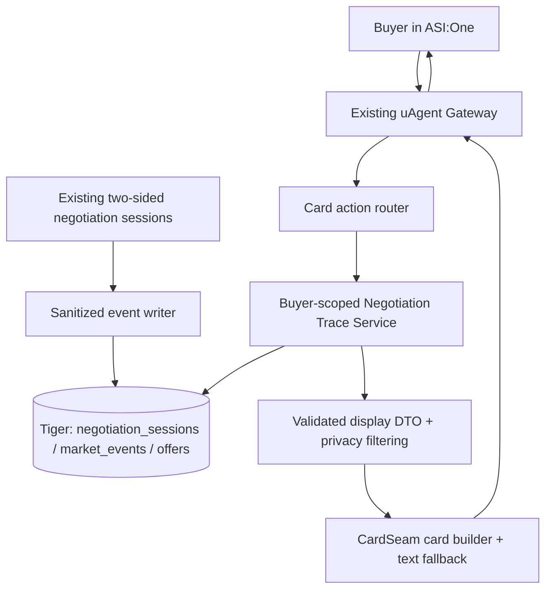

# Feature Specification — Negotiation Transparency in ASI:One

**Project:** Hormuz Exchange / Autonomous Freight Recovery Network  
**Spec ID:** UX-NEG-001  
**Status:** Ready for spec-driven development  
**Priority:** Post core Cards + Payment + two-sided negotiation; additive feature  
**Surfaces:** Buyer-facing ASI:One only  
**Dependencies:** `phase-01-uagent-gateway.md`, `phase-02-interactive-cards.md`, `phase-04-two-sided-negotiation.md`; Phase 5 for recovery-specific visibility  
**Not in scope:** Carrier dashboard redesign, public Exchange Command Center, real-time animated or mutable cards.

## 1. Goal

Give a buyer an optional, comprehensible view of **how their own buyer agent negotiated with carrier-company agents** without leaving their ASI:One chat. The buyer must be able to see which eligible carriers responded, how opening prices changed through bounded counter rounds, why the buyer agent made each move, and why the winning offer was recommended. Use **real, persisted, validated negotiation events**, not a generated or hardcoded transcript.

**Product promise:** “Your agent negotiated on your behalf. Here's what actually happened.”

The feature is **explanatory**, not a new negotiation control plane. A buyer may view details but cannot alter a completed round, edit counter prices, view competitors' confidential data, or select an expired offer.

## 2. Product decision: simplest supported interaction

**P0: On-demand completed transcript.** After normal booking negotiations close, append a compact summary to each offer in the existing ASI:One offer carousel. Include a `View negotiation` action for that offer. When tapped, return a **new** ASI:One detail/custom card presenting a redacted, human-readable negotiation timeline and a `Back to offers` action. Preserve the selected request's state and the ability to book.

**P1 (after P0): Sparse in-chat progress messages.** Optionally push only milestone messages to the buyer's **already established chat session**, for example “4 of 5 carriers have replied; counteroffers underway.” Do not stream every protocol packet. Rate-limit / deduplicate progress messages. If push delivery is unreliable, fall back to P0 with no effect on booking.

**Explicitly deferred:** streaming every offer token, overwriting/updating cards in place, WebSockets embedded in ASI:One cards, graphical bid animations, exposing raw agent messages, live negotiation steering by the buyer, and a separate buyer webpage.

### 2.1 Placement and buyer journey

1. Buyer submits cargo request through existing setup card.
2. Existing exchange opens parallel buyer↔carrier negotiation sessions. The system logs sanitized business events to Tiger.
3. Sessions reach terminal state or deadline. Existing backend validates/ranks final offers.
4. Existing offer carousel displays price, sailing, dates, validity, and optionally `Opening: $5,200 → Final: $4,940` plus a grounded savings indicator (not market-wide savings).
5. Buyer taps **View negotiation** for Atlas. Gateway handles the card action and requests a **buyer-scoped** timeline by `request_id` + `offer_id`.
6. A separate detail/custom card shows the timeline and verified outcome. Buyer taps **Back to offers** and receives a refreshed carousel with current expiry/eligibility, or a clear expired-offer message.
7. Buyer selects and reviews an offer, proceeding with existing holds, Fetch payment and carrier confirmation. No additional approval is needed to merely view negotiation details.

**Recovery:** once Phase 5 runs, affected buyers may open **View recovery negotiations** from their disruption/result card. Only show negotiations pertaining to **that buyer's disrupted booking**, redacted as below. Exchange-wide comparisons and other buyers' terms remain in operator-only views. The recovery negotiation-session deadline remains `recovery_negotiation_timeout_seconds = 60`; the UI does not extend or reset it.

## 3. Card content and visual hierarchy

### 3.1 Offer carousel summary (existing card extended)

For each offer:
- Carrier name, sailing identifier, departure/arrival, quantity and **final simulated freight price**.
- If opening and final prices are comparable for the **same carrier, same sailing, same quantity and currency**, show `Opened at $X · Negotiated to $Y` and `Price decrease $Z (P%)` **only when Y < X**.
- If there was no counter or comparable opening quote, show `Final quote $Y` or `Carrier did not negotiate` as appropriate. Never imply a saving if the final quote rose or if terms changed.
- `View negotiation` action referencing current request + offer/session identifiers.
- Existing `Select` action retained unchanged. Never hide expiry or simulated/actual payment separation.

### 3.2 Negotiation detail card

**Header:** `How your agent negotiated with [Carrier]` + outcome badge `Accepted`, `Countered`, `Rejected`, `Timed out`, or `No feasible offer` (from actual session state).

**Context:** lane, container count/type, candidate sailing, deadline/quote validity, final amount (if offered).

**Timeline (chronological):**
- Session opened / carrier contacted.
- Carrier's opening offer, with precise amount and terms.
- Buyer's counter proposal with a concise safe explanation (e.g. “Compared with another eligible offer and your fastest-arrival preference”).
- Carrier accepted/countered/rejected (actual event, no invented intermediate steps).
- Optional second counter exchange, never more than configured maximum.
- Session closed; final agreed quote or no valid quote.

**Decision explanation:** One or two sentences from deterministic rule outputs: price ranking, verified arrival comparison, or configured priority. If the logic did not record a rationale, say `Counter strategy applied` rather than inventing a reason.

**CTAs:** `Back to offers`; optionally `Select this offer` if currently selectable. If not current, omit selection and offer a refresh.

**Display conventions:** Label all ocean freight figures **simulated USD**. Do not describe a *counter proposal* as a paid or accepted price. Fetch testnet service payment is separate and belongs in existing review/receipt flow.

### 3.3 Example (illustrative only; never seed UI with it)

> **Atlas — negotiation complete**  
> Initial quote: $5,200 simulated USD  
> Your agent countered: $4,800 (compared valid competing options)  
> Atlas countered: $4,940  
> Your agent accepted final quote: $4,940  
> **Price improvement vs Atlas opening quote: $260 (5.0%)**  
> *Offer expires in accordance with its live `expires_at` record.*

Do not label it `saved $260` without clarifying the baseline: this is improvement versus **that carrier's opening quote**, not savings versus an independently verified market rate.

## 4. Architecture — no new agent or orchestration graph



**Invariants:**
- Tiger is authoritative; no new stored transcript is necessary in P0.
- Gateway is a protocol adapter, not an LLM analyst or negotiation decision-maker.
- Existing carrier signed-message handling remains unchanged.
- Existing `CardSeam` emits documented `TextContent` + `MetadataContent` combinations; do not assume dynamic card mutations.
- Reads do not trigger new negotiation sessions, extend quote validity, advance a workflow or reserve capacity.

### 4.1 New interfaces (suggested names; adapt to repository conventions)

```python
async def get_buyer_negotiation_trace(
    *, buyer_id: str, request_id: str, offer_id: str | None,
    session_id: str | None, viewer_session_id: str
) -> NegotiationTraceView: ...

async def list_buyer_offer_summaries(
    *, buyer_id: str, request_id: str, viewer_session_id: str
) -> list[OfferNegotiationSummary]: ...


def build_negotiation_detail_card(trace: NegotiationTraceView, card_instance_id: str): ...
```

Backend resolves `buyer_id` and chat session **from authenticated gateway context**, never from untrusted card JSON. Where the current code supports multiple sessions per offer, trace selection resolves through persisted final offer → negotiation session relationship.

## 5. Canonical display DTOs

Implement a schema-validated DTO distinct from wire-format ACP messages and raw database rows. Prices are integer minor units or decimal strings, never floats for accounting.

```json
{
  "schema_version": "1.0",
  "request_id": "req_x001",
  "offer_id": "offer_atlas_01",
  "session_id": "neg_123",
  "carrier_display_name": "Atlas Lines",
  "sailing_id": "ATL-101",
  "state": "ACCEPTED",
  "opening_price_minor": 520000,
  "final_price_minor": 494000,
  "currency": "USD",
  "comparable_terms": true,
  "price_improvement_minor": 26000,
  "steps": [
    {"sequence": 1, "kind": "CARRIER_OFFER", "actor": "carrier", "price_minor": 520000, "round": 0, "at": "2026-10-18T09:00:00Z", "explanation": null},
    {"sequence": 2, "kind": "BUYER_COUNTER", "actor": "buyer_agent", "price_minor": 480000, "round": 1, "at": "2026-10-18T09:00:05Z", "explanation": "Compared eligible rival offers"},
    {"sequence": 3, "kind": "CARRIER_COUNTER", "actor": "carrier", "price_minor": 494000, "round": 1, "at": "2026-10-18T09:00:10Z", "explanation": null},
    {"sequence": 4, "kind": "SESSION_ACCEPTED", "actor": "buyer_agent", "price_minor": 494000, "round": 1, "at": "2026-10-18T09:00:11Z", "explanation": null}
  ],
  "quote_expires_at": "2026-10-18T09:10:00Z",
  "can_select_now": true
}
```

**The above is a fixture/example, not the official ASI card schema.** The card builder must map the DTO into the exact validated supported ASI schema. `can_select_now` is informative only; every actual selection is revalidated transactionally.

### 5.1 Source-event mapping

| Persisted business event | Buyer display | Notes |
|---|---|---|
| `NEGOTIATION_OPENED` | “Contacted [carrier]” | Session must be owned by viewer's request |
| `OFFER_SENT` | Opening quote or carrier counter | Determine round / message actor from structured fields |
| `COUNTER_SENT` | Buyer's actual proposed amount | Never imply accepted |
| `OFFER_ACCEPTED` | “Quote accepted” | Actual session outcome only |
| `OFFER_REJECTED` | “Carrier declined” | Preserve rejection vs failure semantics |
| `NEGOTIATION_CLOSED` | Final outcome / timeout | Prefer authoritative final session status |

**Event shape additions, if not already present:** `event_id`, `schema_version`, `session_id` (`correlation_id`), `request_id`, `carrier_id`, `offer_id`, `message_id`, `round`, `actor_role`, `event_type`, `created_at`, `price_minor`, `currency`, `sailing_id`, `quantity`, `safe_reason_code`, `terminal_status`. Add fields to existing logging only when needed; do not create a parallel event system. Store client-facing rationale as **allowlisted reason codes**, not raw LLM reasoning or private policy dumps.

**Consistency:** Append messages in persisted event sequence order (`sequence`, then timestamp and ID as stable ties); dedupe identical `message_id` or idempotency key. Session `status` and final offers take precedence over a partially missing event stream. If the trace is incomplete, show `Some negotiation details are unavailable` without synthesizing missing steps.

## 6. Privacy and access controls — nonnegotiable

- A buyer may see **only their own request and negotiation sessions**, including their own proposed counter prices and public quotes sent to them.
- Never expose a buyer's `max_total_price`, private urgency coefficient, other private limits, `must_deliver` priority, `recovery_allowance`, or other buyers' negotiations.
- Never expose carrier `minimum_price_per_unit`, margins, business preset internals, occupancy-sensitive private policies, exact concession formulas or internal rule thresholds.
- Rival leverage explanations may cite a competing public quote **only if that same buyer was genuinely sent that eligible offer**; otherwise use generic rationale.
- Data reads must be scoped to owner and session before fetching/formatting events, not filtered only after a cross-tenant DB query.
- `view_negotiation` must validate authenticated chat sender, actual session, request ownership, and offer↔session membership. Supplied IDs are references, not authority.
- Sanitize or omit sensitive raw agent payloads, signatures, wallets, payment metadata, debugging traces and free-form text. Use approved structured fields.
- Recovery trace visibility is per disrupted buyer, not Exchange-wide. Do not disclose another buyer's assignment price when explaining why capacity was allocated.
- Limit detail card payload length and event count; page/group if necessary, never silently drop decisive counter or final result.

## 7. Gateway action contract

Suggested actions in card `selection` metadata:

```json
{"action":"view_negotiation","request_id":"req_x001","offer_id":"offer_atlas_01","card_instance_id":"card_abc"}
{"action":"back_to_offers","request_id":"req_x001","card_instance_id":"card_def"}
{"action":"view_recovery_negotiations","recovery_id":"rec_001","booking_id":"BK-001","card_instance_id":"card_ghi"}
```

These are **application actions inside the supported CTA `selection` value**, not new Fetch message types. The gateway must normalize both structured JSON and natural-language card-action results as in Phase 2. A natural-language fallback such as “Show me how Atlas negotiated for this shipment” is supported only if the buyer has one unambiguous matching current request/offer; otherwise ask which offer.

**Security:** Use state-aware resolution plus short-lived `card_instance_id`/revision. Never accept the submitted carrier name, dollar totals, buyer ID, or explanation as trusted. Read-only replay may return the same trace; it must cause **zero** writes or agent sends.

## 8. Progress updates (P1 only)

Emit buyer-facing progress from **aggregate milestones**, not per packet:

- `NEGOTIATION_STARTED`: “Your agent contacted 4 eligible carriers.”
- `INITIAL_OFFERS_COMPLETE` or timeout: “3 quotes received; one carrier did not respond.”
- `COUNTER_ROUNDS_IN_PROGRESS`: “Your agent is comparing and countering eligible quotes.”
- `NEGOTIATION_COMPLETED`: “Negotiation complete. Review your offers.” + final carousel.

**Rules:** Push only into the already-established ASI:One session known to support outbound messages; if absent, store events and show the summary upon next user message. Do not assert delivery merely because a send was queued. Throttle to avoid repetitive notifications. Message counts come from verified session state; no speculative `X agents are thinking` commentary. Do not expose other buyers' activity.

**Important:** The `60 s` recovery timeout is for agent negotiation completion, **not** a fixed UI waiting animation or a guarantee of every carrier responding. Finish early if all sessions close.

## 9. Error and edge-case behavior

| Situation | Required UX / system behavior |
|---|---|
| Card metadata fails to render | Send equivalent succinct textual transcript and log card error; no booking impact |
| Buyer opens negotiation before it finishes | Show `Negotiation still in progress` + completed steps; do not invent final outcome |
| Carrier rejects or never responds | Show `Declined` or `Timed out`; no fake discount or final offer |
| Carrier returns same price | Show `No change from opening quote` |
| Final price higher than opening / changed quantity or sailing | Show actual final terms; suppress savings comparison |
| No event rows, but valid final offer exists | Show final verified quote and `Detailed negotiation history unavailable` |
| Duplicate/replayed action | Return current read-only trace; never create duplicate events, holds or payments |
| Expired offer on detail page | Show history for audit but hide selection; refresh current offers |
| Different buyer requests another's `offer_id` | Reject without leaking even the existence of that record |
| Many sessions/events | Cap payload; offer next-page detail or aggregate by round, preserving exact final outcome |
| UI push message fails | Buyer can still retrieve history from current chat; booking/recovery unaffected |
| Negotiation closes after original chat handler returns | Read from persistent state and return result when available; no indefinite blocking |

## 10. Implementation breakdown (three small slices)

### Slice A — trace correctness and privacy (backend)
1. Inventory current `market_events`, `negotiation_sessions`, `offers`, and identifiers; document actual columns and all emitted event payloads.
2. Add missing **additive** event fields / reason codes if necessary, with migrations and tests.
3. Implement buyer-scoped trace queries and typed normalized DTO with stable ordering, idempotent de-duplication, verified amount comparisons, and missing-data handling.
4. Add feature flag `NEGOTIATION_TRANSPARENCY_ENABLED`; keep trace reads completely outside booking state transitions.

**Exit:** deterministic unit/integration tests reconstruct real seeded sessions with correct amounts and zero cross-buyer leakage.

### Slice B — ASI cards and navigation
1. Extend `final_offers_carousel` builder with a concise per-offer summary and `View negotiation` action.
2. Add `negotiation_detail_card` builder using official validated ASI detail/custom card primitives; keep text fallback.
3. Add gateway action routes for `view_negotiation` and `back_to_offers`, using authenticated context and server revalidation.
4. Test in a **real ASI:One chat**, including navigation, stale/expired offers and continued ability to complete Fetch payment normally.

**Exit:** buyer successfully sees their real negotiation trace and returns to select/book without a broken conversation or duplicate transaction.

### Slice C — polish and optional progress
1. Add grounded decision rationale from predefined strategy reason codes; improve date/price display.
2. Optional milestone progress pushes (P1), with throttling and existing-chat-only delivery.
3. Add recovery trace entry point **only after** the Phase 5 multi-buyer recovery flow is green; keep buyer-scoped privacy.
4. Instrument read failures and render failures with sanitized `request_id`/`session_id` via existing telemetry (Sentry when enabled).

**Exit:** progress events match persisted reality, fallback works when push/cards fail, buyer/private secrets stay hidden.

## 11. Test matrix / acceptance criteria

### Automated tests (must pass)

- [ ] Zero, one and two round transcripts reconstruct from persisted event fixtures without invented steps.
- [ ] Parallel carrier sessions never interleave or misattribute one another's counter prices.
- [ ] A price decrease is reported only for matching currency, sailing, quantity and comparable terms.
- [ ] Counter amount is visually distinguished from carrier-accepted price.
- [ ] Rejected, expired, incomplete and timed-out negotiations are accurately labeled.
- [ ] Authenticated buyer A cannot access buyer B's traces by substituting request/session/offer IDs.
- [ ] No output contains carrier floor, buyer max budget, recovery allowance or private rule thresholds.
- [ ] Duplicate events and repeated card clicks do not double-count rounds or mutate booking state.
- [ ] Expired/withdrawn offer cannot be booked via old navigation, even if its historical trace is viewable.
- [ ] Explanation reason codes produce no fabricated competing offer or invented savings.
- [ ] No raw payment wallet information is included in trace card payloads or logs.

### Real ASI:One end-to-end acceptance (must pass)

- [ ] Buyer submits cargo setup → real carrier negotiations → final carousel.
- [ ] Tapping `View negotiation` opens a **real native card** with matching Tiger events and correct prices.
- [ ] Tapping `Back to offers` returns to accurate, still-valid offers.
- [ ] Buyer can then select, hold, complete verified Fetch payment, and receive a booking receipt.
- [ ] Text fallback works for unsupported/invalid card render without duplicate business side effects.
- [ ] Another buyer in a separate ASI:One session cannot inspect the first buyer's timeline.
- [ ] If progress push is enabled, messages appear only in the correct existing chat and do not stall negotiation.

## 12. Demo sequence (30–45 seconds within overall hackathon video)

1. Show buyer request and offer carousel containing opening → final quote indicators.
2. Open one carrier's `View negotiation` card; scroll through the actual recorded counter sequence.
3. Point out a brief grounded reason (“competing eligible offer” or “buyer prioritized earlier arrival”) while emphasizing that the carrier floor and buyer budget remain hidden.
4. Return to the offers card and book normally. Later, show per-buyer recovery negotiation explanations after a disruption.

**Judge-facing proof:** correlated `session_id` in Tiger's sanitized `market_events` matching the buyer card content, and the signed carrier negotiation messages behind those events. Never claim model-generated reasoning where the strategies are deterministic.

## 13. Non-goals / deferral line

No new public pages, no market-wide buyer access, no exchange-visible secret pricing, no LLM-generated negotiation narrative, no real-time card mutation, no new actor, no replacement for ASI:One buyer UI, and no carrier dashboard design work. A read-only Exchange War Room may separately consume sanitized aggregates in a future spec.

## 14. Definition of done

Feature is complete when a buyer can **inspect an actual, correctly scoped and redacted negotiation history inside ASI:One**, then resume booking the selected quote without changing the existing agent protocol, payment, inventory, or recovery behavior. Native card rendering and authenticated actions must be verified in ASI:One—not assumed from mock previews.
