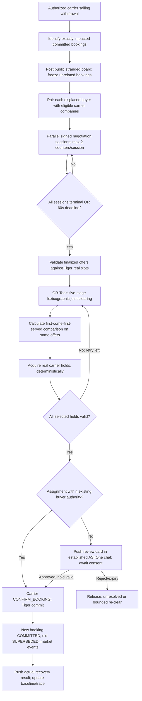

# Phase 05 — Timed recovery negotiations, joint clearing and live release

**Priority:** final implementation phase · **Owner:** Parth (all work in this phase)  
**Dependencies:** Phases 1–4 green; existing transactional holds, recovery worker, carrier withdrawal and Tiger events  
**Hard exit gate:** one carrier cancellation causes at least two existing committed buyers to **negotiate replacement rates with carrier agents**, a 60-second **maximum** parallel session deadline, strict 5-stage OR-Tools joint clearing, verified holds and approvals, carrier-confirmed replacements, original bookings `SUPERSEDED`, unaffected bookings unchanged, and truthful ASI:One push cards.

## 1. Major change to Part 1

Old recovery: carriers answer once; no bargaining; RecoveryGraph is an async polling service; solver prefers maximum whole bookings, fewer approvals (code), least extra cost. New recovery: **for every stranded booking and eligible carrier, open an authenticated negotiation session**; crisis-surge carrier bid → buyer private counter → carrier response → optional second counter; then collect **only final valid signed offers**. Existing recovery worker still launches on authorized sailing withdrawal and holds original DB truth. Do not rebuild recovery as a chat-triggered LangGraph function; chat pushes occur from the worker into existing gateway buyer sessions.

**Locked semantics:** `recovery_negotiation_timeout_seconds = 60` is the **upper bound** on all parallel recovery sessions for a withdrawal. Begin clearing as soon as all are final, rejected or expired; do not add a 60-second artificial wait. Do not confuse this with a procurement/auction period.

## 2. Preconditions and invariants

- Authorized `WITHDRAW_SAILING` event from carrier-scoped API/console; dedupe by authenticated carrier and withdrawal event.
- Mark affected *committed* bookings disrupted; preserve every unrelated active booking/slot ownership exactly as it was. Don't “optimize” unaffected customers out of their current sailing.
- Carrier inventories are truthful Tiger capacity-slots constrained by holds/commitments. A final quote does not reserve a slot.
- Private `max_total_price`, recovery allowance, must-deliver and derived urgency never sent to carriers. `must_deliver` **may be read by Exchange** for lexicographic priority but is absent from public board.
- No agent can exceed its private carrier floor; no buyer agent can assent beyond hard private caps. Above preapproved additional simulated freight cost, recovery **requires actual user approval**; must-deliver does not override authorization.
- Booking state changes and market events are persisted idempotently. Original disrupted booking is retained and ultimately `SUPERSEDED` when replacement confirms; any unresolved remains explicitly disrupted/unrecovered.
- Recovery clearing is a **multi-carrier saga**: atomic holds inside Tiger per carrier, deterministic sequence across carriers; release partial holds and re-clear at most once.

## 3. End-to-end workflow (single worker, not chat-driven)



**Implementation detail:** avoid busy polling all sessions each millisecond. Use async completion callbacks or periodic worker checks plus one persisted recovery deadline. On process restart, recompute remaining deadline from `opened_at + 60s`; don't restart clock. If no eligible carriers or no finalized offers, report accurate `NO_REPLACEMENT_AVAILABLE` instead of running fictional solver output.

## 4. Pairing + recovery negotiation session runner

### Public board item (carrier-view)

```json
{
  "recovery_id":"rec_001",
  "disrupted_booking_ref":"opaque_job_ref_A",
  "origin_port":"AEJEA",
  "destination_port":"INBOM",
  "container_type":"20GP",
  "quantity":2,
  "latest_arrival_at":"2026-10-25T23:59:00Z",
  "cargo_class":"general",
  "allow_split":false,
  "source_kind":"SIMULATED_BUYER"
}
```

Not present: must-deliver, max budget, recovery allowance, buyer internal ID, urgency. Do not publish origin booking's private contracted price. A carrier may nevertheless infer constraints through negotiation behavior; that is part of the intended incomplete-information mechanism, not publication of private fields.

### Pair/open/send/guard/close

- Use Phase-4 `pair_candidates` extended to the recovery board and live `capacity_slots`, at most five company carriers per stranded booking; check corridor, cargo class, sailing arrival and quantity rules.
- For each pair, `open_negotiation(..., kind="recovery", rounds_max=2, expires_at=run_deadline)`; stores owner company ID, logical buyer state key, original booking/recovery ID. No LLM chooses pairings.
- Send `REQUEST_RECOVERY_CAPACITY` / round-specific proposal via the **already working signed uAgents business channel**, *not* through buyer's ASI Chat messages. Carrier applies private `disruption_surge_pct`, occupancy and floor; buyer may counter twice through private policy. Carrier signs its replies; the internal buyer counter has buyer-key provenance.
- Validate `message_id` uniqueness, original sender registered to carrier, session/member match, round progression, proper expiry, exact scenario and advertised sailing. No negotiations outside permitted sessions. Unknown/replayed/late messages ignored or rejected with auditable outcome.
- Session finishes on `ACCEPTED`, `REJECTED`, `EXHAUSTED`, `EXPIRED` with `final_offer_id` only if a genuinely finalized agreed/signed offer exists. A partial bargaining message is not yet a final offer.
- `ready_to_clear = all sessions terminal OR now>=run_deadline`. At most 60 seconds total for negotiation collection. Finalize/expire outstanding sessions atomically, then freeze the offer set for that solve attempt.
- Record negotiation round trace to `market_events` with `correlation_id=session_id`; do not leak floors, caps or private coefficients.

### Guard unit tests

1. One carrier never replies: clock hits 60s, valid other offers still clear.
2. All finish after 12s simulated time: solve immediately, not at 60s.
3. Late counter at 61s cannot change frozen offers.
4. Retry duplicated signature/message ID cannot advance round twice.
5. A booking may be paired with at most five eligible companies; missing required capacity excludes bad pair.
6. Crisis surge affects quote; carrier floor never violated.
7. Price below buyer cap only influences buyer response privately, not outbound public metadata.

## 5. OR-Tools mathematical/implementation contract

Use existing `packages/freight_allocation` and add **two things**: the `must_deliver` priority stage and the deterministic FCFS baseline (preserve already-added approval-priority stage). Do **not** replace the actual slot/hold code with a new generalized auction engine.

### Inputs

- Displaced bookings `B`; candidate replacement sailings `S`; feasible finalized offers `O` indexed by `(b,s)` (possibly multiple company proposals, dedupe/choose defined final per actual carrier session).
- For booking `b`: `quantity[b]`, earliest departure, deadline, cargo/risk rules, split boolean, original freight total, `must_deliver[b]`, buyer-approved recovery allowance, hard buyer eligibility and possible `requires_approval[b,s]`.
- For sailing `s`: available sellable `20GP` slots **excluding unrelated booked and held slots**; arrival; company owner; active status; valid price offers.
- All costs as **integer minor units**. Prices/delay checked against each booking's hard limits; proposals outside preapproved *but approvable* envelope marked `approval_required=1`. Never violate a hard maximum even with user approval without regenerating authorized terms.

### Variables and hard constraints

- `r_b ∈ {0,1}`: booking fully recovered.
- For indivisible booking, `y_{b,s} ∈ {0,1}`; `sum_s y_{b,s}=r_b`; units allocated are `q_b*y_{b,s}`.
- For split-allowed booking, `x_{b,s} ∈ integers [0,q_b]`; `sum_s x_{b,s}=q_b*r_b`, with linking binaries where needed for capacity and any per-sailing quote/cost. If split isn't supported in current code, **implement/validate it or disable the UI control with explicit unsupported response**; never silently split an indivisible booking.
- For all sailings: `sum_b allocated_units_{b,s} ≤ sellable_capacity_s`. No input includes unrelated bookings to reassign; their slots are excluded upfront.
- `approval_b ∈ {0,1}` indicated if any selected assignment requires new consent; clear/persist expected price and delay delta. No `approval_b` can be auto-committed without approved card.
- Every selected edge satisfies owner-signed offer, expiry, required port/lane/type/class, allowed risk, earliest-departure and latest-arrival, correct price/currency and buyer feasibility. Each physical slot can be held by only one booking after solve.

### Strict lexicographic solves

Implement five CP-SAT solves sequentially, **fixing the prior optimum as an equality** before solving the next objective (or verified equivalent lexicographic method); do not approximate with casually chosen weights.

```text
Stage 1: maximize SUM(r_b for b if must_deliver_b)
Stage 2: maximize SUM(r_b for all b), while stage-1 optimum fixed
Stage 3: minimize SUM(approval_b), while stages 1/2 fixed
Stage 4: minimize SUM(incremental_simulated_freight_cost_b), while 1/2/3 fixed
Stage 5: minimize SUM(assigned_arrival_metric_b), while 1/2/3/4 fixed
Final deterministic tie break: stable booking ID / sailing ID order
```

**Important modeling choices:** price objective counts **incremental** cost per successfully recovered booking vs its original booked simulated price. Fix a documented rule on whether negative deltas (savings) may offset other costs; suggested is signed incremental cost and separate display of increases/savings, while approvals depend on positive increases. For stage-5 split cases use the **latest** assigned arrival for the booking (or explicitly selected per-unit metric) and document it; all parts must meet hard arrival constraint. The source document specifies priority stages but not these mathematical tie definitions, so these are implementation conventions recorded and tested here.

**`must_deliver` caveat:** buyer-declared flag (not verified emergency/actual contractual guarantee); used ONLY as solver priority. No automatic approval, payment, or overriding hard rule results from this flag.

## 6. FCFS comparison contract

Build `first_come_first_served_baseline(displaced_bookings, final_offers, capacity_snapshot)` as a **pure deterministic simulation**, NOT a real inventory mutation:

1. Sort displaced bookings by known disrupted-booking posting sequence, then stable booking ID.
2. For each booking, select its best currently feasible finalized carrier offer according to its private-policy-compatible ranking, attempting to use available slots; if none fits, leave unresolved. If split allowed, use its actual policy and hard constraints.
3. Reduce only a **copied** capacity vector. Do not touch Tiger slot ownership, holds or approvals.
4. Report baseline recovered count, must-deliver recovered count, sum extra simulated cost, and selected booking→sailing mappings. Show same numbers for solver result.
5. Include explicit `baseline_kind="FIRST_COME_FIRST_SERVED_SIMULATED"`, `offer_snapshot_id`, and deterministic ordering in `CLEARING_DONE` event, so judges cannot mistake comparison for actual execution.

**Demo fixture (source design):** A (2 units, Oct25), B (1 unit, Oct22, must-deliver), C (1 unit, Oct22); Beacon 2 slots arrives Oct22, Cove 2 arrives Oct24. FCFS A may grab Beacon (1/3). Global allocation A→Cove, B+C→Beacon (3/3) **if** all final signed offers and buyer constraints are valid. A seeded test must explicitly prove feasibility and not hardcode a result.

## 7. Holds, approvals, confirmation and re-clear

**Order:** `final offers → CP-SAT → hold selected slots → approval if required → carrier confirm → DB commit → notify`. Acquire multi-carrier holds in deterministic (carrier ID, sailing ID, booking ID) order. If any selected hold fails, release all now-unneeded holds, invalidate stale offer/capacity claim, refresh inventory and **re-run at most once** (`recovery_clears_max=2`). A second hold failure ends in accurate partial/unresolved state. Don't claim distributed ACID across independent carriers.

**Approval:** `APPROVAL_REQUIRED` if extra simulated cost exceeds persisted allowance (or other rebooking-authority rule). Send native ASI:One `review` card into buyer's established gateway chat with `approval_id`, exact replacement terms and 30-min expiry. On approve, transactionally verify owner, latest terms, hold live, time/risk/budget constraints, then confirm replacement. On reject/expiry, release hold; bounded re-clear if it still fits the two-clear maximum and improves feasible outcome. Preapproved changes auto-confirm. If a hold TTL is shorter than approval deadline, carrier must extend under its policy or avoid claiming that space remains reserved for 30 minutes; reconfirm availability before commit.

**Persist:** replacement booking is NEW; original `DISRUPTED`→`SUPERSEDED` only when replacement confirmed. Maintain immutable `old_booking_id -> replacement_booking_id`, assignment reason, approval record, payment status **separate** from simulated freight changes. Real FET service fee was charged at original booking only; don't initiate an unimplemented top-up or refund on recovery.

**Notifications:** `AWAITING_APPROVAL`, `RECOVERED_CONFIRMED`, `PARTIALLY_RECOVERED`, `NOT_RECOVERED` are distinct outcomes. A solver assignment is not yet recovered. Send results through gateway's DB-backed outbox to the same established sender/chat context; if ASI chat delivery fails, retain durable pending notification and surface current state when buyer returns. Push must be live-tested; a new session started by server alone may be dropped by ASI:One.

## 8. Observability evidence & Tiger

Required events: `SAILING_WITHDRAWN`, `BOOKING_DISRUPTED`, `NEGOTIATION_OPENED`, `OFFER_SENT`, `COUNTER_SENT`, `NEGOTIATION_CLOSED`, `CLEARING_DONE`, `RECOVERY_APPROVAL_REQUESTED`, `HOLD_GRANTED`, `BOOKING_COMMITTED`, `BOOKING_SUPERSEDED`, `RECOVERY_COMPLETED`/`RECOVERY_PARTIAL`/`RECOVERY_UNRESOLVED`. Events carry public booking/recovery/session references and actual timestamps, never carrier floors or hidden buyer budgets. Query existing Tiger hypertable(s) to show timeline and proof. If read-only market view is already present, feed it these events; **do not build the next-generation operations dashboard in this phase**.

**Metrics for demo:** negotiation sessions opened/completed/expired, offer count, number of affected bookings, preapproval vs pending, optimizer recovered count and must-deliver recovered count, FCFS baseline, confirmed recovery count, number untouched, provider-verified original booking-service payment. Do not advertise latency performance beyond your actual measured run.

## 9. Regression / acceptance matrix

| Test | Expected |
|---|---|
| One withdrawal displaces A+B, C unrelated | A/B disrupted; C's booking, hold slots, invoice and state byte-for-byte unaffected |
| Same withdrawal delivered twice | Exactly one recovery, no extra approvals or messages causing new commitments |
| Multi-carrier negotiated replies | Real signed final offers, valid rounds, no hidden data leakage |
| All recovery sessions close early | Solver starts before timeout |
| One carrier silent until deadline | Solver uses other **final** offers at 60s, never waits indefinitely |
| Invalid/late signed recovery offer | Excluded from final set |
| Must-deliver conflicts with total count | Stage 1 optimum fixed even if total recovered would be greater otherwise |
| Same must-deliver count, different total | Stage 2 selects larger total |
| Same recovered count, approvals 0 vs 1 | Stage 3 selects 0 (even if more costly), per agreed rule |
| Same approvals, price differs | Stage 4 chooses lower incremental simulated freight cost |
| All above equal, arrival differs | Stage 5 earlier arrival |
| FCFS A takes scarce Beacon | Baseline 1/3; OR-Tools may achieve 3/3 from valid fixture |
| Indivisible 2-slot booking offered only separate 1 slots | Not recovered via illegal split |
| Concurrent hold race | No slot owned twice, bounded re-clear and release |
| Approval above allowance | Native card required before carrier confirmation |
| Must-deliver + allowance exceeded | Still pending approval; cannot auto-confirm |
| Approved old card after price/sailing change | Declined; new approval required |
| Approval expires / hold expires | Cannot confirm; report unresolved/re-clear safely |
| Partial assignment | Only confirmed replacements counted as recovered |
| Old booking and new replacement | Original `SUPERSEDED`, new `COMMITTED`, link persisted |
| Live ASI:One push | Existing session receives actual notice/approval/result |
| End-to-end payment | Original paid booking has **real verified** Fetch testnet fee proof; recovery doesn't double charge |

## 10. Commit slices and submission readiness

1. Extend recovery worker to generate public board, pairing and Phase-4 negotiation sessions with persisted overall 60-second deadline; test early finish and expiry.
2. Validate/freeze signed final offers, claim-check against real Tiger slots; emit audited offer events.
3. Add `must_deliver` to existing solver model (backend/exchange-visible only), implement five-stage strict lexicographic objective and deterministic tie break, preserve no-split and capacity constraints.
4. Add pure FCFS baseline on same offers/snapshot; record both result sets and reasoned explanation.
5. Integrate with existing holds, saga compensations and 30-minute approval store; push Phase-2 native review/status cards; `SUPERSEDED` old commitment after carrier confirmation only.
6. Reset deterministic scenario; run old tests plus new per-stage solver, timer, race, and no-leak tests. Show carrier-policy change affects crisis price from Tiger.
7. Public README, accurate identities/Agentverse links, Fetch badges, Devpost + ASI Submission Agent, 3–5-minute recorded end-to-end proof.

### Final go/no-go checklist

- [ ] New gateway agent in Agentverse, buyer journey entirely within ASI:One, functional four card kinds.
- [ ] Original booking charged **one** small testnet FET fee under genuine Fetch Payment Protocol; tx proven by ledger.
- [ ] Buyer and each eligible carrier negotiate within separate signed/validated sessions for normal and disrupted cases; ≤2 counter rounds.
- [ ] Cancelled sailing affects multiple booked buyers, with valid deadline/slot/cost rules.
- [ ] Global recovery waits **no longer than 60 seconds** for negotiations; early completion works.
- [ ] OR-Tools stages and first-come baseline are reproducible and traceable; actual holds/commits agree with selected solution.
- [ ] Approval card reaches buyer before any above-limit rebook; unresolved states accurately reported.
- [ ] Unaffected bookings unchanged, old bookings retained as `SUPERSEDED` when replacement confirmed; no double booking.
- [ ] Public repo documentation, badges, submitted agent profiles, shared ASI:One chat, Devpost + Submission Agent, and short video.

**After this phase (not part of current specs):** proper carrier dashboard UI—carrier identity/login, sailings CRUD/cancel/withdrawal, map, revenue/utilization/time series and strategy controls.
